# 第4章 辅酶和维生素

::: {.reading-section #guide}

## 考纲与使用说明

本章按官方考纲4.1—4.12和刘玉乐《生物化学》第5版印刷p78—94展开。学习主线是**辅因子的结构与反应中心 → 电子或基团转移 → 辅因子再生 → 代谢功能与缺乏后果**。先掌握逐节精讲，再用图解串联反应，最后独立完成背诵、练习和订正。

| 官方范围 | 必须能回答的问题 | 教材印刷页 | 精讲与背诵 |
|---|---|---|---|
| 4.1 辅因子 | 全酶、共底物和辅基怎样区分？ | 78—79 | [精讲](#learn-4-1) · [背诵](#recite-4-1) |
| 4.2 NAD⁺和NADP⁺ | 结构差别为何不改变反应中心？氢怎样记账？ | 79—80 | [精讲](#learn-4-2) · [背诵](#recite-4-2) |
| 4.3 FMN和FAD | 为何能连接双电子与单电子传递？ | 80—81 | [精讲](#learn-4-3) · [背诵](#recite-4-3) |
| 4.4 辅酶A | 巯基、硫酯与酰基转移是什么关系？ | 82 | [精讲](#learn-4-4) · [背诵](#recite-4-4) |
| 4.5 TPP | 为什么α-酮酸能脱羧？ | 82—83 | [精讲](#learn-4-5) · [背诵](#recite-4-5) |
| 4.6 PLP | 内/外醛亚胺如何完成转氨循环？ | 83—85 | [精讲](#learn-4-6) · [背诵](#recite-4-6) |
| 4.7 生物素 | ATP如何参与羧化？摆臂怎样连接酶？ | 85—86 | [精讲](#learn-4-7) · [背诵](#recite-4-7) |
| 4.8 THF | 一碳单位有哪些氧化水平和去向？ | 86—87 | [精讲](#learn-4-8) · [背诵](#recite-4-8) |
| 4.9 两种B₁₂辅酶 | 重排与甲基转移怎样区分？ | 88—89 | [精讲](#learn-4-9) · [背诵](#recite-4-9) |
| 4.10 硫辛酰胺 | 怎样同时转移酰基和还原当量？ | 89—90 | [精讲](#learn-4-10) · [背诵](#recite-4-10) |
| 4.11 维生素C | 还原性如何联系胶原和坏血病？ | 90 | [精讲](#learn-4-11) · [背诵](#recite-4-11) |
| 4.12 A、D、E、K | 视觉、核受体、抗氧化和羧化如何分别解释？ | 91—93 | [精讲](#learn-4-12) · [背诵](#recite-4-12) |

真题资料整理／改编中的问法已放入对应重点提示，并链接背诵和练习。正文依考纲与教材完整展开；原书印刷p94的10道习题全部提供导学与完整解析。资料身份集中见第八部分，题旁注明具体来源或关联。

[进入完整精讲](#lecture) · [直接背诵](#recitation) · [比较与图解](#comparison) · [独立练习](#practice) · [教材10题](#textbook)

### 阅读与作答方法

初学按精讲顺序阅读；复习可从12组背诵题进入，再返回不清楚的机制。练习分为基础识记、机制辨析和定量综合三级，主观题另列完整示范答案。题干、简短答案与详细解析各有入口；“仅看题目”和练习打印均保留作答空间。来源身份与重要校订集中在第八部分，具体依据仍紧邻相关知识。

闭卷验收只供自测和订正，本页不记录学习进度、作答结果或复习日期。

:::

::: {.reading-section #lecture}

## 第一部分｜逐节完整精讲

### 4.1 辅因子 {#learn-4-1}

::: {.note-box .focus}

**重点｜本节必须掌握**

先分清化学身份（金属或有机）与结合方式（共底物或辅基），再用具体实例说明全酶和辅因子再生。

:::

[↔ 完整背诵](#recite-4-1) · [对应训练](#p4-01)

#### 辅因子与全酶

有些酶只靠蛋白质侧链不能有效完成所需的电子、质子或基团转移，需要非蛋白成分共同参与。这些成分称**辅因子**，包括金属离子和有机小分子。缺少所需辅因子的蛋白质部分称酶蛋白或脱辅酶；结合必要辅因子、具有相应催化活性的整体称全酶。上述关系适用于需要辅因子的酶，另有酶可仅由蛋白质组成。

#### 金属辅因子和有机辅因子的分类

金属酶的金属离子通常结合较紧，可参与电子转移、稳定负电荷、定位底物或活化水。碳酸酐酶中的Zn²⁺帮助活化水；细胞色素氧化酶中的铁、铜参与氧化还原。金属激活酶与金属结合相对疏松，反应体系通常需要适宜的金属离子，如许多激酶利用Mg²⁺与ATP配位。分类取决于金属与酶的结合及其在反应中的作用。

对有机辅因子还要区分两种使用方式。**共底物**在一次反应中进入和离开活性部位，发生化学变化后通常在另一反应中再生，如许多脱氢酶使用NAD⁺。**辅基**在催化循环中保持与酶紧密结合，在同一酶或酶复合物上完成改变与再生，如许多黄素酶中的FAD、羧化酶上的生物素。紧密结合既可以依靠共价键，也可以依靠强非共价作用。

::: {.note-box .note}

**校订｜辅酶与辅基的使用口径**

教材在一些位置以“辅酶”统称有机辅助成分，机构题又常把“辅酶”限指松结合的共底物。作答先说明口径，再给出结合方式与实例。酶蛋白与辅因子共同决定底物识别、反应类型和催化效率。

:::

#### 维生素的定义、分类与缺乏原因

维生素是维持正常生理和代谢所需的微量有机营养物，某物质是否属于某种动物的维生素，取决于其合成能力和需要量。多数B族维生素形成辅酶；维生素和辅酶不是同义词，CoQ等有机辅因子并不要求来自膳食维生素。生物素本身参与辅基结构，不同维生素对活化和化学修饰的要求各不相同。

::: {.note-box .danger}

**易错提醒｜分类规律有例外**

水溶性B族及C通常较易排泄，脂溶性A、D、E、K的吸收与脂质处理有关，常与结合蛋白或脂蛋白运输。但B₁₂可在肝等处储存较多，水溶性维生素过量也可能有害。分类描述的是一般分布规律，具体储存与排泄仍取决于分子和机体条件。缺乏可以来自摄入不足、吸收障碍、需要量增加或活化/利用障碍。

:::

来源：教材p78—79；配套PPT4第3—8张；求臻第25讲p4—11、秃哥上册p129—134。辅酶/辅基的口径差异据这些来源对照整理。

### 4.2 NAD⁺和NADP⁺ {#learn-4-2}

::: {.note-box .focus}

**重点｜本节必须掌握**

识别2′磷酸与烟酰胺C4的不同作用；能写出NADH的电子、质子记账，并完成340 nm定量换算。

:::

[↔ 完整背诵](#recite-4-2) · [对应训练](#p4-02)

#### 结构与反应中心

NAD⁺由腺苷酸与烟酰胺单核苷酸通过焦磷酸连接组成；NADP⁺在**腺苷酸一侧核糖的2′-OH**上多一个磷酸。两者的氧化还原中心都在烟酰胺环，主要受氢位置是C4。额外磷酸主要帮助酶识别不同辅酶池，烟酰胺环C4仍承担受氢反应。烟酸、烟酰胺属于维生素PP，现行常称B₃；泛酸现行称B₅，须与教材沿用的旧编号分开。

#### 氢负离子转移与反应计量

以乳酸脱氢酶为例，乳酸的仲醇被氧化为丙酮酸的羰基，两个电子随一个氢以氢负离子形式交给NAD⁺，另一个质子进入溶液：

$$\mathrm{lactate+NAD^+\rightleftharpoons pyruvate+NADH+H^+}.$$

::: {.note-box .danger}

**易错提醒｜NADH不写成NADH₂**

辅酶本身的半反应写为$\mathrm{NAD^++H^++2e^-\rightleftharpoons NADH}$。**NADH+H⁺表示一个还原型辅酶和一个游离质子，不是NADH₂。** 酶还决定从底物哪一面移走氢、移到辅酶哪一面，游离辅酶不等于可以任意实现同一反应。

:::

#### 代谢分工与辅酶池

NAD⁺/NADH多用于分解代谢和向呼吸链供电子，NADP⁺/NADPH多用于还原性合成和抗氧化体系。这里是代谢分工而非绝对用途：必须依据具体酶、底物和细胞区室判断。两个辅酶池分别维持适宜氧化还原状态，有利于同一细胞同时进行氧化供能与还原合成。NADPH也参与THF再生及谷胱甘肽还原体系。磷酸戊糖途径氧化阶段是重要NADPH来源，苹果酸酶等也可贡献还原力；不能由“主要来源”推成唯一来源。NADPH还经硫氧还蛋白等体系支持核糖核苷酸还原，NADPH氧化酶则把电子交给O₂用于相关防御过程，说明还原当量既可用于抗氧化再生，也可用于受调控的活性氧生成。

#### 340 nm检测与缺乏机制

氧化型和还原型都在约260nm处吸收，还原型在340nm处有特征吸收，可用来跟踪反应。若题目给定摩尔吸光系数$\varepsilon$与光程$l$，用$A=\varepsilon lc$；消耗NADH时测$-\Delta A/\Delta t$，生成NADH时测正斜率。若要换算原样本浓度，还须乘反应总体积与样本体积之比、考虑稀释倍数及反应计量，不能把比色皿浓度直接当原样本浓度。

烟酸不足会影响NAD/NADP供给，典型缺乏病为癞皮病。玉米膳食背景要同时考虑可利用烟酸和色氨酸供给；牛奶和肉提供烟酸或其合成前体色氨酸。膳食组成、加工和营养搭配共同影响缺乏风险。

来源：教材p79—80、习题2—3；PPT4第9—15张；秃哥上册p131—132；现行编号交叉依据：<a href="https://ods.od.nih.gov/factsheets/Niacin-HealthProfessional/">NIH ODS烟酸</a>、<a href="https://ods.od.nih.gov/factsheets/PantothenicAcid-HealthProfessional/">泛酸</a>。比色计算为本册按给定条件推导。

::: {.structure-reference}

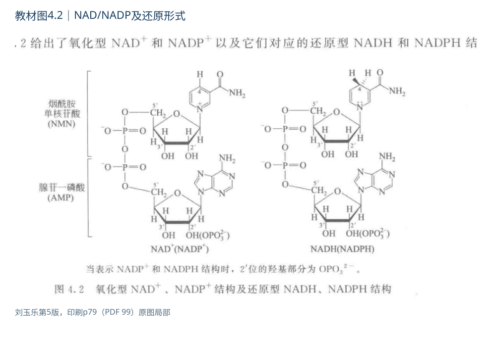{#fig-4-nad-structure}

:::

### 4.3 FMN和FAD {#learn-4-3}

::: {.note-box .focus}

**重点｜本节必须掌握**

掌握异咯嗪环、半醌和单/双电子传递；把黄素在酶内循环与净还原产物分开。

**考查问法：**由维生素前体判断哪类辅酶能传递单电子。

**答题展开：**核黄素→FMN/FAD→异咯嗪环→半醌；进一步解释双电子输入怎样衔接单电子输出。 [→ P4-14 电子传递](#p4-14)

资料联系：《841模拟卷三》Word段12—13。

:::

[↔ 完整背诵](#recite-4-3) · [对应训练](#p4-14)

#### 来源与结构

核黄素B₂含异咯嗪环及核糖醇；核黄素磷酸化形成FMN，FMN再接腺苷酸形成FAD。因此FAD含腺苷酸，FMN不含；FMN虽名为“核苷酸”，其糖醇部分不是普通核苷中的核糖。反应中心位于异咯嗪环，完整还原涉及N1与N5附近的电子和质子变化。

#### 氧化还原与半醌中间体

黄素能接受两个电子和两个质子形成完全还原型，也可分两步形成**半醌自由基**：

$$\mathrm{FAD\rightleftharpoons FADH^{\bullet}\rightleftharpoons FADH_2}.$$

式中每一步相应耦合一个电子与质子，是便于学习的中性半醌写法；具体质子化状态受环境影响。NAD⁺通常以氢负离子转移完成双电子过程，而黄素可把双电子输入拆成单电子输出，适合连接NADH与铁硫中心或细胞色素等单电子载体。这解释了“黄素半醌”为什么是机制要点，而不仅是一个中间体名称。

#### 酶结合方式及电子传递

多数教材实例中FAD/FMN是酶结合辅基。琥珀酸脱氢酶催化琥珀酸变成延胡索酸时用FAD；呼吸链复合体I首先将NADH的还原当量交给FMN，再传递给铁硫中心。结合的蛋白环境会改变黄素氧化还原性质，不同黄素酶具有不同电势和电子受体。

::: {.note-box .danger}

**易错提醒｜不同黄素酶的电子出口**

来自不同黄素酶的电子不都经过复合体Ⅱ：脂酰CoA脱氢酶可经电子转移黄素蛋白及相关氧化还原酶交给CoQ；甘油-3-磷酸穿梭也通过膜结合黄素酶把胞质NADH的还原当量送到CoQ。胞质NADH本身不能自由穿过线粒体内膜，苹果酸—天冬氨酸穿梭则在线粒体内再生NADH。代谢图把FADH₂画成产物时，常是还原当量记账，不表示所有FADH₂都自由扩散。

:::

#### 光谱性质与B₂缺乏

氧化型黄素在约445—450nm吸收而显黄色，完全还原后该可见吸收减弱。B₂不足影响多种黄素酶，常见口角、唇舌和皮肤黏膜改变。光谱变化可帮助追踪反应，但实际检测须考虑酶蛋白及其他吸光组分背景。

来源：教材p80—81；PPT4第16—21张；求臻第30讲p18—26；生化老头精华p18的呼吸链比较；本地第14章PPT第26—30、55—58张，求臻生物氧化/脂代谢总结。B₂—FAD/FMN不是“烟酸—NAD”的另一套名字。

::: {.structure-reference}

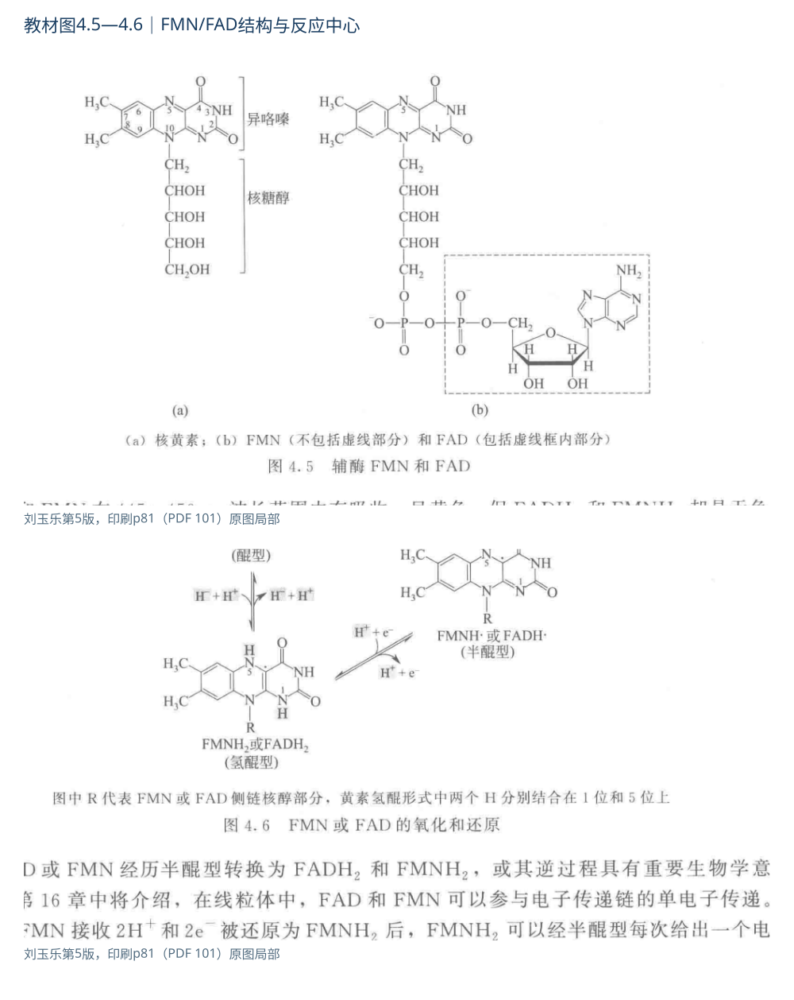{#fig-4-fad-structure}

:::

### 4.4 辅酶A {#learn-4-4}

::: {.note-box .focus}

**重点｜本节必须掌握**

从末端巯基、硫酯及酰基转移势解释CoA作用，区分ATP分子数与能量当量。

**考查问法：**根据组成和反应中心辨认CoA及其维生素前体。

**答题展开：**说明泛酸、末端巯基、硫酯与酰基转移的关系；旧编号与现行编号一并对应。 [→ P4-04 反应中心](#p4-04)

资料联系：分章笔记Word段837—840。

:::

[↔ 完整背诵](#recite-4-4) · [对应训练](#p4-15)

#### 组成与酰基转移中心

CoA含泛酸、巯基乙胺以及3′-磷酸腺苷二磷酸部分。真正用于酰基转移的是末端巯基，常写CoA-SH、HS-CoA或CoASH。其中核苷酸部分参与识别与结合；末端巯基决定其主要的酰基载体作用。

#### 硫酯的酰基转移势

酰基与硫连接形成$\mathrm{R-C(=O)-S-CoA}$，这是一条**硫酯键**，不是普通氧酯，也不是二硫键。硫对羰基的共振稳定较弱，酰基转移产物可获得更好的稳定，因而酰基CoA具有较高酰基转移势。“高能键”指相关水解或转移反应的自由能变化有利；单独断键本身需要能量。

#### 脂肪酸活化与ACP联系

脂肪酸活化的总体关系为：

$$\mathrm{RCOO^-+CoA{-}SH+ATP\rightarrow RCO{-}SCoA+AMP+PP_i}.$$

随后$PP_i$水解常使过程有利于向前推进；ATP变成AMP对应两个高能磷酸键当量。乙酰CoA只是酰基CoA的一种。泛酸还组成ACP上的**4′-磷酸泛酰巯基乙胺辅基**；ACP是蛋白质载体，磷酸泛酰巯基乙胺是其可运动的辅基。

来源：教材p82、图4.7；PPT4第22—24张；求臻第30讲p35—40；秃哥上册p132。编号采用现行B₅＝泛酸，旧编号在校订表保留说明。

::: {.structure-reference}

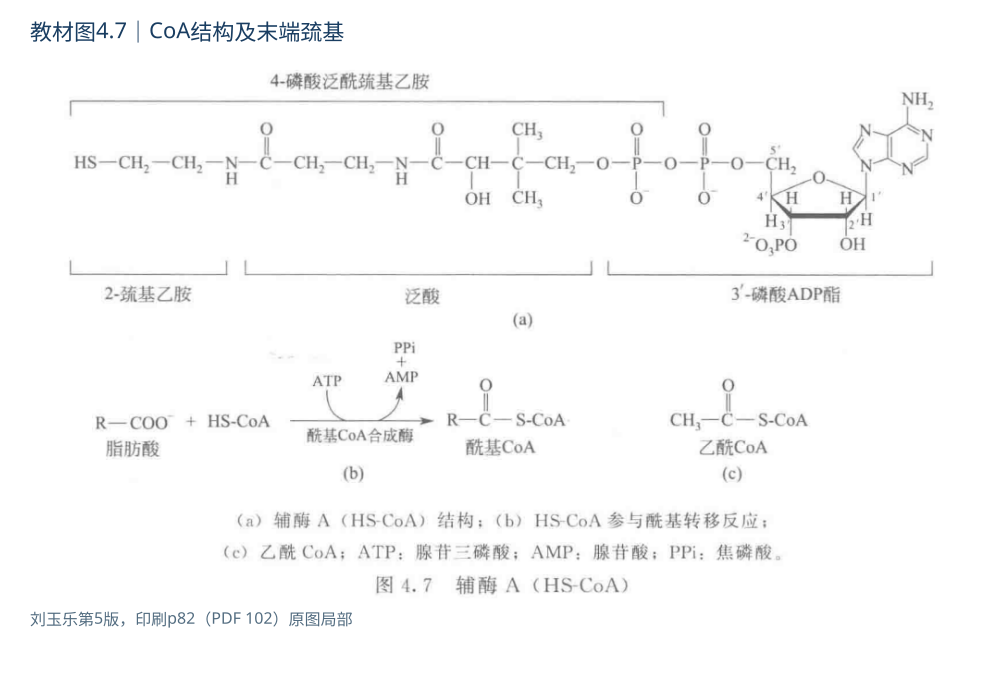{#fig-4-coa-structure}

:::

### 4.5 硫胺素焦磷酸（TPP） {#learn-4-5}

::: {.note-box .focus}

**重点｜本节必须掌握**

说明噻唑鎓C2如何稳定脱羧中间体，并区分酵母脱羧、氧化脱羧与转酮醇反应。

:::

[↔ 完整背诵](#recite-4-5) · [对应训练](#p4-04)

#### 组成与TPP反应位点

硫胺素B₁含**嘧啶环和带正电的噻唑环**，形成硫胺素焦磷酸TPP后作为多种酶的辅助成分。环名称按教材结构采用；课件的个别误名见第八部分。TPP的关键反应位点是噻唑环C2。

#### 脱羧中间体的稳定机制

::: {.note-box .info}

**机制难点｜TPP的电子汇**

C2失去质子后形成可作亲核体的叶立德/碳负离子共振结构，进攻α-酮酸羰基碳，形成共价加合物。随后脱羧，脱羧后残留的电子可在辅酶共轭系统中离域，避免生成极不稳定的游离碳负离子。这种电子离域作用称为“电子汇”，可稳定反应中间体；具体反应方向还取决于酶、底物及反应条件。

:::

#### 代表反应与B₁缺乏

::: {.note-box .danger}

**易错提醒｜相似底物的不同产物**

丙酮酸脱羧后形成羟乙基-TPP。酵母丙酮酸脱羧酶最终释放**乙醛**；丙酮酸脱氢酶复合物则把羟乙基氧化并转交给硫辛酰胺，最终生成**乙酰CoA**。两种过程不可用同一产物概括。转酮醇酶利用TPP转移二碳单位，转醛醇酶转移三碳单位且不以TPP为其同类辅酶。

:::

B₁不足使TPP相关氧化脱羧和转酮醇反应受影响，丙酮酸等代谢物可积累、供能受限，神经和心肌尤其易受损。脚气病是营养缺乏病，脚癣是真菌感染。辅酶在循环中再生，不是每分解一分子葡萄糖就永久消耗一分子B₁。

来源：教材p82—83；PPT4第25—29张；求臻第30讲p9—17；求臻背诵手册p128；秃哥下册丙酮酸氧化脱羧相关段。电子汇解释及两种产物对比为本册机制整理。

::: {.structure-reference}

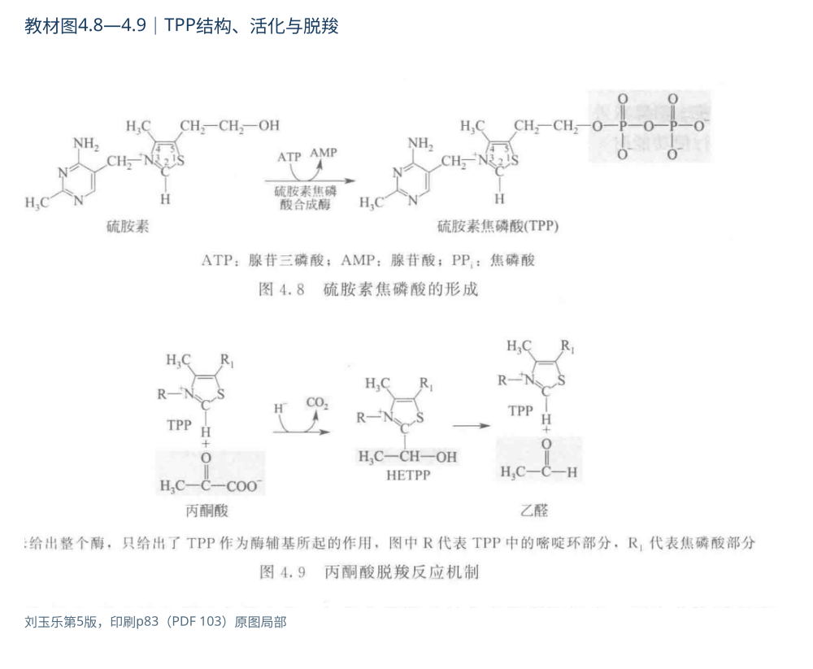{#fig-4-tpp-structure}

:::

### 4.6 磷酸吡哆醛（PLP） {#learn-4-6}

::: {.note-box .focus}

**重点｜本节必须掌握**

完整复述内/外醛亚胺交换和PLP/PMP两个半反应；结合酶环境区分转氨、脱羧及磷酸解。

**考查问法：**识别转氨所需辅酶，并完整叙述转氨过程。

**答题展开：**从内/外醛亚胺写到PLP→PMP→PLP两个半反应，再给净反应与氨基去向。 [→ R4.6 完整背诵](#recite-4-6)

资料联系：《841模拟卷一》Word段78—82；《841模拟卷三》段79。

:::

[↔ 完整背诵](#recite-4-6) · [对应训练](#p4-16)

#### B₆形式及内、外醛亚胺

B₆包括吡哆醇、吡哆醛、吡哆胺等形式；重要辅酶为PLP和PMP。PLP的醛基可以与氨基缩合成醛亚胺即希夫碱。静息酶中，PLP常与酶赖氨酸的ε-氨基形成**内醛亚胺**；底物α-氨基酸进入后，氨基取代赖氨酸，形成**外醛亚胺**。这种交换叫转醛亚胺化，不是先把PLP扔进溶液再随意结合。

#### 转氨反应的两个半反应

::: {.note-box .info}

**机制难点｜氨基怎样暂存并转交**

转氨循环可分成两个半反应。第一半：氨基酸与PLP形成外醛亚胺，经历电子重排生成酮亚胺，水解释放相应α-酮酸，PLP转为PMP。第二半：PMP把氨基交给另一个α-酮酸，经逆向过程形成新的氨基酸并再生PLP。总体上**氨基从一个碳骨架移到另一个碳骨架，通常不净释放游离氨**。

:::

$$\mathrm{amino\ acid_1+\alpha\!\mbox{-}keto\ acid_2\rightleftharpoons\alpha\!\mbox{-}keto\ acid_1+amino\ acid_2}.$$

#### 反应选择性与代谢实例

PLP的吡啶共轭系统稳定底物中间体的电子变化。酶把底物的某一键定向到适宜位置，因而可以选择转氨、脱羧、消旋、β/γ消除等不同反应。PLP反应的选择性取决于底物在酶活性部位的定向和被活化的键。

AST/GOT：谷氨酸＋草酰乙酸⇌α-酮戊二酸＋天冬氨酸；ALT/GPT：谷氨酸＋丙酮酸⇌α-酮戊二酸＋丙氨酸。两者是酶学与临床生化联系的例子，单个指标并不能单独确定某一种疾病。

::: {.note-box .danger}

**易错提醒｜含PLP不等于都转氨**

跨章例外：糖原磷酸化酶也含PLP，但它主要利用PLP的磷酸基参与酸碱催化，支持糖苷键磷酸解，不通过本节转氨反应的外醛亚胺路径。这说明同一种辅因子在不同酶中的具体用途仍取决于酶环境；辅酶名称不能代替机制判断。来源联系：秃哥下册PDF36页及导图PDF33页。

:::

神经递质联系：谷氨酸脱羧形成GABA；5-羟色氨酸脱羧形成5-羟色胺；DOPA脱羧形成多巴胺，都涉及PLP依赖酶。去甲肾上腺素由多巴胺再羟化生成，不能误说它直接由PLP催化的那一步产生。PLP也参与ALA合酶催化的血红素合成起始反应、同型半胱氨酸转硫途径中的酶反应。缺乏可影响神经递质及血红素合成；水溶性不等于大剂量长期服用无神经毒性。

来源：教材p83—85、图4.10—4.12；求臻第31讲p5—13；秃哥上册p133。教材转氨循环末尾的“水解”简写不应遮蔽内/外醛亚胺交换，图示按完整循环解释。

::: {.structure-reference}

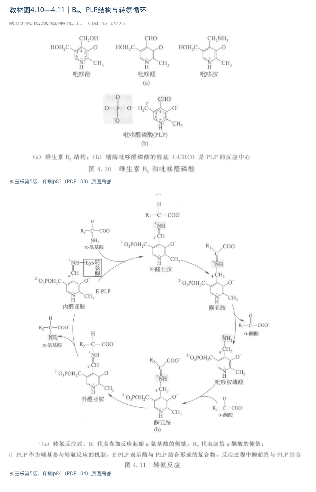{#fig-4-plp-structure}

:::

### 4.7 生物素 {#learn-4-7}

::: {.note-box .focus}

**重点｜本节必须掌握**

分别标出与酶连接的侧链羧基、暂携羧基的脲基氮，并写清ATP参与的两个阶段。

:::

[↔ 完整背诵](#recite-4-7) · [对应训练](#p4-09)

#### 酶连接位置与羧化位点

生物素具有含硫稠环和戊酸侧链，通过侧链羧基与酶赖氨酸ε-氨基形成酰胺键，构成生物胞素。**与酶连接的位置和暂时携带CO₂的位置不同**：连接用侧链羧基，反应中羧化发生在生物素脲基环氮。长的连接臂能在不同活性部位间运动。

#### ATP偶联的羧化过程

丙酮酸羧化酶总体反应：

$$\mathrm{pyruvate+HCO_3^-+ATP\rightarrow oxaloacetate+ADP+P_i}.$$

::: {.note-box .info}

**机制难点｜羧化的活化与转移**

先由ATP帮助活化碳酸氢根，使生物素被羧化；再把羧基转移给丙酮酸，生成草酰乙酸并再生生物素。生物素是载体，ATP提供偶联驱动力，分别承担载体与供能的作用。丙酮酸羧化酶参与糖异生和补充三羧酸循环中间体；乙酰CoA羧化酶形成丙二酰CoA；丙酰CoA羧化酶连接奇数碳脂肪酸代谢。后者之后的重排才需要B₁₂，整条途径需要按步骤辨认相应辅酶。

:::

#### 缺乏情境与生物素结合技术

生蛋清中的avidin可紧密结合生物素，长期大量摄入可减少生物素利用；加热可使avidin变性。结合技术中的一分子avidin通常有四个结合位点，便于富集生物素化分子。细菌能合成生物素不等于已证明它们满足人体的全部需要，来源与吸收须分开考虑。

来源：教材p85—86；求臻第31讲p14—22；秃哥上册p133—134；<a href="https://ods.od.nih.gov/factsheets/Biotin-HealthProfessional/">NIH ODS生物素</a>核对羧化酶及来源边界。

::: {.structure-reference}

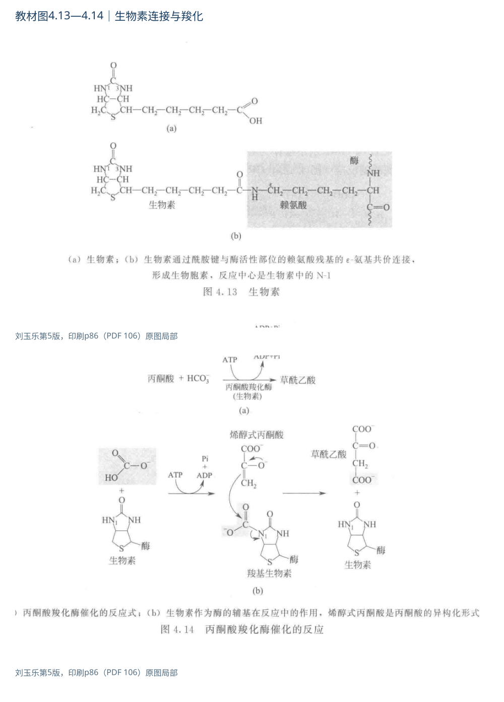{#fig-4-biotin-structure}

:::

### 4.8 四氢叶酸（THF） {#learn-4-8}

::: {.note-box .focus}

**重点｜本节必须掌握**

把一碳形式、结合位置与具体去向一一配对，尤其辨清嘌呤、dTMP与甲硫氨酸合成。

**考查问法：**判断THF的活性形式及一碳单位去向。

**答题展开：**把不同一碳形式与嘌呤、dTMP和甲硫氨酸合成配对；CO₂固定另与生物素比较。 [→ P4-03 一碳辨析](#p4-03)

资料联系：《841模拟卷一》Word段86；分章笔记Word段793—796。

:::

[↔ 完整背诵](#recite-4-8) · [对应训练](#p4-17)

#### 组成、活化与一碳形式

叶酸由蝶啶相关部分、对氨基苯甲酸和谷氨酸构成。经二氢叶酸还原酶、利用NADPH进行还原可形成四氢叶酸THF/FH₄。细胞内叶酸衍生物常有多聚谷氨酸尾，有利于保留及酶识别，链长不是所有分子都固定相同。

::: {.note-box .danger}

**易错提醒｜CO₂与叶酸一碳单位**

THF主要在N5、N10或两者之间携带一碳单位。常见的有5-甲基THF、5,10-亚甲基THF、5,10-次甲基THF、10-甲酰THF和5-亚胺甲基THF。一碳单位不等于所有含一个碳的分子；**CO₂通常不纳入这里的叶酸一碳单位定义**，其羧化转移重点对应生物素。

:::

| 形式 | 代表去向 | 需要辨析 |
|---|---|---|
| 10-甲酰THF | 嘌呤环的C2、C8来源 | 两次甲酰基转移，不是直接供整个嘌呤环 |
| 5,10-亚甲基THF | dUMP生成dTMP | 提供一碳单位并参与还原；产物伴随DHF形成 |
| 5-甲基THF | 经B₁₂把甲基交给同型半胱氨酸 | THF再生与甲硫氨酸循环相联系 |

#### 核苷酸合成与药物靶点

::: {.note-box .info}

**机制难点｜一碳供体与THF再生**

胸苷酸合酶反应为$\mathrm{dUMP+5,10\!\mbox{-}methylene\!\mbox{-}THF\rightarrow dTMP+DHF}$。教材以“提供甲基”概括最终结果，实际直接供体是**亚甲基THF**，它在反应中也供还原当量，不能把供体误写成5-甲基THF。DHF需经还原酶、消耗NADPH再生THF。细菌叶酸合成可利用对氨基苯甲酸，磺胺类通过竞争相关底物抑制二氢蝶酸合成步骤；人体依靠膳食叶酸，不能把这一抑菌靶点误写成人体叶酸合成酶。甲氨蝶呤抑制DHF还原酶，限制还原叶酸供给；5-FU的活性衍生物FdUMP则作用于胸苷酸合酶，这是不同靶点。

:::

#### 叶酸缺乏与造血

叶酸不足使嘌呤和dTMP合成受影响，DNA复制和细胞分裂受限，骨髓快速增殖细胞尤其敏感，可形成巨幼红细胞性贫血。补充材料中的“所有嘧啶合成都直接由THF供碳”并不准确，须明确到dTMP这一步。

来源：教材p86—87；求臻第31讲p23—42；生化老头精华p7、p20；求臻背诵手册p126—129；<a href="https://ods.od.nih.gov/factsheets/Folate-HealthProfessional/">NIH ODS叶酸</a>。原书概括与具体供体名称分开说明。

::: {.structure-reference}

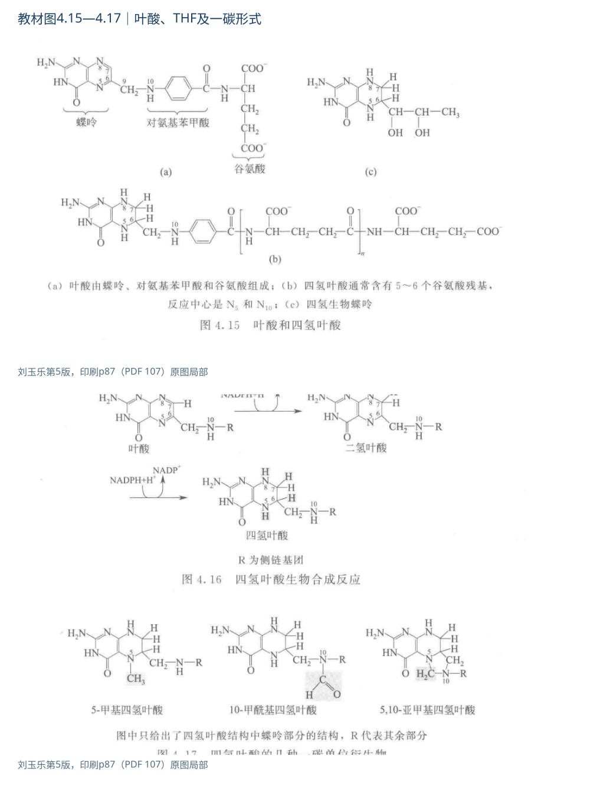{#fig-4-thf-structure}

:::

### 4.9 腺苷钴胺素和甲基钴胺素 {#learn-4-9}

::: {.note-box .focus}

**重点｜本节必须掌握**

区分两种Co—C键的用途；用两条反应解释叶酸陷阱、代谢指标与缺乏后果。

:::

[↔ 完整背诵](#recite-4-9) · [对应训练](#p4-08)

#### 两种活性形式的结构差别

B₁₂含钴和咕啉环，其上方轴向配体不同形成不同形式。连接5′-脱氧腺苷基的是腺苷钴胺素，连接甲基的是甲基钴胺素；氰钴胺素、羟钴胺素可以在体内转化成代谢所需形式。咕啉环与卟啉环相似而不相同，不能把B₁₂说成含铁血红素。

#### 自由基重排与甲基转移

腺苷钴胺素的Co—C键均裂可形成5′-脱氧腺苷自由基，后者从底物夺取氢原子，帮助发生自由基重排，再把氢返回并恢复辅酶。代表是L-甲基丙二酰CoA重排为琥珀酰CoA：碳数不变，连接关系改变。甲基钴胺素则作为甲基转移中的中介，从5-甲基THF接收甲基，再转给同型半胱氨酸，生成甲硫氨酸并再生THF。甲硫氨酸可与ATP形成S-腺苷甲硫氨酸SAM，后者是许多甲基化的直接甲基供体；THF、B₁₂与SAM各处不同环节，不能互写为同一化合物。

#### 叶酸陷阱、吸收与缺乏后果

::: {.note-box .info}

**机制难点｜叶酸陷阱的因果链**

B₁₂缺乏可使甲基转移受阻，叶酸池偏向5-甲基THF，其他可用THF衍生物不足，称“甲基叶酸陷阱”。这解释B₁₂和叶酸缺乏都可影响DNA合成，而其与DNA合成的联系是通过还原叶酸的可利用性实现的。B₁₂缺乏还可出现神经系统异常，不能把两种缺乏病视为完全相同。

:::

自然界B₁₂主要由某些微生物合成。人体从动物性或强化食物等获得的B₁₂需经过释放、结合与转运，内因子参与末端回肠吸收；胃壁细胞受损或内因子缺乏会造成吸收障碍。**恶性贫血通常特指内因子相关吸收障碍所致的一类疾病，不等于所有巨幼红细胞性贫血。** B₁₂储备较多，也反驳“水溶性维生素都不能储存”。

来源：教材p88—89；求臻第31讲p43—53；秃哥上册p133；<a href="https://ods.od.nih.gov/factsheets/VitaminB12-HealthProfessional/">NIH ODS B₁₂</a>核对活性形式和吸收环节。自由基过程为本册机制深化；SAM联系参见本地第18章PPT第2张。

::: {.structure-reference}

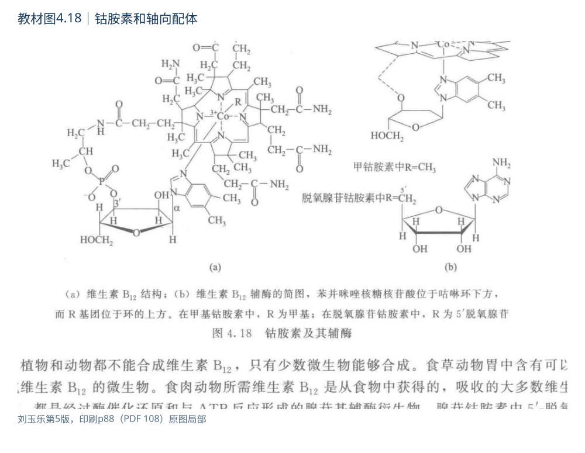{#fig-4-b12-structure}

:::

### 4.10 硫辛酰胺与多辅酶协同 {#learn-4-10}

::: {.note-box .focus}

**重点｜本节必须掌握**

按E1/E2/E3顺序讲清五辅酶协同，独立画出碳流、电子流及再生路径。

:::

[↔ 完整背诵](#recite-4-10) · [对应训练](#p4-05)

#### 摆臂结构与双重功能

硫辛酸通过羧基与酶赖氨酸侧链形成酰胺连接，成为硫辛酰基摆臂。氧化型具有分子内二硫键，还原后形成两个巯基；酰基可暂时以硫酯形式结合。它因此兼有**酰基载体和氧化还原载体**功能。游离硫辛酸并非化学上绝对不存在，教材“没有游离形式”应理解为所讨论酶催化中的功能形式主要是共价结合摆臂。

#### 五辅酶协同的反应步骤

以丙酮酸脱氢酶复合物为例：

1. E1用TPP完成丙酮酸脱羧，CO₂离开，留下羟乙基-TPP。
2. 羟乙基被氧化为乙酰基，转给E2的氧化型硫辛酰胺；硫辛酰胺的二硫键同时被还原。
3. 乙酰基转给CoA，释放乙酰CoA；摆臂此时为还原型二氢硫辛酰胺。
4. E3中的FAD接收还原当量，帮助摆臂恢复二硫键。
5. NAD⁺接受来自还原黄素的还原当量，生成NADH并再生FAD。

$$\mathrm{pyruvate+CoA{-}SH+NAD^+\rightarrow acetyl{-}CoA+CO_2+NADH+H^+}.$$

::: {.note-box .danger}

**易错提醒｜内部辅基与净产物分开**

碳流是丙酮酸→羟乙基-TPP→乙酰硫辛酰胺→乙酰CoA；电子流是底物→硫辛酰胺→FAD→NAD⁺。**FAD是内部循环辅基，NADH是总体反应的可离开还原产物。** 总反应中的还原产物计为NADH；FAD/FADH₂仅记入内部循环。CoA、NAD⁺为共底物，TPP、硫辛酰胺、FAD主要留在复合物中。

:::

#### 代谢联系与抑制实例

α-酮戊二酸脱氢酶复合物采用类似逻辑，产生琥珀酰CoA。亚砷酸盐可与还原型硫辛酰胺邻近巯基结合、妨碍再生，这是补充导图所列砷毒性的机制例子；不同价态砷的作用不能一概用此解释。这种“共价摆臂＋相邻活性位点”有利于中间体定向传递，减少扩散和副反应，但不改变净物质守恒。

来源：教材p89—90；PPT4第42—43张；秃哥下册丙酮酸脱氢酶相关页；生化老头专题训练p48。五辅酶碳流/电子流为本册按反应步骤整合。

::: {.structure-reference}

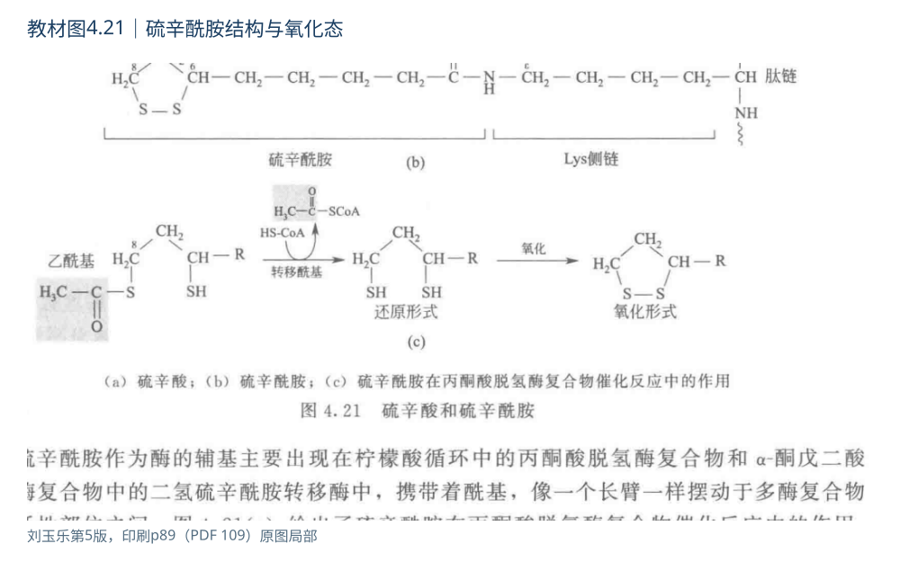{#fig-4-lipoate-structure}

:::

### 4.11 维生素C {#learn-4-11}

::: {.note-box .focus}

**重点｜本节必须掌握**

用还原作用—胶原羟化—组织成熟的因果链解释坏血病，并区别经典辅酶与还原性辅因子的口径。

**考查问法：**从缺乏症辨认C，再展开生物学作用。

**答题展开：**从还原作用→胶原羟化条件→组织成熟→坏血病；扩展功能与直接临床疗效分开。 [→ S4-04 C与K比较](#s4-04)

资料联系：《841模拟卷一》Word段33—37、98；答案稿段32—33。

:::

[↔ 完整背诵](#recite-4-11) · [对应训练](#p4-18)

#### 结构与还原性质

L-抗坏血酸是水溶性、带烯二醇结构的内酯，容易供出电子。人和豚鼠等不能完成维生素C生物合成的末端关键反应，需外源获得；教材图4.23以葡萄糖相关前体展示合成路线，不能由此推出人体也有完整途径。L表示构型，不能解释成“左旋所以有活性”。

#### 胶原羟化与坏血病的因果链

::: {.note-box .info}

**机制难点｜羟化受阻为何损伤组织**

在胶原脯氨酰和赖氨酰羟化酶体系中，维生素C帮助维持酶所需的还原状态。相关反应还需O₂、Fe²⁺和α-酮戊二酸，后者氧化脱羧成琥珀酸和CO₂。羟脯氨酸有助于胶原三股螺旋稳定，羟赖氨酸参与后续修饰和交联相关过程。缺乏导致胶原成熟不良、毛细血管脆性增加、牙龈出血、伤口愈合不良等坏血病表现。

:::

#### 其他功能与分类口径

维生素C还联系肉碱合成、某些神经递质合成、非血红素铁吸收及抗氧化。它可把Fe³⁺还原成较易吸收的Fe²⁺，参与恢复维生素E等抗氧化体系。恢复GSH的主要酶促电子来源应写**NADPH—谷胱甘肽还原酶**，不能把维生素C直接放到该酶反应中代替NADPH。

::: {.note-box .note}

**校订｜经典辅酶与还原性辅因子**

教材称维生素C“不是辅酶”，是与NAD、CoA等经典可循环基团载体相区别；现代酶学中常将其称作还原性辅因子。回答定义题应说明分类口径，回答机制题则写清其还原作用，避免把术语差异判成化学矛盾。

:::

::: {.note-box .note}

**校订｜可逆氧化与不可逆损失**

教材与部分课件把脱氢抗坏血酸称为“无活性”，但它可被生物体系还原回抗坏血酸；进一步不可逆降解才造成不能恢复的损失。正文保留氧化敏感性，同时避免绝对化。抗氧化或支持正常免疫功能，也不能直接推出“补充维生素C能普遍治疗病毒感染、癌症或重金属中毒”。

:::

来源：教材p90、图4.22—4.23；求臻第32讲p3—19；机构每日一题胶原题；<a href="https://ods.od.nih.gov/factsheets/VitaminC-HealthProfessional/">NIH ODS维生素C</a>交叉核对功能与临床推论边界。

::: {.structure-reference}

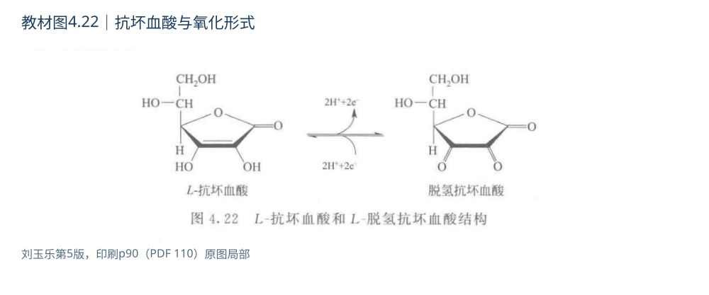{#fig-4-c-structure}

:::

### 4.12 脂溶性维生素 {#learn-4-12}

::: {.note-box .focus}

**重点｜本节必须掌握**

按功能形式、作用机制与缺乏后果比较A、D、E、K；四者分别联系视觉/转录、钙磷、链终止抗氧化与蛋白γ-羧化。

:::

[↔ 完整背诵](#recite-4-12) · [对应训练](#p4-12)

#### 4.12.1 维生素A {#learn-4-12-a}

**考查问法：**辨认视紫红质色团并解释光信号方向。

**答题展开：**11-顺视黄醛→光异构化→蛋白构象变化→信号链；色团再生与通道变化分别回答。 [→ P4-11 视觉判断](#p4-11)

资料联系：《841模拟卷三》Word段70及答案稿段80。

维生素A相关视黄类有视黄醇（末端—CH₂OH）、视黄醛（—CHO）和视黄酸（—COOH），都具有特定生物学作用。视黄醇不是“无活性的视黄醛”，它参与储存、转运及转化；视黄酸的重要作用是调节基因表达。β-胡萝卜素是维生素A原；食物来源、吸收转化效率和维生素A本身的活性不能混用一个固定换算比。

暗处，**11-顺视黄醛与视蛋白结合形成视紫红质**。吸收光后发生11-顺→全反式的异构化，带动蛋白构象改变并启动信号。视循环把视黄类重新加工为11-顺形式，以维持后续感光。B₂等是酶的辅助物，视黄醛在这里还承担捕获光的发色团角色。缺乏维生素A使色素再生受影响，可致暗适应下降和夜盲。

::: {.note-box .danger}

**易错提醒｜光照后通道关闭**

机制深化：光激活视紫红质后，经转导蛋白和磷酸二酯酶使cGMP下降，cGMP门控阳离子通道关闭，视杆细胞超极化，递质释放改变。故课件若把“光照使通道开放”作为这一步的结论，方向应校正。详细受体循环超出教材简图时，仅作为帮助解释的机制补充。

:::

视黄酸通过RAR/RXR相关核受体调节转录，联系上皮分化、生长和发育；维生素A不足还可导致干眼、角化异常。β-胡萝卜素与预成维生素A的过量风险和作用不能完全等同；细胞分化作用也不能直接变成普通补充剂的抗癌疗效结论。

来源：教材p91；PPT4第52—56张；求臻第26讲p4—18、秃哥上册p129；<a href="https://ods.od.nih.gov/factsheets/VitaminA-HealthProfessional/">NIH ODS维生素A</a>。光信号链补核<a href="https://pubmed.ncbi.nlm.nih.gov/1697545/">光转导研究综述摘要</a>，原课件通道方向列入校订记录。

#### 4.12.2 维生素D {#learn-4-12-d}

**考查问法：**膳食充足时，D活化障碍为何仍影响骨矿化。

**答题展开：**前体来源→肝25-羟化→肾1α-羟化→肠钙磷吸收与骨矿化，最后解释器官障碍。 [→ 教材4-8 肾活化](#t4-08)

资料联系：分章笔记Word段817—828；教材第4章习题8。

D₂为麦角钙化醇，D₃为胆钙化醇。D₃来自食物或皮肤7-脱氢胆固醇的紫外光化学转化，再经热异构等步骤形成；它属于开环固醇相关结构，不能说完整保留胆固醇的所有环。

::: {.note-box .info}

**机制难点｜来源、储备与活化分开**

D₃首先在肝进行25-羟化，再主要在肾进行1α-羟化，生成**1,25-(OH)₂D₃，即骨化三醇**。25-OH-D常用于评价维生素D状态，不能与最终主要活性形式混同。D₂也经类似的活化。由此可见，教材“脂溶性维生素都不需化学修饰”不是适用于所有成员的严格命题。

:::

::: {.note-box .danger}

**易错提醒｜骨软化、骨质疏松与肾活化**

活性维生素D与核受体结合，调节肠道钙磷吸收等过程，帮助维持血钙磷及骨矿化。缺乏时儿童表现为佝偻病，成人主要为骨软化；骨质疏松与骨软化不是同义词，前者强调骨量/微结构，后者强调矿化不足。肾损伤可使活化不足，且常有磷排泄障碍，故饮食均衡仍可能出现骨矿化异常。

:::

钙磷联系可按“肠—肾—骨”组织：维生素D促进肠吸收；PTH有利于保钙、排磷并促进活性D形成；骨在不同激素及营养条件下进行沉积和动员。血中总钙还受白蛋白结合影响，酸碱变化可改变离子钙比例。不能把“钙磷乘积恒定”当作跨疾病、跨条件的守恒定律。

来源：教材p91—92及习题8；求臻第27讲p4—14；清华分章笔记钙磷段（页码已重新定位）；<a href="https://ods.od.nih.gov/factsheets/VitaminD-HealthProfessional/">NIH ODS维生素D</a>核对活化与缺乏病。具体疾病诊疗不由本章的机制图直接推出。

#### 4.12.3 维生素E {#learn-4-12-e}

维生素E包含生育酚和生育三烯酚等，具有含酚羟基的环和疏水侧链。人体维生素E营养需要主要由α-生育酚满足；体外某种清除自由基实验的强弱不等同于人体的生物活性排名。

::: {.note-box .info}

**机制难点｜自由基链的终止**

酚羟基可向脂质过氧自由基提供氢，生成较稳定的生育酚自由基，终止继续夺氢的链传播：$\mathrm{LOO^{\bullet}+TocOH\rightarrow LOOH+TocO^{\bullet}}$。疏水侧链使其适合在膜和脂蛋白环境发挥作用。其主要作用方式是链终止抗氧化；“水相的C”和“脂相的E”可构成相互联系而位置不同的抗氧化网络。

:::

严重缺乏可出现溶血与神经肌肉异常，脂肪吸收障碍者更易缺乏。教材中的生育相关命名有动物实验背景，不应直接写成“人缺E一定不孕”或“补充E普遍保胎、抗癌、抗衰老”。其参与基因调控等扩展研究，不替代本章必须掌握的抗氧化反应机制。

来源：教材p92；求臻第28讲p4—13；<a href="https://ods.od.nih.gov/factsheets/VitaminE-HealthProfessional/">NIH ODS维生素E</a>核对八种形式、α-生育酚及缺乏表现。

#### 4.12.4 维生素K {#learn-4-12-k}

K₁主要为叶绿醌，K₂为一组甲基萘醌相关化合物，具有2-甲基-1,4-萘醌骨架。还原型维生素K参与γ-谷氨酰羧化酶反应，把特定蛋白质上的Glu侧链γ位羧化为**Gla残基**，自身被氧化为环氧化物，后经维生素K循环再生。

::: {.note-box .info}

**机制难点｜Gla修饰如何支持凝血**

增加的羧基提高相关蛋白对Ca²⁺的结合能力，有利于其在适宜膜表面定位，完成凝血反应。因此维生素K作用不仅是“多合成一点凝血酶原”，更要写出**翻译后羧化修饰**。因子II、VII、IX、X及蛋白C、S等与这一体系相关。华法林抑制K再生，使新合成相关蛋白不能正常完成修饰；它不是直接把血中的所有凝血酶原立刻去掉。

:::

骨钙素、基质Gla蛋白也联系维生素K依赖羧化，所以资料中的骨代谢、血管钙化关联可纳入结构机制联系。但“某蛋白参与钙化调节”不能直接推出大剂量补K的临床获益。新生儿储备和转运、脂质吸收障碍等可影响K供给，不能把胎盘转运简单写成绝对为零。

来源：教材p92—93、图4.27；求臻第29讲p4—11；<a href="https://ods.od.nih.gov/factsheets/VitaminK-HealthProfessional/">NIH ODS维生素K</a>核对结构、凝血和其他Gla蛋白。

::: {.structure-reference}

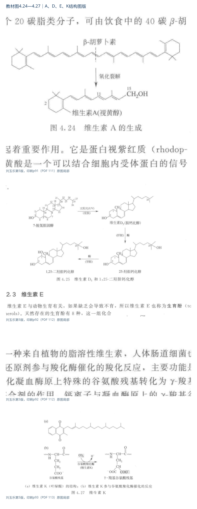{#fig-4-fat-structures}

:::

### 教材相关话题：维生素药物与营养补充的解释边界 {#vitamin-applications}

教材p92—93逐项列出维生素类药物。复习时要建立“缺乏物质→受影响反应→生理后果→补足缺乏”的链条，例如A与暗视觉、B₁与氧化脱羧、B₂与黄素酶、PP与NAD/NADP、B₆与PLP反应、C与胶原、D与活化及钙磷、K与Gla形成。药物剂量、适应证、给药途径和疗效证据属于另一个层面，不由这些例子直接决定。

配套PPT关于营养补充与运动成绩的讨论可用于理解“需要维生素”和“摄入更多就更好”之间的区别。维生素维持必要代谢功能，而不是直接供能；辅酶在催化循环中再生。营养充足条件下，额外增加一种原料未必解除真正的限速因素。此处用作机制推理，不给补充剂处方。

来源：教材p92—93相关话题；PPT4第64—65张；NIH ODS各维生素功能与健康证据分节。

:::

::: {.reading-section #comparison}

## 第二部分｜核心图解、机制推导与综合比较

### 从反应中心定位辅酶 {#coenzyme-table}

| 维生素或前体 | 活性形式与反应中心 | 主要转移对象 | 代表性联系 |
|---|---|---|---|
| PP：烟酸/烟酰胺（现行B₃） | NAD(P)；烟酰胺环C4 | 氢负离子，2e⁻ | 乳酸脱氢、还原合成 |
| B₂核黄素 | FMN/FAD；异咯嗪环 | 1e⁻或2e⁻ | 呼吸链、琥珀酸脱氢 |
| 泛酸（现行B₅；教材旧称B₃） | CoA；末端—SH | 酰基 | 乙酰CoA、琥珀酰CoA |
| B₁硫胺素 | TPP；噻唑鎓C2 | 活化醛片段，常见二碳 | α-酮酸脱羧、转酮酶 |
| B₆ | PLP/PMP；醛基与共轭环 | 氨基及氨基酸中间体 | 转氨、氨基酸脱羧 |
| 生物素（B₇） | 酶结合生物素；脲基氮 | 活化CO₂ | 丙酮酸、乙酰CoA羧化 |
| 叶酸（B₉） | THF；N5、N10 | 不同氧化态一碳单位 | 嘌呤、dTMP、甲硫氨酸 |
| B₁₂ | 腺苷/甲基钴胺素；Co—C | 自由基重排/甲基 | 甲基丙二酰CoA、同型半胱氨酸 |
| 硫辛酸 | 酶结合硫辛酰胺；S—S/二巯基 | 酰基及还原当量 | α-酮酸脱氢酶复合体 |
| C | 抗坏血酸；烯二醇 | 还原当量 | 胶原羟化、抗氧化 |
| K | 还原型维生素K | 羧化反应所需还原当量 | 蛋白Glu→Gla，不是生物素羧化 |

图4-A把两条流同时展开；图4-B把常见“都是一碳相关”的三组反应分开。图为根据教材原理绘制的机制图，反应中心局部式不冒充辅酶完整结构。

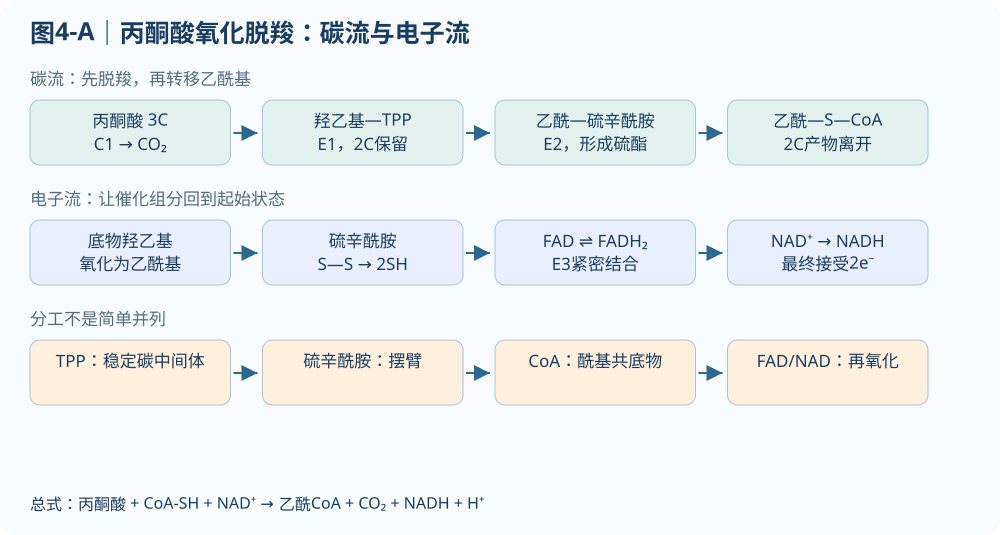{#fig-4-pdh}

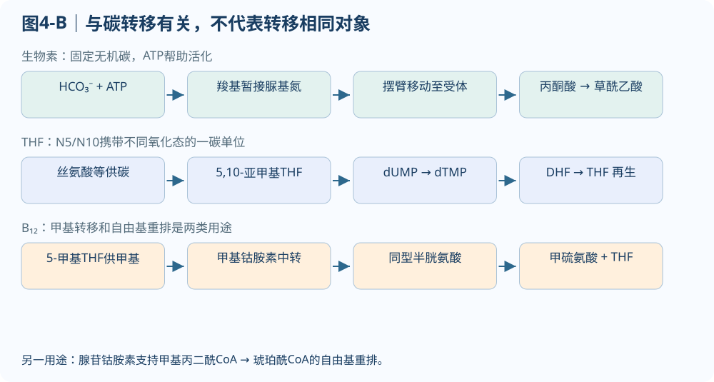{#fig-4-carbon}

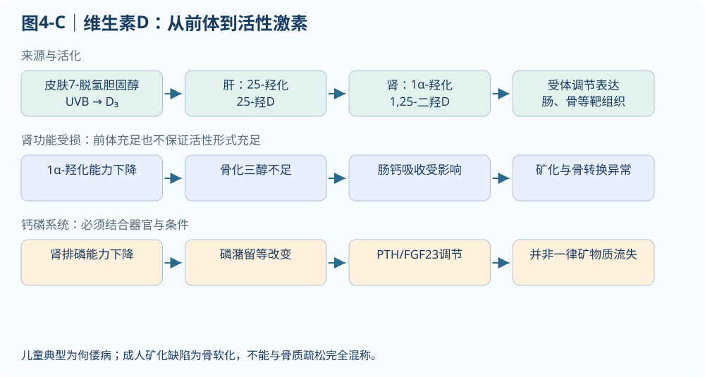{#fig-4-d}

### 易混反应的判定顺序 {#reaction-comparison}

先看底物变化，再定位辅酶：失去CO₂并形成碳负离子中间体的α-酮酸反应想到TPP；氨基酸脱羧想到PLP；加入HCO₃⁻并耗ATP的羧化想到生物素；给嘌呤或dTMP供一碳单位想到THF；蛋白谷氨酸侧链γ-羧化想到K；脯/赖氨酸羟化想到C及Fe²⁺、氧、α-酮戊二酸。仅见“羧化”或“脱羧”两个字不能直接选答案。

NADPH、C、E和谷胱甘肽联系抗氧化但所在环节不同。E主要在脂质环境中截断自由基链；C在水相参与还原与抗氧化，可联系E再生；谷胱甘肽过氧化物酶利用GSH还原过氧化物，谷胱甘肽还原酶以FAD和NADPH恢复GSH。不能把四者写成同一种酶的可互换辅酶。

### PLP转氨循环的推导 {#plp-derivation}

在转氨酶中，PLP先把第一种氨基酸的氨基暂存为PMP，再把氨基交给第二种α-酮酸。用两个半反应相加，可以看出PLP/PMP在总反应中被约去，转移的是氨基，碳骨架则各自转成对应的α-酮酸或氨基酸。

1. 氨基酸₁＋酶-PLP ⇌ α-酮酸₁＋酶-PMP。
2. α-酮酸₂＋酶-PMP ⇌ 氨基酸₂＋酶-PLP。
3. 相加得氨基酸₁＋α-酮酸₂ ⇌ α-酮酸₁＋氨基酸₂。常规转氨无游离NH₃净释放，也没有ATP直接参与这两个半反应。

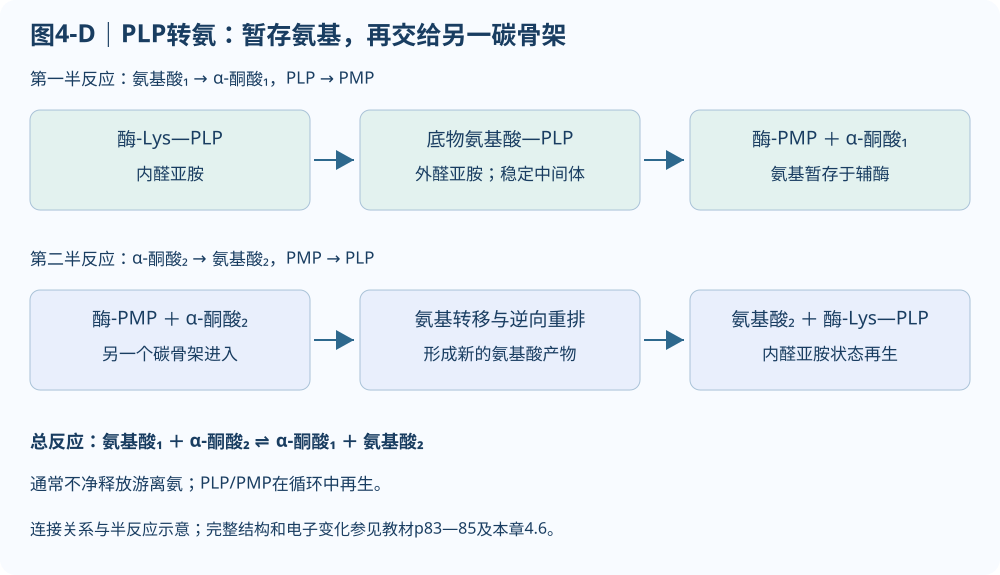{#fig-4-plp-cycle}

### 羧化、羟化与一碳转移比较 {#modification-comparison}

| 反应 | 直接改变 | 关键辅助物与条件 | 判断依据 |
|---|---|---|---|
| 丙酮酸羧化 | 碳骨架增加一碳，生成草酰乙酸 | 生物素、HCO₃⁻、ATP | 活化无机碳与摆臂转移 |
| dUMP→dTMP | 核苷酸上形成甲基 | 5,10-亚甲基THF；生成DHF | 特定一碳形式及还原当量转移 |
| 同型半胱氨酸→甲硫氨酸 | 硫原子接受甲基 | 5-甲基THF、甲基钴胺素 | B₁₂中介与THF再生 |
| 蛋白Glu→Gla | 侧链γ位新增羧基 | 还原型K、CO₂、O₂ | 翻译后修饰，增加Ca²⁺结合能力 |
| 胶原脯/赖氨酸羟化 | 残基引入羟基 | C、Fe²⁺、O₂、α-酮戊二酸 | 羟化和胶原成熟 |

来源：教材4.6—4.12及相应正文来源；半反应相消、比较维度和图4-D为本册机制整理。

:::

::: {.reading-section #recitation}

## 第三部分｜完整背诵与易混辨析

以下答案供独立复述。答题先说活性形式和反应中心，再说转移对象、代表反应和必要条件；不能只报缺乏症。要理解细节时返回对应精讲。

<button id="recall-toggle" type="button" aria-pressed="false">闭卷回忆：隐藏全部参考</button>先回答每条问题，再展开完整答案并核对要点。

::: {.recite-card #recite-4-1}

### R4.1 辅因子、辅酶、辅基与维生素

::: {.recite-question}

说明辅因子、辅酶、辅基、共底物、全酶与维生素之间的关系，分别举例。

:::

[↔ 返回对应精讲](#learn-4-1)

::: {.recite-body}

#### 可直接复述的完整答案

辅因子是酶发挥催化作用所需的非蛋白质成分，包括金属离子和有机辅因子。酶蛋白与所需辅因子结合形成有催化活性的全酶。有机辅因子中，结合相对松散、可作为共底物参与反应的常称辅酶；与蛋白紧密结合的称辅基，紧密结合既可依靠共价键，也可依靠强非共价作用。

广义上辅酶也可包括紧密结合形式，答题须说明使用口径。维生素是机体少量需要、不能充分合成而须从膳食获得的有机营养物质。许多水溶性维生素是辅酶前体，但维生素、辅酶和辅基三者不等同；D可在皮肤合成，硫辛酰胺也不能据其辅基身份直接判为人体必需维生素。

#### 答题核对点（本册整理）

- 非蛋白成分
- 金属/有机
- 结合方式
- 再生位置
- 营养与催化身份不同

:::

:::

::: {.recite-card #recite-4-2}

### R4.2 NAD与NADP的结构、反应和分工

::: {.recite-question}

比较NAD⁺与NADP⁺的结构、受氢方式和主要代谢分工，并写出乳酸氧化反应。

:::

[↔ 返回对应精讲](#learn-4-2)

::: {.recite-body}

#### 可直接复述的完整答案

NAD⁺与NADP⁺均为维生素PP的衍生物，均含烟酰胺核苷酸和腺苷酸。NADP⁺比NAD⁺在腺苷核糖2′位多一磷酸，主要影响酶识别。两者反应中心都是烟酰胺环C4，接受一个氢负离子，即一个质子与两个电子，形成NADH或NADPH；底物脱去的另一质子通常进入介质。

因此乳酸氧化应写为乳酸＋NAD⁺⇌丙酮酸＋NADH＋H⁺，不写NADH₂。NAD体系主要联系分解代谢供电子，NADPH主要用于还原性合成、抗氧化及羟化等反应；这是主要分工而非所有酶的绝对规则。

#### 答题核对点（本册整理）

- 2′磷酸
- C4
- H⁻与介质H⁺
- NADH写法
- 辅酶池分工

:::

:::

::: {.recite-card #recite-4-3}

### R4.3 黄素辅酶为什么能连接单电子与双电子反应

::: {.recite-question}

说明FMN/FAD来源、反应中心和半醌的作用，举出两种黄素酶。

:::

[↔ 返回对应精讲](#learn-4-3)

::: {.recite-body}

#### 可直接复述的完整答案

FMN和FAD均来自核黄素B₂，反应中心为异咯嗪环，FAD比FMN多一个腺苷酸部分。黄素可经半醌自由基接受或交出一个电子，也可完成两个电子的转移，完全还原形成FMNH₂或FADH₂。这使它们能够把底物脱氢的双电子过程与铁硫中心、细胞色素等单电子过程联系起来。

它们常作为紧密结合的辅基，例如呼吸链复合体Ⅰ的FMN、琥珀酸脱氢酶中的FAD；具体氧化还原电势受酶环境影响。缺乏B₂可影响多类黄素酶，出现口角、舌和皮肤等改变。

#### 答题核对点（本册整理）

- B₂
- 异咯嗪
- 单/双电子
- 复合体I和琥珀酸脱氢酶

:::

:::

::: {.recite-card #recite-4-4}

### R4.4 CoA怎样活化并转移酰基

::: {.recite-question}

说明CoA组成、反应中心、硫酯的意义以及CoA与ACP的联系。

:::

[↔ 返回对应精讲](#learn-4-4)

::: {.recite-body}

#### 可直接复述的完整答案

辅酶A由泛酸、β-巯基乙胺及核苷酸部分组成，末端巯基是反应中心。酰基与巯基形成硫酯R—CO—S—CoA，水解或转移具有较高的酰基转移势，可使酰基参与缩合、氧化分解和合成。CoA转移的是酰基，不是固定只转乙酰基。乙酰CoA连接糖、脂肪和氨基酸代谢，琥珀酰CoA参与三羧酸循环及血红素合成。

脂肪酸合成ACP也用4′-磷酸泛酰巯基乙胺摆臂，但ACP是蛋白载体，不等于游离CoA。

#### 答题核对点（本册整理）

- 泛酸
- 末端SH
- 酰基
- 硫酯
- 乙酰/琥珀酰CoA
- ACP摆臂

:::

:::

::: {.recite-card #recite-4-5}

### R4.5 TPP的结构基础、反应与缺乏后果

::: {.recite-question}

解释TPP稳定脱羧中间体的结构基础，比较其代表反应与B₁缺乏后果。

:::

[↔ 返回对应精讲](#learn-4-5)

::: {.recite-body}

#### 可直接复述的完整答案

TPP是B₁硫胺素的焦磷酸衍生物。噻唑鎓环C2去质子化形成亲核体，进攻底物羰基，环的电子离域稳定脱羧后中间体，随后转移活化醛片段并再生TPP。代表反应是丙酮酸和α-酮戊二酸的氧化脱羧、酵母丙酮酸脱羧及磷酸戊糖途径转酮酶反应；不应把所有脱羧反应都归于TPP。

B₁不足可使α-酮酸氧化利用受阻，丙酮酸等积累、能量供应受损，神经和心血管系统易受累。转酮酶转移二碳单位，TPP不是一碳单位载体。

#### 答题核对点（本册整理）

- B₁
- 噻唑鎓C2
- 电子汇
- 酵母脱羧/氧化脱羧/转酮酶

:::

:::

::: {.recite-card #recite-4-6}

### R4.6 PLP催化转氨的完整过程

::: {.recite-question}

从内醛亚胺出发完整说明PLP转氨循环，并举出其他PLP依赖反应。

:::

[↔ 返回对应精讲](#learn-4-6)

::: {.recite-body}

#### 可直接复述的完整答案

PLP是B₆的活性辅酶，醛基与酶赖氨酸形成内醛亚胺。底物氨基酸进入后发生转醛亚胺化，形成外醛亚胺。共轭体系稳定α碳反应中间体，经重排和水解生成第一种α-酮酸及PMP。PMP再与第二种α-酮酸反应，把氨基转给它，形成第二种氨基酸并再生PLP。

全过程通常不释放游离氨，也不直接耗ATP。PLP还参与氨基酸脱羧、消旋及部分侧链反应；酶结合方式决定断裂哪个键。GABA、5-羟色胺和多巴胺的合成均有PLP依赖脱羧步骤。

#### 答题核对点（本册整理）

- 内→外醛亚胺
- PLP→PMP→PLP
- 两个半反应
- 氨基转移
- 神经递质

:::

:::

::: {.recite-card #recite-4-7}

### R4.7 生物素与羧化反应

::: {.recite-question}

说明生物素怎样与酶结合并完成羧化，列举三个羧化酶及缺乏情境。

:::

[↔ 返回对应精讲](#learn-4-7)

::: {.recite-body}

#### 可直接复述的完整答案

生物素以侧链羧基与酶赖氨酸ε-氨基形成酰胺键。ATP先帮助活化HCO₃⁻，将羧基暂时固定到生物素脲基氮；摆臂再把活化羧基送到受体，完成羧化并再生生物素。代表酶有丙酮酸羧化酶、乙酰CoA羧化酶、丙酰CoA羧化酶等。生物素不携带THF形式的一碳单位，也不参与丙酮酸脱氢酶复合体的五辅酶反应。

长期大量生食蛋清时，抗生物素蛋白结合生物素、妨碍利用，可能引起缺乏；加热可使该蛋白失活。

#### 答题核对点（本册整理）

- 赖氨酸酰胺
- 脲基氮
- ATP和HCO₃⁻
- 三种羧化酶
- avidin

:::

:::

::: {.recite-card #recite-4-8}

### R4.8 THF、一碳单位与DNA合成

::: {.recite-question}

说明THF组成、一碳结合位置、主要形式及其与核苷酸合成和贫血的联系。

:::

[↔ 返回对应精讲](#learn-4-8)

::: {.recite-body}

#### 可直接复述的完整答案

叶酸由蝶啶、对氨基苯甲酸及谷氨酸组成，接受还原后形成THF。一碳单位以不同氧化态连接在N5、N10或两者之间，包括甲基、亚甲基、次甲基、甲酰基和亚氨甲基等；CO₂不是此处THF所携带的一碳单位。10-甲酰THF向嘌呤环供给C2和C8；5,10-亚甲基THF参与dUMP到dTMP的转化，并被氧化成DHF，后者由二氢叶酸还原酶利用NADPH还原。

5-甲基THF通过B₁₂依赖甲硫氨酸合酶转移甲基。叶酸缺乏使核苷酸供给和DNA复制受限，增殖旺盛的造血细胞成熟受阻，可出现巨幼红细胞性贫血。

#### 答题核对点（本册整理）

- N5/N10
- 甲酰/亚甲基/甲基
- 嘌呤C2/C8
- dTMP
- DHF再生

:::

:::

::: {.recite-card #recite-4-9}

### R4.9 B₁₂两种活性形式与叶酸的联系

::: {.recite-question}

比较B₁₂两种活性形式的结构、反应及缺乏后果，说明叶酸陷阱。

:::

[↔ 返回对应精讲](#learn-4-9)

::: {.recite-body}

#### 可直接复述的完整答案

B₁₂含钴和咕啉环，主要活性形式为腺苷钴胺素与甲基钴胺素。前者Co—C键均裂形成自由基，参与甲基丙二酰CoA到琥珀酰CoA等分子内重排；后者参与甲硫氨酸合酶反应，将5-甲基THF的甲基经钴中心转给同型半胱氨酸，生成甲硫氨酸并再生THF。

B₁₂缺乏可造成叶酸陷阱和DNA合成障碍，兼有神经系统损伤风险。胃内因子结合及末端回肠吸收对正常吸收重要；恶性贫血特指与内因子缺陷等相关的病理类型，不能把所有巨幼红细胞性贫血都称为恶性贫血。

#### 答题核对点（本册整理）

- Co—C
- 腺苷自由基/甲基中介
- 两条反应
- THF再生
- 吸收与神经风险

:::

:::

::: {.recite-card #recite-4-10}

### R4.10 丙酮酸氧化脱羧的五辅酶协同

::: {.recite-question}

写出丙酮酸氧化脱羧净反应，按顺序解释五种辅酶作用并分别追踪碳和电子。

:::

[↔ 返回对应精讲](#learn-4-10)

::: {.recite-body}

#### 可直接复述的完整答案

丙酮酸＋CoA-SH＋NAD⁺→乙酰CoA＋CO₂＋NADH＋H⁺。E1上的TPP先促脱羧，形成羟乙基TPP；羟乙基被氧化为乙酰基并转到E2硫辛酰胺摆臂，二硫键同时被还原。乙酰基再转给CoA，生成乙酰CoA。E3以FAD氧化还原型硫辛酰胺，FADH₂再把还原当量转给NAD⁺，再生FAD并生成NADH。

TPP、硫辛酰胺和FAD循环再生；CoA和NAD⁺作为共底物进入并以产物形式离开。碳流与电子流必须分开追踪，NAD⁺是该反应中最终的还原当量受体；Mg²⁺支持TPP相关催化，但不计入五种有机辅酶。

#### 答题核对点（本册整理）

- TPP→硫辛酰胺→CoA
- 硫辛酰胺→FAD→NAD⁺
- 再生与净产物

:::

:::

::: {.recite-card #recite-4-11}

### R4.11 C缺乏为什么引起坏血病

::: {.recite-question}

用结构—反应—组织后果的因果链说明维生素C缺乏为何引起坏血病。

:::

[↔ 返回对应精讲](#learn-4-11)

::: {.recite-body}

#### 可直接复述的完整答案

维生素C即L-抗坏血酸，烯二醇结构易提供还原当量，氧化可经自由基中间态形成脱氢抗坏血酸。它帮助胶原合成相关羟化酶维持催化所需的金属还原状态；脯氨酸、赖氨酸羟化还需氧、Fe²⁺和α-酮戊二酸。羟化不足使胶原成熟和稳定性下降，毛细血管及结缔组织脆弱，导致出血、伤口愈合不良等。

C也参与抗氧化网络、非血红素铁利用及部分生物合成过程。教材把它与经典基团转移辅酶分开，不等于它不参与酶反应；同一化学与立体结构的纯C不会因天然或合成来源而改变分子身份。

#### 答题核对点（本册整理）

- 烯二醇
- 还原状态
- 胶原羟化
- Fe²⁺/O₂/α-酮戊二酸
- 成熟障碍

:::

:::

::: {.recite-card #recite-4-12}

### R4.12 脂溶性维生素完整比较答案

::: {.recite-question}

按功能形式、作用机制、代表过程和缺乏后果比较A、D、E、K。

:::

[↔ 返回对应精讲](#learn-4-12)

::: {.recite-body}

#### 可直接复述的完整答案

维生素A包括视黄醇及相关形式；11-顺视黄醛是视觉色团，光照使其异构化为全反式形式并触发信号，视黄酸则通过核受体影响基因表达，二者功能不能互换。缺乏可损害暗适应和上皮组织。D₃可由皮肤7-脱氢胆固醇受紫外线作用产生，经肝25-羟化和肾1α-羟化生成骨化三醇，调节钙磷吸收和骨矿化；肾功能受损可导致活化不足，儿童出现佝偻病，成人典型为骨软化。

E的生育酚和生育三烯酚合计八种，α-生育酚与人体需要关系最明确，其酚羟基提供氢、终止膜脂过氧化链反应。K的还原形式支持谷氨酸残基γ-羧化，产生能结合Ca²⁺的Gla残基，使凝血相关蛋白正确定位并发挥功能；K经环氧化与还原循环再生。脂溶性影响吸收、分布和储存，不意味着四者具有同一种机制或都无需活化。

#### 答题核对点（本册整理）

- A色团/核受体
- D两次羟化
- E酚羟基链终止
- K的Gla修饰

:::

:::

:::

::: {.practice-section #practice}

## 第四部分｜原创分级练习

::: {.note-box .info}

**题型与答题要求**

官方考纲列明选择题、判断题、简答题、论述题等。本册以这四类组织训练，填空作辅助巩固；结构、计算、反应和实验分析是简答或论述的具体任务。下面的核对要求用于练习订正。

| 题型 | 答题路径 | 作答后核对 |
|---|---|---|
| 选择题 | 审清单选／多选与否定词；按概念、结构和适用条件逐项判断。 | 能说明所选项成立的理由，并找出干扰项错在哪里。 |
| 判断题 | 先判断，再改正关键错误，补足成立条件；有需要时用反例或反应式说明。 | 不只写“对／错”，改正后的句子本身应准确。 |
| 简答题 | 先直接回答，再分层写结构或机制、必要条件和代表实例；计算写公式、代入与单位。 | 围绕题目所问，步骤完整，名称、碳号和量纲对应。 |
| 论述题 | 先给总观点，沿完整因果链展开；比较题固定维度，实验题写原理、对照、预期与局限。 | 结论有机制或证据支持，跨章联系能回到题目。 |
| 辅助填空 | 根据上下文确定对象、反应位置、数值或术语，填写完整名称和必要单位。 | 用于巩固与自查；不把它标为考纲明确列出的题型。 |

:::

共18道训练，按官方题型组织；结构、机制和计算任务归入简答题，跨知识综合归入论述题。所有原题的知识点和题号保留。

### 选择题｜基础识别与机制判断

::: {.exercise .open-question #p4-01}

### P4-01 选择题（多选）：识别辅因子的两条分类轴 {#p4-01-多选识别辅因子的两条分类轴}

下列说法正确的是：

- A.辅因子一定是有机物。
- B.辅基一定共价连接。
- C.FAD可作为紧密结合辅基。
- D.同一有机辅因子可能因酶环境不同而结合方式不同。

::: {.source-note}

本册原创题，非841原题 · 对应知识：[4.1](#learn-4-1)

:::

[查看答案与解析](#solution-p4-01)

:::

::: {.exercise .open-question #p4-10}

### P4-10 选择题（多选）：哪几项属于脂溶性维生素 {#p4-10-多选与题目校订哪几项属于脂溶性维生素}

- A.K
- B.C
- C.B₁
- D.A

来源：真题资料二次整理的分章笔记，将类似内容标注为2024年单选题。本册依据现有题面再次改编为多选；该年份为汇编标注，尚未逐题对应原卷。

::: {.source-note}

改编题（来源见题干） · 对应知识：[4.12](#learn-4-12)

:::

[查看答案与解析](#solution-p4-10)

:::

::: {.exercise .open-question #p4-14}

### P4-14 选择题（单选）：双电子供体怎样连接单电子载体 {#p4-14-机制辨析双电子供体怎样连接单电子载体}

某氧化还原酶将NADH的还原当量传给只能一次接受一个电子的铁硫中心。下列哪项最能解释酶结合FMN的作用？

- A.FMN只结合一个电子，所以每分子NADH只被氧化一半。
- B.FMN可经历半醌中间态，把双电子输入与单电子输出连接起来。
- C.FMN把NADH转化成NADPH，再由额外磷酸传递电子。
- D.FMN每传一个电子后必须离开酶，由膳食重新补入。

::: {.source-note}

本册原创题，非841原题 · 对应知识：[4.2](#learn-4-2) · [4.3](#learn-4-3)

:::

[查看答案与解析](#solution-p4-14)

:::

### 判断题｜说明理由并改正

::: {.exercise .open-question #p4-03}

### P4-03 判断题并改正：所有一碳转移都依赖THF {#p4-03-判断并改正所有一碳转移都依赖thf}

说明CO₂固定、dTMP合成和同型半胱氨酸甲基化各涉及什么辅因子。

::: {.source-note}

本册原创题，非841原题 · 对应知识：[4.7](#learn-4-7) · [4.8](#learn-4-8) · [4.9](#learn-4-9)

:::

[查看答案与解析](#solution-p4-03)

:::

::: {.exercise .open-question #p4-11}

### P4-11 判断题并改正：光照使视杆细胞cGMP门控通道开放 {#p4-11-判断并改正光照使视杆细胞cgmp门控通道开放}

::: {.source-note}

本册原创题，非841原题 · 对应知识：[4.12](#learn-4-12)

:::

[查看答案与解析](#solution-p4-11)

:::

### 简答题｜结构、计算与机制分析

::: {.exercise .open-question #p4-04}

### P4-04 简答题·结构辨认：根据局部结构辨认活性中心 {#p4-04-结构辨认根据局部结构辨认活性中心}

①带正电噻唑鎓环C2；②醛基可与氨基酸形成希夫碱；③末端—SH形成硫酯；④脲基环氮临时结合羧基；⑤咕啉环中央钴与有机碳成键。分别对应何种辅酶？指出其中哪种可通过侧链羧基与酶赖氨酸相连。

::: {.source-note}

本册原创题，非841原题 · 对应知识：[4.4](#learn-4-4) · [4.5](#learn-4-5) · [4.6](#learn-4-6) · [4.7](#learn-4-7) · [4.9](#learn-4-9)

:::

[查看答案与解析](#solution-p4-04)

:::

::: {.exercise .open-question #p4-05}

### P4-05 简答题·反应分析：五辅酶中谁先后被还原 {#p4-05-反应分析五辅酶中谁先后被还原}

依据[图4-A](#fig-4-pdh)，追踪一分子丙酮酸的C1、其余两碳及两个电子的去向。若E3不能将电子转给NAD⁺，为何即使TPP充足反应也逐渐停止？

{#fig-4-pdh-question}

::: {.source-note}

本册原创题，非841原题 · 对应知识：[4.10](#learn-4-10)

:::

::: {.hint}

分别画碳流与电子流，检查摆臂能否回到氧化态。

:::

[查看答案与解析](#solution-p4-05)

:::

::: {.exercise .open-question #p4-06}

### P4-06 简答题·计算：周转次数和辅酶再生 {#p4-06-定量周转次数和辅酶再生}

纯化体系含1 μmol可用硫辛酰胺摆臂，加入100 μmol丙酮酸、足量CoA与NAD⁺。忽略损失，完全转化需摆臂平均周转多少次？净生成多少NADH？是否净消耗100 μmolFAD？

::: {.source-note}

本册原创题，非841原题 · 对应知识：[4.10](#learn-4-10)

:::

[查看答案与解析](#solution-p4-06)

:::

::: {.exercise .open-question #p4-08}

### P4-08 简答题·机制推理：一类巨幼红细胞贫血为何不能只考虑叶酸 {#p4-08-病例推理一类巨幼红细胞贫血为何不能只考虑叶酸}

有人存在巨幼红细胞性贫血，同时同型半胱氨酸及甲基丙二酸升高。由反应关系推断最应关注的辅酶缺陷，并解释两个指标；不要求给出临床诊疗方案。

::: {.source-note}

本册原创题，非841原题 · 对应知识：[4.8](#learn-4-8) · [4.9](#learn-4-9)

:::

[查看答案与解析](#solution-p4-08)

:::

::: {.exercise .open-question #p4-09}

### P4-09 简答题：长期大量食用生蛋清可能怎样同时影响糖异生和奇数脂酸代谢 {#p4-09-简答长期大量食用生蛋清可能怎样同时影响糖异生和奇数脂酸代谢}

来源：根据秃哥简答题PDF61—62、86页情境改编，不是841原题。

::: {.source-note}

改编题（来源见题干） · 对应知识：[4.7](#learn-4-7) · [4.9](#learn-4-9)

:::

[查看答案与解析](#solution-p4-09)

:::

::: {.exercise .open-question #p4-13}

### P4-13 简答题·光谱计算：从反应液换算到原样本 {#p4-13-光谱计算从反应液换算到原样本}

原创题。340nm处NADH的摩尔吸光系数给定为6.22 mM⁻¹·cm⁻¹，光程1cm。取0.10mL样本加入反应液，终体积3.00mL，另有完整试剂空白；反应按每1分子待测物消耗1分子NADH进行。扣除空白后终点吸光度降低0.311，求原样本待测物浓度；假定反应完全、无其他干扰。

::: {.source-note}

本册原创题，非841原题 · 对应知识：[4.2](#learn-4-2)

:::

[查看答案与解析](#solution-p4-13)

:::

::: {.exercise .open-question #p4-15}

### P4-15 简答题·计算与能量分析：脂肪酸活化消耗多少ATP当量 {#p4-15-定量与能量分析脂肪酸活化消耗多少atp当量}

某体系把20 μmol脂肪酸转为脂酰CoA，反应中ATP转为AMP和PPᵢ，PPᵢ随后完全水解。求ATP分子消耗量及通常折算的高能磷酸键当量。解释“硫酯断裂放能”这一说法为什么不够准确。

::: {.source-note}

本册原创题，非841原题 · 对应知识：[4.4](#learn-4-4)

:::

[查看答案与解析](#solution-p4-15)

:::

::: {.exercise .open-question #p4-16}

### P4-16 简答题·机制解释：相同PLP为何催化不同反应 {#p4-16-机制解释相同plp为何催化不同反应}

甲酶把谷氨酸转为GABA，乙酶在谷氨酸与草酰乙酸之间转移氨基，丙酶用无机磷酸从糖原非还原端释放葡萄糖-1-磷酸。三种酶均含PLP。分别指出反应类型，并解释不能用“都含PLP”推断同一机理的原因。

::: {.source-note}

本册原创题，非841原题 · 对应知识：[4.6](#learn-4-6)

:::

[查看答案与解析](#solution-p4-16)

:::

::: {.exercise .open-question #p4-17}

### P4-17 简答题·靶点比较：叶酸相关反应受阻的位置 {#p4-17-靶点比较叶酸相关反应受阻的位置}

将下列作用与靶点配对，并说明它们对核苷酸供给的影响：①磺胺类；②甲氨蝶呤；③5-FU的活性衍生物FdUMP。候选靶点为细菌二氢蝶酸合成酶、二氢叶酸还原酶、胸苷酸合酶。

::: {.source-note}

本册原创题，非841原题 · 对应知识：[4.8](#learn-4-8)

:::

[查看答案与解析](#solution-p4-17)

:::

::: {.exercise .open-question #p4-18}

### P4-18 简答题·网络分析：膜脂抗氧化体系中的分工 {#p4-18-网络分析膜脂抗氧化体系中的分工}

某示意图写成“E清除脂质过氧自由基；谷胱甘肽过氧化物酶用GSH还原过氧化物；谷胱甘肽还原酶直接用C把GSSG变回GSH；NADPH与FAD无关”。指出错误，写出GSH再生反应，并解释C和E可能的协作。

::: {.source-note}

本册原创题，非841原题 · 对应知识：[4.2](#learn-4-2) · [4.3](#learn-4-3) · [4.11](#learn-4-11) · [4.12](#learn-4-12)

:::

[查看答案与解析](#solution-p4-18)

:::

### 论述题｜跨知识综合比较

::: {.exercise .open-question #p4-12}

### P4-12 论述题：A、D、E、K为什么不能用“都作为辅酶”概括 {#p4-12-综合论述adek为什么不能用都作为辅酶概括}

::: {.source-note}

本册原创题，非841原题 · 对应知识：[4.12](#learn-4-12)

:::

[查看答案与解析](#solution-p4-12)

:::

### 辅助填空题｜巩固基础

::: {.exercise .open-question #p4-02}

### P4-02 填空题（辅助）：给电子记账 {#p4-02-填空给电子记账}

乳酸＋NAD⁺⇌丙酮酸＋（　　）＋（　　）。NADP⁺多出的磷酸位于（　　），真正受氢中心是（　　）。

::: {.source-note}

本册原创题，非841原题 · 对应知识：[4.2](#learn-4-2)

:::

[查看答案与解析](#solution-p4-02)

:::

::: {.exercise .open-question #p4-07}

### P4-07 填空题（辅助）：辅因子结合、转氨与叶酸循环 {#p4-07-名词解释辅基转醛亚胺化叶酸陷阱}

（1）某有机辅因子与酶紧密结合，在酶上完成变化和再生，这种功能形式称为（①）；其紧密结合（②：一定／不一定）要求共价键。

（2）常规转氨酶中，PLP先与酶赖氨酸形成（③），底物氨基酸进入后形成（④）；第一半反应结束时，接受氨基的辅酶形式为（⑤）。

（3）B₁₂依赖甲硫氨酸合酶受阻时，叶酸池偏向5-甲基THF，其他THF形式再生受限，这种现象称为（⑥）。

::: {.source-note}

本册原创题，非841原题 · 对应知识：[4.1](#learn-4-1) · [4.6](#learn-4-6) · [4.9](#learn-4-9)

:::

[查看答案与解析](#solution-p4-07)

:::

:::

::: {.practice-section #subjective}

## 第五部分｜四道主观题与示范答案

以下均为本册原创综合题，非841原题。每题给出可独立书写的完整答案及核对要点；核对要点用于订正，不是官方评分标准。与第四部分相比，本部分重点训练多步骤机制的组织及实验条件的表达。

::: {.exercise .subjective-question #s4-01}

### S4-01 同一丙酮酸的两条去路：用碳标记解释辅酶分工

分别以[1-¹³C]丙酮酸和未标记丙酮酸＋H¹³CO₃⁻为材料。在丙酮酸脱氢酶与丙酮酸羧化酶体系中追踪标记，并比较两条反应的辅酶、能量利用和代谢意义。只考虑各体系的一轮直接反应，不考虑CO₂再固定和后续代谢。

::: {.answer}

丙酮酸脱氢酶复合物催化氧化脱羧，丙酮酸C1释放为CO₂，因此[1-¹³C]丙酮酸产生¹³CO₂，直接生成的乙酰CoA不保留这个标记。其净反应为丙酮酸＋CoA-SH＋NAD⁺→乙酰CoA＋CO₂＋NADH＋H⁺。TPP先稳定脱羧后羟乙基，硫辛酰胺接受氧化产生的乙酰基与电子，CoA接受乙酰基，FAD和NAD⁺依次完成再氧化，最终还原产物为NADH。

丙酮酸羧化酶保留原丙酮酸三碳，并利用ATP把HCO₃⁻来源的无机碳加入碳骨架，形成四碳草酰乙酸。生物素先在脲基氮上暂时携带羧基，再借摆臂转给丙酮酸。按草酰乙酸C1邻近C2酮基、C4为另一端羧基的编号，[1-¹³C]丙酮酸的标记保留在草酰乙酸C1；H¹³CO₃⁻提供的标记进入新形成的C4羧基。

氧化脱羧联系乙酰CoA供给及氧化供能，本步不直接消耗ATP；羧化消耗ATP，联系糖异生与补充三羧酸循环中间体。在动物常见代谢条件下，前者形成的乙酰CoA不能通过简单逆转丙酮酸脱氢酶反应重新变回丙酮酸。碳标记位置由上述连接变化推导；只讨论题设单轮反应，后续循环及对称化会改变标记分布。两条路径的“碳损失”和“碳增加”由不同的化学机制承担。

**答题核对点：**注明碳编号与单轮条件；C1脱羧；新羧基C4；五辅酶顺序；生物素与ATP；两条反应的不同代谢用途。[对应精讲](#learn-4-7) · [五辅酶机制](#learn-4-10)

:::

:::

::: {.exercise .subjective-question #s4-02}

### S4-02 TPP与PLP的电子汇：相似原理如何产生不同反应

比较TPP依赖α-酮酸脱羧与PLP依赖氨基酸脱羧：分别说明底物连接方式、活性中心、中间体稳定和产物形成；解释为何不能仅凭“脱羧”确定所需维生素。

::: {.answer}

TPP来自B₁。噻唑鎓环C2去质子化形成亲核体后，进攻α-酮酸的羰基碳，使底物与TPP形成共价加合物。脱去CO₂后，残余碳中间体的电子可在辅酶共轭体系离域，降低局部碳负离子的不稳定性。丙酮酸脱羧形成羟乙基TPP；不同酶可进一步释放乙醛，或将其氧化并转给硫辛酰胺，最终形成乙酰CoA。

PLP来自B₆。其醛基先与酶赖氨酸形成内醛亚胺，底物氨基酸进入后通过转醛亚胺化形成外醛亚胺，建立底物与辅酶的共轭联系。脱羧产生的电子变化由该共轭体系稳定，随后经质子化和产物释放再生辅酶结合状态。谷氨酸脱羧生成GABA是代表实例。

两者都能稳定反应中间体，但共价连接方式和底物类型不同：TPP主要通过C2亲核进攻羰基建立连接，PLP通过醛基与氨基形成醛亚胺建立连接。活性部位进一步决定底物取向和后续反应，所以“脱羧”只是净变化名称；必须结合α-酮酸或氨基酸等底物特征选择辅酶。

**答题核对点：**B₁/TPP与B₆/PLP；C2—羰基加合物与外醛亚胺；电子离域；底物和产物实例；酶的定向与反应选择性。[对应4.5](#learn-4-5) · [对应4.6](#learn-4-6)

:::

:::

::: {.exercise .subjective-question #s4-03}

### S4-03 还原叶酸不足为何限制细胞增殖

某细胞体系的二氢叶酸还原酶受到抑制。解释dTMP与嘌呤合成受限的原因；若加入可被该体系利用的胸苷，是否足以证明叶酸相关缺陷全部恢复？将该机制与B₁₂缺乏的叶酸陷阱比较。

::: {.answer}

二氢叶酸还原酶利用NADPH把DHF还原为THF。胸苷酸合酶使dUMP转为dTMP时，直接利用5,10-亚甲基THF提供一碳单位及还原当量，叶酸组分转为DHF；还原酶受抑制后，这一循环的再生受限，可用还原叶酸减少，dTMP供给受影响。10-甲酰THF还分别向嘌呤环的C2、C8供碳，因此嘌呤合成也可能受限，DNA复制和细胞增殖受到影响。

在题设明确细胞能利用外加胸苷的条件下，胸苷可经补救途径生成胸苷酸，部分绕过从dUMP合成dTMP的需要。这只能支持相应核苷酸供给缺陷得到一定补偿，不能直接证明嘌呤供给、全部还原叶酸形式和其他代谢功能都已恢复。实验还需比较未抑制对照、抑制组及补充组，分别检测dTMP相关指标、嘌呤供给与细胞增殖，避免把一个终点当成全部机制的证明。

B₁₂缺乏的关键障碍是甲硫氨酸合酶反应受影响：5-甲基THF难以有效转出甲基并再生THF，形成甲基叶酸陷阱。它与还原酶被抑制都可降低其他可用THF衍生物，但受阻步骤不同。B₁₂还参与甲基丙二酰CoA重排，并有神经系统相关后果，故叶酸相关造血变化改善不能据此断言B₁₂全部功能恢复。

**答题核对点：**直接一碳供体；DHF与NADPH；嘌呤C2/C8；补救途径的前提和局限；实验对照；B₁₂阻断位置及独立功能。[对应4.8](#learn-4-8) · [对应4.9](#learn-4-9)

:::

:::

::: {.exercise .subjective-question #s4-04}

### S4-04 都可能出现出血，C与K缺乏为何机制不同

从蛋白质修饰出发比较维生素C与K的作用。若只观察到组织出血，为什么不能直接确定缺乏哪一种维生素？说明应从哪些分子过程区分两种机制。

::: {.answer}

维生素C帮助维持胶原合成相关脯氨酰、赖氨酰羟化酶所需的还原状态。羟化反应还涉及Fe²⁺、O₂与α-酮戊二酸，后者转为琥珀酸和CO₂。羟化及后续成熟不足会使胶原稳定性和结缔组织支持作用下降，毛细血管脆性增加，并可伴随伤口愈合不良，属于组织结构基础受损。

还原型维生素K参与特定蛋白Glu残基的γ-羧化，形成Gla残基并通过维生素K循环再生。Gla增加相关蛋白结合Ca²⁺和在适宜膜面定位的能力，使凝血相关蛋白正确发挥功能。缺乏K时，即使已合成相应多肽，也可能因修饰不足而功能异常，属于凝血蛋白活化所需修饰受损。

出血是共同表型，不是特异的分子机制证明。比较时应关注胶原羟化与组织成熟，或凝血蛋白γ-羧化、Ca²⁺依赖定位与功能，并结合必要对照解释；其他原因也可能造成出血。两者均不能概括为“维生素增加凝血酶原数量”，C的羟化作用也不能写成生物素或K的羧化。

**答题核对点：**羟化/羧化；底物残基；各自辅助条件；胶原成熟与凝血功能；表型不足以唯一定位原因。[对应4.11](#learn-4-11) · [对应4.12.4](#learn-4-12-k)

:::

:::

:::

::: {.solutions-section #solutions}

## 第六部分｜分级练习参考答案与详细解析

本册拟定参考答案及答题要点，不代表官方评分标准。简短答案与完整解析分别展开；原题身份见题干。

::: {.exercise-solution #solution-p4-01}

### P4-01 选择题（多选）：识别辅因子的两条分类轴｜答案与解析 {#p4-01-多选识别辅因子的两条分类轴答案与解析}

[返回题干](#p4-01) · 对应知识：[4.1](#learn-4-1)

::: {.answer}

C、D。

:::

::: {.solution}

金属离子也可作辅因子，A错。辅基的关键是紧密结合，不限定共价，B错。C、D把化学身份与结合方式分开，符合[4.1](#learn-4-1)。把“所有”“一定”作为判断条件检查，而不是凭名称猜测。

:::

:::

::: {.exercise-solution #solution-p4-02}

### P4-02 填空题（辅助）：给电子记账｜答案与解析 {#p4-02-填空给电子记账答案与解析}

[返回题干](#p4-02) · 对应知识：[4.2](#learn-4-2)

::: {.answer}

NADH；H⁺；腺苷一侧核糖2′位；烟酰胺环C4。

:::

::: {.solution}

一个氢负离子进入NAD⁺，另一个质子进入介质；若写NADH₂，则把介质质子误接到了辅酶上。2′磷酸影响识别而非改变C4氧化还原中心。

:::

:::

::: {.exercise-solution #solution-p4-03}

### P4-03 判断题并改正：所有一碳转移都依赖THF｜答案与解析 {#p4-03-判断并改正所有一碳转移都依赖thf答案与解析}

[返回题干](#p4-03) · 对应知识：[4.7](#learn-4-7) · [4.8](#learn-4-8) · [4.9](#learn-4-9)

::: {.answer}

错误。三者分别联系生物素、5,10-亚甲基THF、5-甲基THF与甲基钴胺素。

:::

::: {.solution}

生物素羧化酶固定HCO₃⁻来源的CO₂，需ATP；THF的一碳单位不包括此处无机CO₂。dTMP合成并非直接由5-甲基THF供甲基；后者主要在B₁₂依赖甲硫氨酸合酶反应中使用。

:::

:::

::: {.exercise-solution #solution-p4-04}

### P4-04 简答题·结构辨认：根据局部结构辨认活性中心｜答案与解析 {#p4-04-结构辨认根据局部结构辨认活性中心答案与解析}

[返回题干](#p4-04) · 对应知识：[4.4](#learn-4-4) · [4.5](#learn-4-5) · [4.6](#learn-4-6) · [4.7](#learn-4-7) · [4.9](#learn-4-9)

::: {.answer}

①TPP；②PLP；③CoA；④生物素；⑤钴胺素。生物素可按题述与赖氨酸共价结合。

:::

::: {.solution}

识别应以反应中心为依据，不能只认腺苷酸，因为NAD、FAD、CoA都含核苷酸部分。生物素与酶结合用侧链羧基，携带CO₂用脲基氮，两处不可颠倒；硫辛酸也可用羧基连接赖氨酸，但不具有题述脲基环结构。

:::

:::

::: {.exercise-solution #solution-p4-05}

### P4-05 简答题·反应分析：五辅酶中谁先后被还原｜答案与解析 {#p4-05-反应分析五辅酶中谁先后被还原答案与解析}

[返回题干](#p4-05) · 对应知识：[4.10](#learn-4-10)

::: {.answer}

C1成为CO₂，余下二碳成为乙酰CoA；电子经硫辛酰胺、FAD到NAD⁺。再氧化中断使氧化型摆臂不能持续再生。

:::

::: {.solution}

E1形成羟乙基TPP，E2上的硫辛酰胺接收乙酰基并被还原；CoA接收酰基后，摆臂仍处于还原态。必须由E3/FAD及NAD⁺重新氧化，才能再接受下一轮底物。辅酶“量少可循环”成立的前提是整个再生路径畅通，增加起始步骤的TPP不能修复下游电子受体缺陷。

:::

:::

::: {.exercise-solution #solution-p4-06}

### P4-06 简答题·计算：周转次数和辅酶再生｜答案与解析 {#p4-06-定量周转次数和辅酶再生答案与解析}

[返回题干](#p4-06) · 对应知识：[4.10](#learn-4-10)

::: {.answer}

平均100次；100 μmolNADH；不净消耗100 μmolFAD。

:::

::: {.solution}

总转化量除以功能摆臂量为100。每分子丙酮酸氧化脱羧净生成1分子NADH；FAD在E3中经FADH₂再回到FAD，属于循环组分。NAD⁺和CoA在这个局部体系中作为共底物净转化，不能与紧密结合辅基混为一谈。该计算忽略失活及反向反应，不用于推算体内实际通量。

:::

:::

::: {.exercise-solution #solution-p4-07}

### P4-07 填空题（辅助）：辅因子结合、转氨与叶酸循环｜答案与解析 {#p4-07-名词解释辅基转醛亚胺化叶酸陷阱答案与解析}

[返回题干](#p4-07) · 对应知识：[4.1](#learn-4-1) · [4.6](#learn-4-6) · [4.9](#learn-4-9)

::: {.answer}

①辅基；②不一定；③内醛亚胺；④外醛亚胺；⑤PMP（磷酸吡哆胺）；⑥甲基叶酸陷阱（叶酸陷阱）。

:::

::: {.solution}

（1）辅基按紧密结合及酶内循环的使用方式界定；紧密结合既可依靠共价键，也可依靠非共价作用。金属离子也可属于辅因子，辅基与共底物是使用方式的区别。

（2）PLP的醛亚胺连接由酶赖氨酸转到氨基酸底物，称转醛亚胺化；之后经重排和水解产生α-酮酸与PMP。PMP再把氨基转给另一α-酮酸并再生PLP。因此转醛亚胺化是转氨中的连接交换步骤，不等于整个转氨循环。[返回PLP精讲](#learn-4-6)

（3）甲基转移受阻使5-甲基THF再利用受限，减少其他可用THF衍生物；并非体内所有叶酸都消失。[返回B₁₂与叶酸陷阱](#learn-4-9)

:::

:::

::: {.exercise-solution #solution-p4-08}

### P4-08 简答题·机制推理：一类巨幼红细胞贫血为何不能只考虑叶酸｜答案与解析 {#p4-08-病例推理一类巨幼红细胞贫血为何不能只考虑叶酸答案与解析}

[返回题干](#p4-08) · 对应知识：[4.8](#learn-4-8) · [4.9](#learn-4-9)

::: {.answer}

重点关注B₁₂活性或利用障碍，两条B₁₂依赖反应分别受影响。

:::

::: {.solution}

甲基钴胺素参与同型半胱氨酸转成甲硫氨酸，受阻时前者可升高；腺苷钴胺素参与甲基丙二酰CoA重排，受阻时甲基丙二酸可升高。伴随叶酸陷阱可影响DNA合成。单纯叶酸缺乏不直接阻断后一反应；这种机制比较不能替代临床鉴别。

:::

:::

::: {.exercise-solution #solution-p4-09}

### P4-09 简答题：长期大量食用生蛋清可能怎样同时影响糖异生和奇数脂酸代谢｜答案与解析 {#p4-09-简答长期大量食用生蛋清可能怎样同时影响糖异生和奇数脂酸代谢答案与解析}

[返回题干](#p4-09) · 对应知识：[4.7](#learn-4-7) · [4.9](#learn-4-9)

::: {.answer}

抗生物素蛋白结合生物素，长期大量摄入可妨碍其利用。丙酮酸羧化酶受影响时草酰乙酸补充及糖异生受限；丙酰CoA羧化酶受影响时丙酰CoA不能顺利进入甲基丙二酰CoA途径。

:::

::: {.solution}

奇数链脂酸最后生成丙酰CoA，先经生物素依赖羧化，随后经差向异构及B₁₂依赖重排进入琥珀酰CoA。故这一通路还可区分生物素与B₁₂缺陷：一个阻断羧化，一个阻断重排。不能把整条途径都写成B₁₂羧化反应。

:::

:::

::: {.exercise-solution #solution-p4-10}

### P4-10 选择题（多选）：哪几项属于脂溶性维生素｜答案与解析 {#p4-10-多选与题目校订哪几项属于脂溶性维生素答案与解析}

[返回题干](#p4-10) · 对应知识：[4.12](#learn-4-12)

::: {.answer}

A、D。

:::

::: {.solution}

脂溶性为A、D、E、K。若题型强制单选且这些选项无其他限制，题目本身有两个正确答案，不能用“选第一个”制造唯一解。看到机构答案时也要先检查题干条件。

:::

:::

::: {.exercise-solution #solution-p4-11}

### P4-11 判断题并改正：光照使视杆细胞cGMP门控通道开放｜答案与解析 {#p4-11-判断并改正光照使视杆细胞cgmp门控通道开放答案与解析}

[返回题干](#p4-11) · 对应知识：[4.12](#learn-4-12)

::: {.answer}

错误。经典视杆细胞信号中，光激活视紫红质、转导蛋白和磷酸二酯酶，使cGMP下降，cGMP门控阳离子通道关闭，膜超极化。

:::

::: {.solution}

11-顺视黄醛光异构化为全反式是起点；暗电流减小而不是增加。求臻第26讲第9页示意图把光照后的Ca²⁺通道方向画错，本册在[4.12.1](#learn-4-12-a)按信号链校订。必须区分视觉循环中色团再生与光转导中的通道变化。

:::

:::

::: {.exercise-solution #solution-p4-12}

### P4-12 论述题：A、D、E、K为什么不能用“都作为辅酶”概括｜答案与解析 {#p4-12-综合论述adek为什么不能用都作为辅酶概括答案与解析}

[返回题干](#p4-12) · 对应知识：[4.12](#learn-4-12)

::: {.answer}

A联系光敏色团和核受体配体；D活化后通过受体调节钙磷相关基因表达；E是脂质环境中的链终止抗氧化剂；K的还原型支持蛋白γ-羧化并经循环再生。共同脂溶性主要解释吸收、分布和储存，不能抹平功能机制差别。

:::

::: {.solution}

完整答案应举例：11-顺视黄醛与视紫红质、骨化三醇与肠钙吸收、α-生育酚与脂质过氧自由基、Gla残基与Ca²⁺结合。D需两次羟化，说明“脂溶性都不需活化”错误；K依赖羧化与生物素羧化的底物层次不同。

:::

:::

::: {.exercise-solution #solution-p4-13}

### P4-13 简答题·光谱计算：从反应液换算到原样本｜答案与解析 {#p4-13-光谱计算从反应液换算到原样本答案与解析}

[返回题干](#p4-13) · 对应知识：[4.2](#learn-4-2)

::: {.answer}

反应液消耗NADH 0.050mM；原样本待测物1.50mM。

:::

::: {.solution}

Δc＝ΔA/(εl)＝0.311/(6.22×1)＝0.050mM。反应消耗量为0.050μmol/mL×3.00mL＝0.150μmol；除以样本0.10mL，得1.50μmol/mL＝1.50mM。反应比与体积稀释均已给定；若样本预稀释，还要乘其倍数。不要把0.050mM直接写作原样本浓度，也不要把终点差值除以时间冒充活性测定。

:::

:::

::: {.exercise-solution #solution-p4-14}

### P4-14 选择题（单选）：双电子供体怎样连接单电子载体｜答案与解析 {#p4-14-机制辨析双电子供体怎样连接单电子载体答案与解析}

[返回题干](#p4-14) · 对应知识：[4.2](#learn-4-2) · [4.3](#learn-4-3)

::: {.answer}

B。

:::

::: {.solution}

NADH通常以H⁻方式提供两个电子；黄素可以接受两个电子形成完全还原态，再分步经半醌交出电子。A把一次接受量与整个循环总量混同；C把辅酶识别用的磷酸误当反应中心；D忽略结合黄素的循环再生。该原理解释复合体I的FMN如何衔接NADH和铁硫中心，具体各步质子化状态取决于蛋白环境。

:::

:::

::: {.exercise-solution #solution-p4-15}

### P4-15 简答题·计算与能量分析：脂肪酸活化消耗多少ATP当量｜答案与解析 {#p4-15-定量与能量分析脂肪酸活化消耗多少atp当量答案与解析}

[返回题干](#p4-15) · 对应知识：[4.4](#learn-4-4)

::: {.answer}

消耗20 μmol ATP分子，通常折算为40 μmol高能磷酸键当量。酰基转移势对应整个反应的自由能变化，单独断键需要能量。

:::

::: {.solution}

每次活化利用1分子ATP，但由ATP到AMP并加上PPᵢ水解，通常按两个ATP→ADP的高能磷酸键当量记账。因而分子数与能量当量分别是20和40 μmol。反应先形成酰基腺苷酸，CoA巯基进攻后形成脂酰CoA；PPᵢ水解有利于驱动总体反应。硫酯相对氧酯的共振稳定较弱，其水解产物获得更好的稳定，说明的是反应前后自由能差。实际ΔG还取决于浓度、pH和其他条件，题设未给出这些数据，不能据此计算具体kJ数值。

:::

:::

::: {.exercise-solution #solution-p4-16}

### P4-16 简答题·机制解释：相同PLP为何催化不同反应｜答案与解析 {#p4-16-机制解释相同plp为何催化不同反应答案与解析}

[返回题干](#p4-16) · 对应知识：[4.6](#learn-4-6)

::: {.answer}

甲为脱羧；乙为转氨；丙为糖原磷酸解。前两者利用PLP与氨基酸形成的醛亚胺及共轭体系，酶的定向作用决定活化的键；丙主要利用PLP磷酸基参与酸碱催化。

:::

::: {.solution}

谷氨酸脱羧移去α-羧基并生成GABA和CO₂；转氨酶则通过PLP/PMP两个半反应把氨基交给草酰乙酸，生成天冬氨酸和α-酮戊二酸。相同的电子汇可稳定不同反应中间体，选择性由活性部位的结合和定向等决定。糖原磷酸化酶是关键例外：其PLP并不通过底物氨基酸外醛亚胺完成糖苷键磷酸解。答题应先识别底物和键的净变化，再说明辅因子具体作用，避免把所有PLP反应都写成转氨。

:::

:::

::: {.exercise-solution #solution-p4-17}

### P4-17 简答题·靶点比较：叶酸相关反应受阻的位置｜答案与解析 {#p4-17-靶点比较叶酸相关反应受阻的位置答案与解析}

[返回题干](#p4-17) · 对应知识：[4.8](#learn-4-8)

::: {.answer}

①细菌二氢蝶酸合成酶；②二氢叶酸还原酶；③胸苷酸合酶。作用位置分别是叶酸合成、还原叶酸再生和dTMP合成。

:::

::: {.solution}

磺胺类作为PABA类似物干扰细菌利用PABA合成叶酸；人体依靠外源叶酸，缺少这一细菌合成途径。甲氨蝶呤阻断DHF→THF再生，限制可用还原叶酸，继而影响嘌呤和dTMP等合成。FdUMP与胸苷酸合酶及5,10-亚甲基THF形成稳定抑制复合物，直接抑制dUMP→dTMP。三者最终都可联系细胞增殖，但靶点、受影响生物和作用层次各不相同。这里分析生化原理，不由此推定具体用药方案。稳定三元复合物依据：[胸苷酸合酶晶体结构研究摘要](https://pubmed.ncbi.nlm.nih.gov/2201779/)。

:::

:::

::: {.exercise-solution #solution-p4-18}

### P4-18 简答题·网络分析：膜脂抗氧化体系中的分工｜答案与解析 {#p4-18-网络分析膜脂抗氧化体系中的分工答案与解析}

[返回题干](#p4-18) · 对应知识：[4.2](#learn-4-2) · [4.3](#learn-4-3) · [4.11](#learn-4-11) · [4.12](#learn-4-12)

::: {.answer}

后两项有误。谷胱甘肽还原酶为FAD依赖酶，利用NADPH提供的还原当量，反应为GSSG＋NADPH＋H⁺→2GSH＋NADP⁺。C可参与还原生育酚自由基，与E形成抗氧化联系。

:::

::: {.solution}

E的酚羟基供氢，主要在脂质环境中截断自由基链传播；谷胱甘肽过氧化物酶还原H₂O₂或脂质过氧化物时消耗GSH并生成GSSG。谷胱甘肽还原酶通过酶结合FAD及催化基团，把NADPH的电子送到GSSG，恢复GSH。C的还原作用可与E再生联系，但不能在谷胱甘肽还原酶反应式中直接替代NADPH。网络图应区分自由基、过氧化物及氧化型抗氧化剂这几类受体，而不能只画成所有维生素相互等价的箭头。反应与FAD依据：[IUBMB EC 1.8.1.7](https://iubmb.qmul.ac.uk/enzyme/EC1/8/1/7.html)。

:::

:::

:::

::: {.practice-section #textbook}

## 第七部分｜教材10道习题完整解析

按刘玉乐第5版p94原顺序，以简述题意代替整页复制。答案为本册依据教材与机制整理，非出版社官方答案。

::: {.exercise #t4-01}

### 教材4-1 按反应类型列举辅酶

按(a)氧化还原试剂、(b)酰基载体、(c)甲基转移、(d)氨基转移、(e)羧化或脱羧，分别列举适用辅酶，并说明同一辅酶是否可以兼有多种功能。

::: {.answer}

氧化还原：NAD(P)、FMN/FAD、硫辛酰胺；酰基：CoA、硫辛酰胺；甲基：甲基钴胺素和相关5-甲基THF体系；氨基：PLP/PMP；羧化：生物素；α-酮酸脱羧：TPP；氨基酸脱羧：PLP。

:::

::: {.solution}

同一辅酶可落在多组：硫辛酰胺既接收酰基又改变氧化态。S-腺苷甲硫氨酸是多种甲基化反应的直接甲基供体，可作补充，但不是B₁₂的同义词。K参与蛋白γ-羧化，与生物素羧化碳骨架区别。写脱羧时附底物类型才完整，不能给出唯一“万能脱羧辅酶”。

:::

:::

::: {.exercise #t4-02}

### 教材4-2 玉米为主食与糙皮病，为何牛奶、肉能改善

题设为20世纪初美国南部以玉米为主食人群的糙皮病，研究排除传染和毒素因素；增加牛奶或肉类后病情改善。从维生素前体和代谢功能解释。

::: {.answer}

相关膳食可同时存在可利用烟酸和色氨酸不足。补入烟酸/烟酰胺及色氨酸可改善NAD/NADP前体供给，恢复相关代谢。

:::

::: {.solution}

NAD/NADP来自维生素PP。玉米烟酸的生物利用度受加工影响，且其蛋白色氨酸相对不足；人体可由色氨酸合成部分烟酸。牛奶虽不是特别富烟酸，却能提供色氨酸，肉还可提供烟酸及优质蛋白。因此不能把改善简单归于热量，也不能说所有以玉米为食的人必然患病；碱处理和膳食搭配会改变风险。糙皮病经典表现为皮炎、腹泻、神经精神改变，严重时危及生命。

:::

:::

::: {.exercise #t4-03}

### 教材4-3 乳酸脱去两个氢，为何写NADH而不是NADH₂

乳酸脱氢酶催化乳酸氧化为丙酮酸，NAD⁺接受两个电子，乳酸总共失去两个氢。是否应该把辅酶还原形式写作NADH₂？给出反应式并解释。

::: {.answer}

NAD⁺接受H⁻形成NADH，另一个H⁺释放到溶液，故总式为乳酸＋NAD⁺⇌丙酮酸＋NADH＋H⁺。

:::

::: {.solution}

按电子计算乳酸氧化失去2e⁻，与一个质子共同转给NAD⁺；反应中第二个质子不加在辅酶上。氧化态NAD⁺的“＋”与整个核苷酸在具体pH下的净电荷并非同一记号问题，作答用生化惯例，避免由名称正电荷误判原子守恒。[关联P4-02](#p4-02)

:::

:::

::: {.exercise #t4-04}

### 教材4-4 透析后的乳酸脱氢酶为何失活，怎样恢复

将从猪肌肉纯化的乳酸脱氢酶装进只允许小分子通过的透析袋，在水中透析后测得催化活性几乎消失。分析首要原因、恢复方法，以及该解释成立的条件。

::: {.answer}

题设意图是小分子NAD⁺等必要组分透出，体系缺少共底物；在合适缓冲、底物和辅酶条件下补加NAD⁺可恢复测得的反应活性。

:::

::: {.solution}

蛋白被保留，不代表完整测定体系被保留。乳酸脱氢酶用游离NAD(H)参与反应，不能因透析后反应小就断言酶蛋白永久损坏。严谨实验还应比较补加NAD⁺前后、缓冲和离子条件；若在纯水中酶已变性，单补辅酶未必恢复。因此答案是题设下的首要解释，而不是“任何透析失活都补辅酶即可”。

:::

:::

::: {.exercise #t4-05}

### 教材4-5 精白米喂鸽为何失衡后仰，米糠为何改善

鸽子只吃精白米和水，随后逐渐无法保持平衡并向后仰，继续饲喂可导致死亡；加入米糠可防止或改善。说明相应维生素及代谢机制。

::: {.answer}

精制去除米糠等部分可使B₁供给不足，TPP依赖α-酮酸代谢和转酮酶反应受影响，神经组织能量与代谢受损；米糠补入B₁可预防或改善缺乏性表现。

:::

::: {.solution}

用“B₁不足→TPP不足→丙酮酸等利用受阻、代谢异常→神经功能异常”串联。对鸽子实验应称B₁缺乏相关多发性神经炎样表现，不能把后仰症状直接当作所有动物某一疾病的唯一诊断。课本的数天发生是题设实验背景，不能推成一般人体耗竭时间。

:::

:::

::: {.exercise #t4-06}

### 教材4-6 B₆缺乏为何影响5-羟色胺和去甲肾上腺素

B₆缺乏可能伴随易怒、神经过敏、抑郁或惊厥。题设联系5-羟色胺与去甲肾上腺素水平降低，请分别指出合成链中B₆参与的直接步骤与间接影响。

::: {.answer}

B₆不足使PLP依赖氨基酸脱羧受影响，5-羟色氨酸生成5-羟色胺、DOPA生成多巴胺均可受限；多巴胺是去甲肾上腺素前体，因此后者也可间接受影响。

:::

::: {.solution}

色氨酸→5-羟色氨酸是羟化步骤，随后PLP依赖脱羧产生5-羟色胺。酪氨酸→DOPA是羟化，DOPA→多巴胺用PLP，多巴胺→去甲肾上腺素则由含铜羟化体系并联系维生素C。不能把去甲肾上腺素的最终羟化步骤错写成PLP直接催化。GABA合成也需PLP，可补充解释惊厥倾向；题列症状并非B₆缺乏特异诊断。

:::

:::

::: {.exercise #t4-07}

### 教材4-7 叶酸缺乏怎样导致巨幼红细胞性贫血

叶酸缺乏可使DNA合成下降、成熟红细胞供给减少，并出现异常增大的红系细胞。请从一碳单位、核苷酸合成及细胞成熟说明机制。

::: {.answer}

THF一碳单位不足，使嘌呤和dTMP合成受限、DNA复制和细胞分裂落后于胞质生长，红系前体成熟障碍并发生无效造血，最终成熟红细胞供给不足。

:::

::: {.solution}

5,10-亚甲基THF参与dUMP→dTMP，10-甲酰THF参与嘌呤合成。骨髓增殖旺盛，对核苷酸供应敏感，形成核质发育不同步。不能把贫血解释为叶酸直接组成血红素，也不能把核苷酸缺陷仅说成蛋白质不足。B₁₂缺乏可经叶酸陷阱产生相近造血表现，但另有神经系统风险，见[P4-08](#p4-08)。

:::

:::

::: {.exercise #t4-08}

### 教材4-8 肾功能受损者为何膳食均衡仍有骨矿化障碍

肾病患者即使膳食均衡仍可有肾性骨发育/矿化异常。原题称其“主要由于矿物质排出过多”。(a)指出相关维生素；(b)解释肾脏作用，并评估这个排泄概括是否普遍成立。

::: {.answer}

与维生素D有关。肾1α-羟化能力下降使骨化三醇不足，肠钙吸收及钙磷稳态受影响；慢性肾病还可磷潴留、继发甲旁亢和骨转换异常，不能统一归为肾排出过多矿物质。

:::

::: {.solution}

(a)D在肝生成25-羟D，在肾生成1,25-二羟D。肾受损时即使前体供应充足，活性形式仍可不足。(b)题干“主要由于矿物质排出过多”的概括需要校订：慢性肾病常见磷排泄能力下降；低活性D、钙磷改变及PTH/FGF23等调节共同形成肾性骨病，不等于所有病人都丢失大量磷。可有肾小管性磷丢失等不同情况，但须明确病因。成人骨软化指矿化缺陷，骨质疏松主要指骨量与微结构问题，不能完全互换。

:::

:::

::: {.exercise #t4-09}

### 教材4-9 同一种纯L-抗坏血酸，天然与合成能否被身体区别

广告称从天然植物中提取的纯L-抗坏血酸比化学合成的更安全有效。假定两者为同一结构、构型、纯度与剂型，身体能否区分分子来源？产品差别应怎样分析？

::: {.answer}

若化学结构、立体构型、纯度及剂型等相同，同一种L-抗坏血酸分子没有“来源标签”，身体不会仅凭天然或合成来源区别它。

:::

::: {.solution}

来源不同的产品可能有不同杂质、伴随成分、剂量和释放条件，须按这些实际差别评价，不能由“天然”直接推出更安全、更有效。其他维生素还可能存在立体异构体组成等差别，例如天然和某些合成维生素E制剂，不能由C的同分子情形推出所有产品等效。题目限定的是同一种纯物质。

:::

:::

::: {.exercise #t4-10}

### 教材4-10 氯仿—水两相中A、B₆、C、D如何分布

用三氯甲烷与水的混合物处理哺乳动物肝脏样品。预测通常游离形式的A、B₆、C、D主要进入哪一相，解释结构依据，并说明影响真实分配的条件。

::: {.answer}

按通常游离形式，A、D主要进入有机相，B₆和C主要进入水相；根本依据是极性、离子化与分子疏水部分的相对大小。

:::

::: {.solution}

A含大疏水共轭骨架，D含疏水甾体衍生骨架；B₆具有多个极性基团，C多羟基且可离子化，更亲水。真实匀浆还受pH、蛋白结合、酯化/磷酸化形式及萃取条件影响；“主要”不等于百分之百在单一相。脂溶性、水溶性分类服务于理解，不能代替具体分配系数。

:::

:::

:::

::: {.reading-section #sources}

## 第八部分｜参考来源与科学校订

正文按教材p78—94及官方4.1—4.12展开。67张原PPT文字已从原始二进制文本恢复，图像与原教材结构结合查读；求臻25—32讲、专题4、专题13导图、背诵及小题资料，秃哥7份、生化老头6类，以及分章汇编、模拟和最小背诵稿的相关内容进入相应机制、比较或题目。全部文件位置、实际使用范围、无法可靠读取之处统一见[本章来源与科学校订](vitamins-coenzymes.html#sources)。题目来源与改动按题旁说明查找，完整对应见本部分资料表。

| 校订对象 | 本册采用表述 |
|---|---|
| B₃/B₅旧编号；B₆误写腺苷钴胺素 | 泛酸现行B₅，PP现行B₃；腺苷钴胺素来自B₁₂ |
| PPT把硫胺素环称“吡啶” | 硫胺素含嘧啶环和噻唑鎓环 |
| 辅基必为共价；脂溶性均无需活化 | 均不是通则，分别见4.1与D活化 |
| C氧化后绝无活性；视黄醇无生理作用 | 脱氢抗坏血酸可被还原利用；视黄醇有转运、储存与前体作用 |
| THF形式、B₁₂贫血名称混用 | dTMP用5,10-亚甲基THF；恶性贫血非所有巨幼贫血总称 |
| 视觉色团与通道方向错误 | 11-顺视黄醛；光转导导致cGMP门控通道关闭 |
| 肾性骨病一律矿物质排出过多 | 按D活化、磷潴留、钙磷与激素调节解释 |
| 把基础机制直接写成临床疗效 | 仅给生化机制和已支持功能，不据此推出抗病毒、抗癌、保胎等普遍疗效 |

权威核对以[NIH ODS专业版事实表](https://ods.od.nih.gov/factsheets/list-VitaminsMinerals/)为入口；具体维生素的直接链接放在对应精讲旁。教材图4.1—4.27的构成、反应中心及反应已融入逐节文字；本册自绘图用于机制比较，原始完整化学结构仍可按紧邻页码回到教材辨认。

::: {.exam-context}

### 真题资料整理与改编的使用说明 {#exam-clues-4}

分章笔记与《841模拟卷一、二、三》属于**基于真题资料的二次整理／改编材料**。分章笔记按年份整理的15条内容用于梳理考点；三套卷用于学习真题相关问法、变式与综合应用。引用题目时保留这条来源链，不将整组材料笼统归为纯机构模拟题，也不把经过改写的题面直接标作原卷原题。

材料中“2024.12”等年份或日期按原资料标注保留；只有逐题对应原卷后，才将其作为该道原题的考试年份。整理稿的条目数不直接当作原题考频，未收录或改写过的内容也不作为删减教材知识的依据。

| 汇编标注年份与主题 | 正确作答方向与本册去向 |
|---|---|
| 2020：夜盲；CoA前体；脂/水溶性判断 | A、泛酸；按分布与储存讨论，参见4.4、4.12及教材题10 |
| 2021：缺乏症配对；钙/PTH关系 | C与坏血病、B₁与脚气、D与儿童佝偻；PTH作用须区分骨、肾、肠及直接/间接作用，见4.12.2 |
| 2022：脚气；脂溶性辨认 | B₁与TPP；A、D、E、K，见P4-10及教材题5 |
| 2023：血钙影响因素；C“抗病毒”论述 | 血钙受钙磷、蛋白结合、pH及激素等影响，单项绝对无关结论不外推；C的酶反应与免疫维持不等于已证实直接临床抗病毒作用，见4.11 |
| 2024：脂溶性单选；硒与健康 | 原脂溶性题有多解，改编P4-10；硒可联系含硒谷胱甘肽过氧化物酶，硒不是维生素，也不以笼统“抗癌”作机制结论 |
| 2025：坏血；脂溶性；D缺乏与活化；钙磷关系 | 见4.11、R4.12、图4-C及教材题8；成人骨软化与骨质疏松分开 |

三套模拟卷中的PLP、THF、C功能和视黄醛情境已吸收至本章精讲、P4-03/07/11及教材题6—7；模拟卷“三”写“13-反式视黄醛”的视觉色团表述已改为11-顺视黄醛。

:::

:::

::: {.practice-section #assessment}

## 第九部分｜闭卷验收与订正

以下六项为本册原创闭卷任务，非841真题。不设自动评分，不保存作答。先独立完成六项，再打开参考；检查时区分知识缺失、机制跳步、条件遗漏、结构辨认和计算记账错误，回到相应精讲订正。

::: {.exercise #a4-01}

### 验收1｜建立反应中心与转移对象总表

默写NAD(P)、FMN/FAD、CoA、TPP、PLP/PMP、生物素、THF及两种B₁₂辅酶的前体、反应中心、主要作用和一个代表实例。另说明辅基与共底物的区别。

::: {.answer}

以[辅酶比较总表](#coenzyme-table)逐项核对。NAD(P)为PP—烟酰胺C4—H⁻；黄素为B₂—异咯嗪—1e⁻/2e⁻；CoA为泛酸—SH—酰基；TPP为B₁—噻唑鎓C2—活化醛片段；PLP/PMP为B₆—醛亚胺/氨基转移体系；生物素以脲基氮暂携活化CO₂；THF为叶酸—N5/N10—不同氧化态一碳单位；B₁₂以钴—碳键分别支持自由基重排与甲基转移。实例分别用乳酸脱氢、复合体I、脂酰CoA、丙酮酸脱羧、AST、丙酮酸羧化、dTMP合成、甲基丙二酰CoA重排和甲硫氨酸合酶说明。

辅基在催化中与酶紧密结合并在酶上再生；共底物进出活性部位，通常在其他反应中再生。共价结合不是所有辅基的必要条件。订正重点是把前体、中心、转移对象配成同一行，不能只默写维生素名称。

:::

:::

::: {.exercise #a4-02}

### 验收2｜闭卷画五辅酶协作图

画出丙酮酸氧化脱羧的碳流和电子流，写出净反应；说明若NAD⁺持续不足，为什么补加TPP不能使反应持续进行。

::: {.answer}

碳流：丙酮酸脱去C1形成CO₂，余下二碳经羟乙基TPP、乙酰硫辛酰胺转成乙酰CoA。电子流：底物→硫辛酰胺→FAD→NAD⁺。净反应为丙酮酸＋CoA-SH＋NAD⁺→乙酰CoA＋CO₂＋NADH＋H⁺。NAD⁺不足妨碍还原黄素与硫辛酰胺的再氧化，摆臂不能持续恢复；补充起始步骤的TPP不能解除再生路径的障碍。[图4-A](#fig-4-pdh)用于核对步骤、辅酶位置和净产物；FADH₂不另计为净产物。

:::

:::

::: {.exercise #a4-03}

### 验收3｜比较转氨、羧化与一碳转移

写出转氨的两个半反应，说明PLP如何再生；比较生物素羧化与THF一碳转移，分别给出底物、辅助条件和代表反应。

::: {.answer}

氨基酸₁＋酶-PLP⇌α-酮酸₁＋酶-PMP；α-酮酸₂＋酶-PMP⇌氨基酸₂＋酶-PLP。相加后氨基从第一碳骨架转至第二碳骨架，PLP被再生，通常不净释放游离氨。生物素羧化利用ATP活化HCO₃⁻来源的无机碳，例如丙酮酸生成草酰乙酸；THF在N5/N10携带甲基、亚甲基、甲酰基等一碳单位，10-甲酰THF参与嘌呤合成，5,10-亚甲基THF参与dTMP合成。普通叶酸一碳单位定义不把CO₂计入其中。[图4-D](#fig-4-plp-cycle) · [图4-B](#fig-4-carbon)

:::

:::

::: {.exercise #a4-04}

### 验收4｜解释叶酸与B₁₂缺乏的共同点和差别

从两条B₁₂依赖反应出发说明：为何两种缺乏均可影响造血，但不能视为同一问题？

::: {.answer}

甲基钴胺素参与甲硫氨酸合酶，使5-甲基THF的甲基转给同型半胱氨酸并再生THF；缺乏B₁₂可导致叶酸陷阱，影响嘌呤和dTMP供给，引起DNA复制与造血细胞成熟障碍。腺苷钴胺素另参与甲基丙二酰CoA到琥珀酰CoA的重排，缺乏可使甲基丙二酸相关指标改变。B₁₂还具有神经系统相关作用，内因子和回肠吸收障碍是重要缺乏原因。叶酸缺乏不直接阻断B₁₂的重排反应；恶性贫血也不是全部巨幼红细胞性贫血的总称。[完整背诵R4.9](#recite-4-9)

:::

:::

::: {.exercise #a4-05}

### 验收5｜用分子机制比较C、A、D、E、K

分别用“功能形式→直接作用→生理功能→缺乏后果”复述五种维生素。解释维生素D来源充足与活性形式充足的区别，并比较C和K的蛋白修饰。

::: {.answer}

C为抗坏血酸，维持相关羟化体系的还原条件，帮助胶原成熟，缺乏可致坏血病。A的11-顺视黄醛承担视觉色团作用，光照形成全反式并启动信号；视黄酸调节转录，缺乏可影响暗适应和上皮。D需经肝25-羟化与肾1α-羟化形成骨化三醇，再通过受体调节钙磷吸收和骨矿化；缺乏在儿童主要为佝偻病、成人为骨软化，肾活化受阻时前体供应充足仍可功能不足。E以酚羟基供氢终止脂质自由基链传播，严重缺乏可有溶血和神经肌肉异常。K的还原型支持蛋白Glu→Gla，促进Ca²⁺依赖功能，缺乏可有凝血障碍。

C联系胶原羟化，K联系γ-羧化；二者反应类型、底物和辅助条件不同。[R4.11](#recite-4-11) · [R4.12](#recite-4-12) · [修饰比较](#modification-comparison)

:::

:::

::: {.exercise #a4-06}

### 验收6｜340 nm数据与计量条件

给定NADH的ε₃₄₀＝6.22 mM⁻¹·cm⁻¹、光程1 cm。取原样本0.20 mL加入反应至终体积2.00 mL；待测物每1分子转化消耗2分子NADH。扣除空白后吸光度降低0.622。假设反应完全且无干扰，求原样本浓度，并列出该换算必须保留的条件。

::: {.answer}

反应液NADH减少0.622/6.22＝0.100 mM，即0.200 μmol；待测物为0.200/2＝0.100 μmol，除以样本0.20 mL得原样本0.500 mM。应保留光程、吸光系数单位、空白校正、反应完全、无干扰、2∶1计量及总体积/样本体积条件。该题改变了计量关系，不能直接套用P4-13的1∶1结果。[返回4.2检测原理](#learn-4-2)

:::

:::

::: {.assessment-guide}

### 订正方法

| 错误类型 | 订正动作 | 返回位置 |
|---|---|---|
| 名称或结构中心混淆 | 重画局部中心并写转移对象 | 比较总表、各节原教材结构参考 |
| 机制缺少步骤或再生 | 补出中间体、去向和恢复过程 | 图4-A、图4-B、图4-D |
| 条件或来源混淆 | 补出适用条件和材料身份 | 精讲对应段、第八部分 |
| 计算错误 | 分开列浓度、物质的量、计量与稀释 | P4-06、P4-13、P4-15 |
| 主观题只列名词 | 改写为结构—反应—功能的完整句群 | 第五部分示范答案 |

:::

:::
