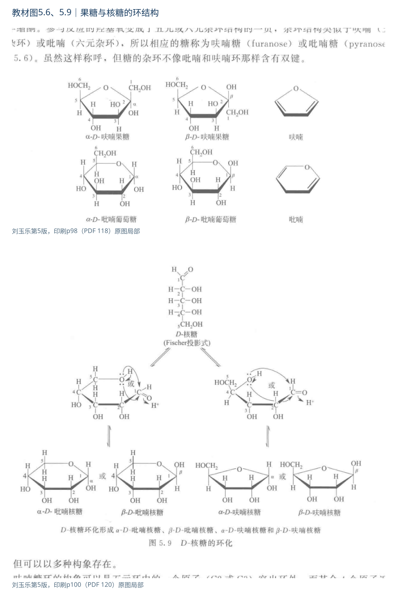
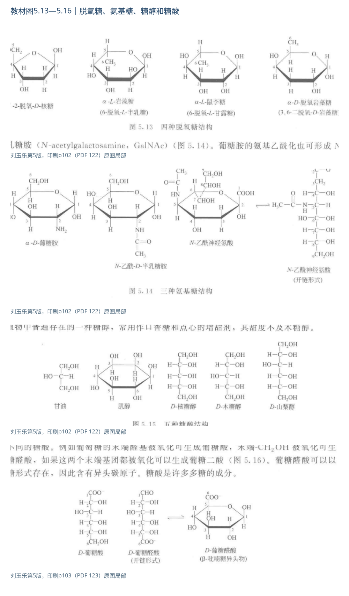
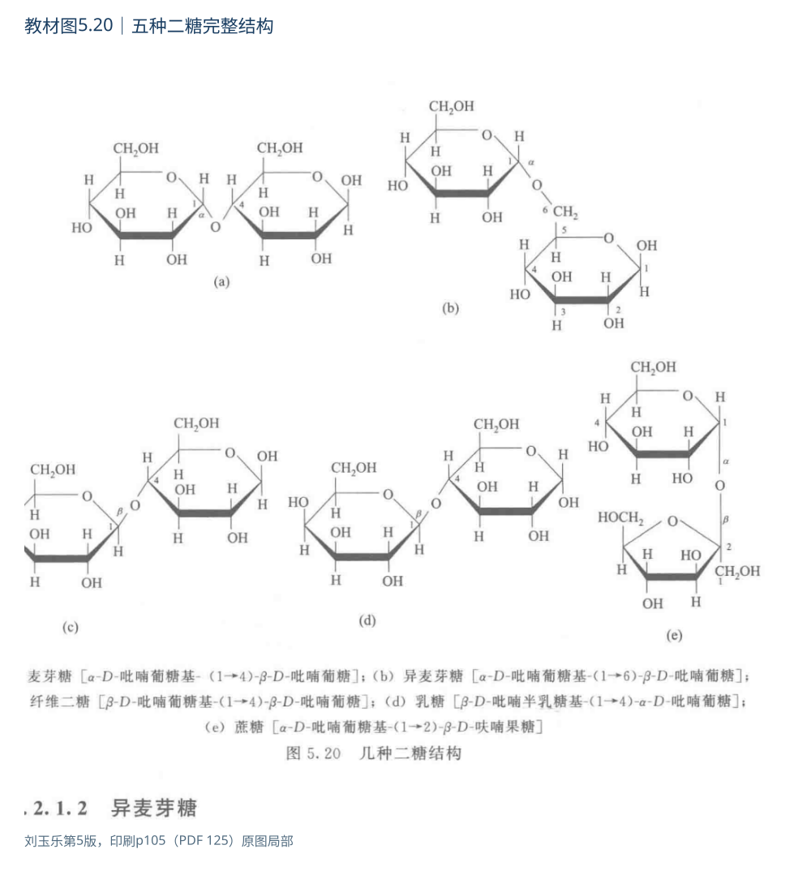
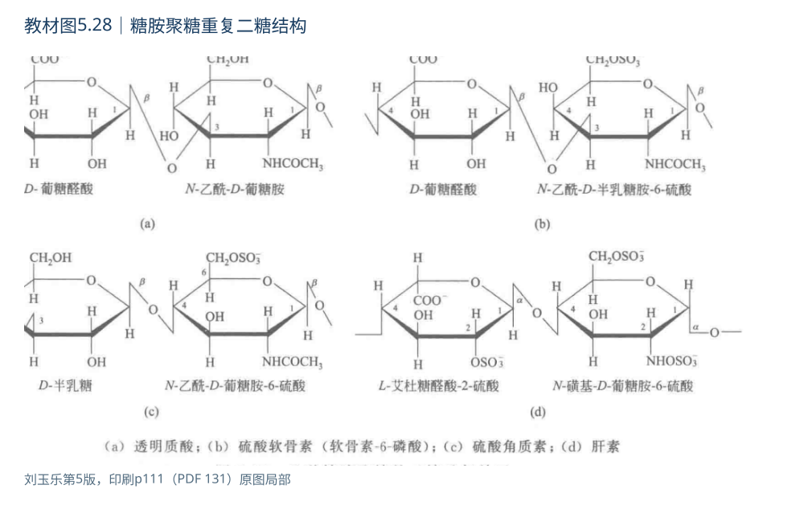
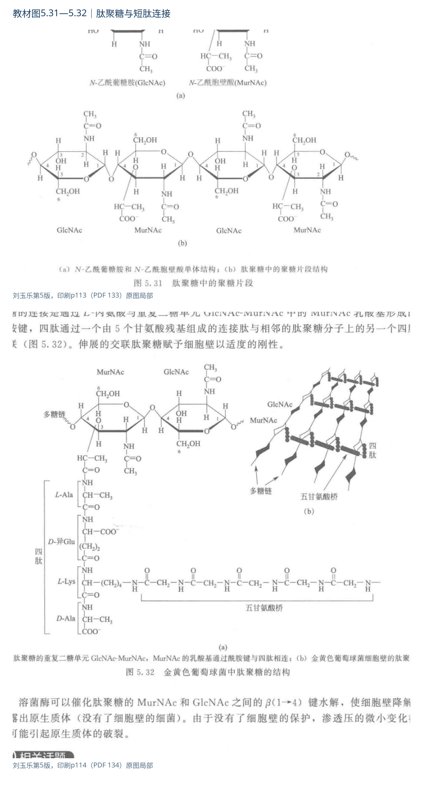
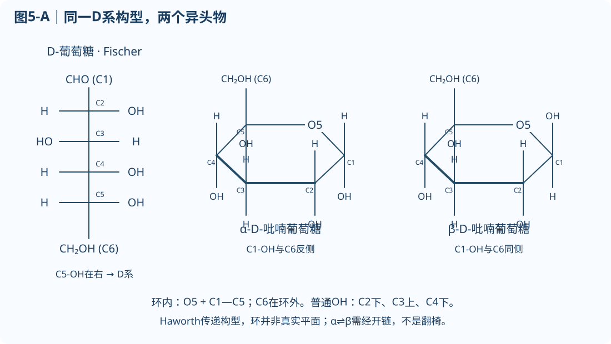
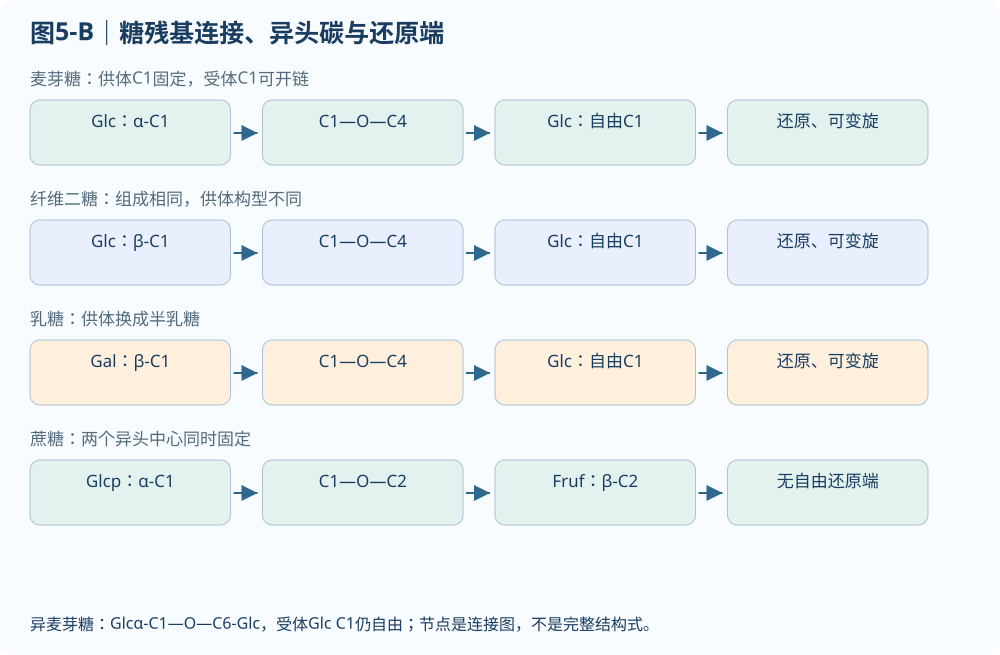
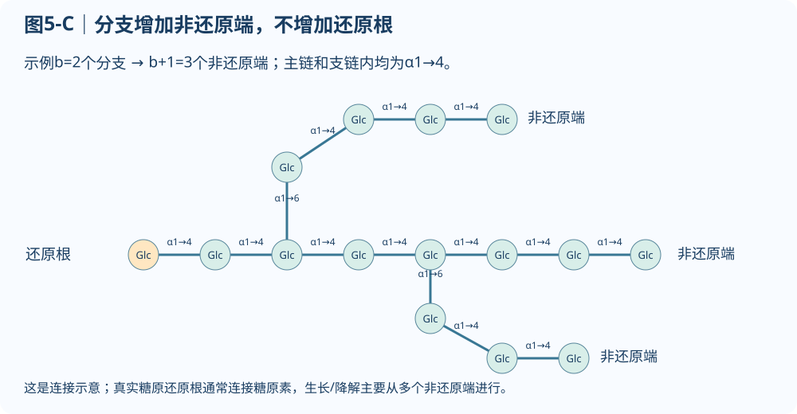
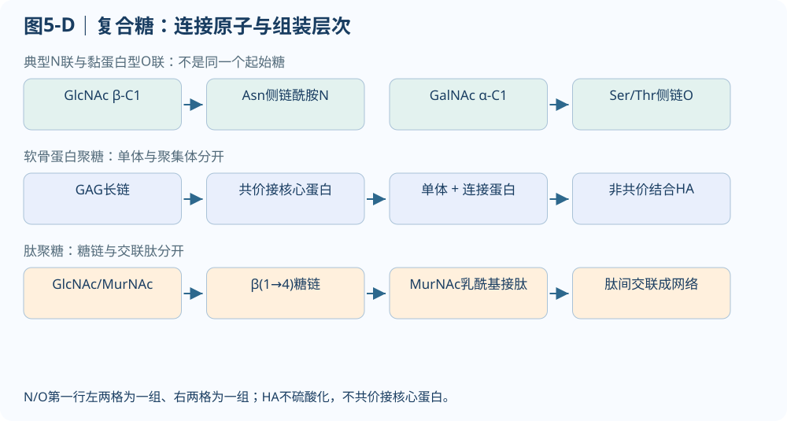

# 第5章 糖：从立体结构到连接、性质与功能

::: {.reading-section #guide}

## 考纲与使用说明

本章按官方5.1—5.4覆盖教材全部下级细目。按“开链定位→环化与构象→化学反应→糖苷键→多糖→复合糖”建立结构语言，再用同一结构解释性质和功能。

| 官方节点 | 教材完整细目 | 精讲及复习入口 |
|---|---|---|
| 5.1 单糖 | 5.1.1开链醛/酮糖；5.1.2环式；5.1.3构象；5.1.4五类衍生物；5.1.5氧化还原 | [精讲](#learn-5-1) · [背诵](#recite-5-1) |
| 5.2 二糖和糖苷 | 5.2.1麦芽糖、异麦芽糖、纤维二糖、乳糖、蔗糖；5.2.2还原/非还原糖；5.2.3核苷及其他糖苷 | [精讲](#learn-5-2) · [比较](#disaccharides) |
| 5.3 多糖 | 5.3.1淀粉与糖原；5.3.2纤维素、几丁质、糖胺聚糖 | [精讲](#learn-5-3) · [背诵](#recite-5-6) |
| 5.4 复合糖 | 5.4.1蛋白聚糖；5.4.2肽聚糖及青霉素话题；5.4.3 N/O联糖蛋白；ABO话题 | [精讲](#learn-5-4) · [比较](#glycoconjugate-table) |

[完整背诵](#recitation) · [比较与图解](#comparison) · [练习](#practice) · [教材11题解析](#textbook) · [来源与校订](#sources)

糖是多羟基醛、多羟基酮及其衍生物、缩合物的总称。“碳水化合物”来自经验式，但脱氧糖、氨基糖等不必符合(CH₂O)ₙ，符合者也不必是糖，如乙酸。按水解结果分单糖、寡糖、多糖；本教材以2—20个单位称寡糖，机构常取2—10，这属于约定差别。糖既作能源和储能形式，也作结构材料、合成碳源与信息载体；甜味不是定义，不能由“无甜味”排除多糖。

来源：教材p95；PPT5第2—5张；求臻第33讲全讲、专题5总结及专题9导图。官方来源为本地《2027清华841_官方考试大纲.pdf》生化部分。

### 阅读与自查方法

依次读精讲、结构图解和完整背诵；结构题先标碳号、异头中心与连接，再判断性质。第四部分保留基础与机制题，第五部分集中四道原有主观题及示范答案，第六部分给出其余练习解析。章节末用四项闭卷任务检查结构、反应、计量与复合糖。所有题目保留来源身份；本页不记录作答或学习状态。

:::

::: {.reading-section #lecture}

## 第一部分｜逐节完整精讲

### 5.1 单糖 {#learn-5-1}

#### 5.1.1 开链结构与立体异构 {#learn-5-1-1}

::: {.note-box .focus}

**重点｜本节必须掌握**

会编号、判D/L并区分结构异构、对映、差向与异头关系；异构体数先说明碳骨架及手性中心条件。

:::

开链醛糖的羰基在链端，编号为C1；酮糖的羰基在链内，应从使羰基编号较小的一端编号，例如果糖羰基为C2，不能把酮糖也从羰基直接编号1。三碳醛糖甘油醛有一个手性碳，三碳酮糖二羟丙酮没有手性碳。四碳糖、五碳糖、六碳糖分别称丁糖、戊糖、己糖；“己酮糖”同时给出碳数和羰基类型。

##### Fischer投影与D/L构型

::: {.note-box .danger}

**易错提醒｜D/L与旋光方向无必然联系**

Fischer投影把碳链竖放、较高氧化态端朝上；横键朝向观察者，竖键背向观察者。对常见单糖，离羰基最远的手性碳，其OH在右为D系、在左为L系。这个判据不能简化成“最后一个碳”，因为末端CH₂OH通常不手性；也不等于旋光方向，D-果糖可左旋。把整张Fischer式在纸面转180°保持所代表构型，转90°通常改变构型；任意交换两个取代基会反转该中心。

:::

##### 立体异构体计数与差向异构体

有n个独立手性中心、无内对称等简并时，最多有2ⁿ种立体异构体。常见开链醛糖含m个碳时有m−2个手性中心，2-酮糖有m−3个；己醛糖16种、D系8种，己酮糖8种、D系4种。这是在比较某一碳骨架家族，不能说“D-葡萄糖自己还有8种D-葡萄糖”。具体D-葡萄糖的各中心构型已经固定。

对映体互为不可重合镜像，如D/L葡萄糖，全部对应手性中心相反。非对映体不是镜像关系；差向异构体是其中仅一个手性中心不同的一对。D-甘露糖与D-葡萄糖差在C2，D-半乳糖与D-葡萄糖差在C4；D-甘露糖和D-半乳糖相差两个中心，不互为差向异构体。醛糖和酮糖互为结构异构体，不是只改变一个手性中心的差向异构体。

下面“右/左”依次写出各手性碳OH在标准Fischer式中的方向，可据此重新画出教材图5.2、5.4，而不是只记名称。

| 家族 | D系成员：OH顺序 |
|---|---|
| 丁醛糖，C2—C3 | 赤藓糖右右；苏糖左右 |
| 戊醛糖，C2—C4 | 核糖右右右；阿拉伯糖左右右；木糖右左右；来苏糖左左右 |
| 己醛糖，C2—C5 | 阿洛糖右右右右；阿卓糖左右右右；葡萄糖右左右右；甘露糖左左右右；古洛糖右右左右；艾杜糖左右左右；半乳糖右左左右；塔罗糖左左左右 |
| 丁酮糖，C3 | 赤藓酮糖右 |
| 戊酮糖，C3—C4 | 核酮糖右右；木酮糖左右 |
| 己酮糖，C3—C5 | 阿洛酮糖右右右；果糖左右右；山梨糖右左右；塔格糖左左右 |

来源：教材p95—97图5.1—5.4；PPT5第5—9张；求臻第34讲第2—14张；秃哥基础笔记p40、上册讲义p87—89、名词解释p25—26。表中译名随教材；阿洛酮糖亦称阿卢糖/阿洛酮糖，须结合结构认定。

#### 5.1.2 环式结构与变旋 {#learn-5-1-2}

::: {.note-box .focus}

**重点｜本节必须掌握**

追踪环氧和异头碳的原子来源，独立转换Fischer与Haworth式，并用开链平衡解释变旋。

**考查问法：**由环化与平衡解释异头物、变旋和检测结果。

**答题展开：**先标异头碳与环氧→比较α/β→说明开链互变；将平衡补给用于解释β特异酶检测总量。 [→ 教材5-3 动态平衡](#t5-03)

资料联系：分章笔记Word段934—941；教材第5章习题2—3。

:::

::: {.note-box .info}

**机制难点｜环化中的原子去向**

葡萄糖C5羟基氧亲核进攻C1醛基，形成分子内半缩醛。环内依次为O5、C1、C2、C3、C4、C5，共六元，C6仍在环外，所以“吡喃己糖”不是六个碳组成的环。原羰基氧成为C1上的羟基，C5羟基氧成为环氧；成环本身是分子内加成，**不净脱一分子水**。当这个半缩醛再与醇形成糖苷时，才可按缩合关系记脱水。

:::

果糖C5羟基可进攻C2羰基，形成五元呋喃环，C2为异头碳，C1与C6均可在环外；C6羟基参加则可形成吡喃环。核糖既有呋喃也有吡喃形式，游离溶液中最丰形式不决定所有结合状态；核苷酸中常见β-D-呋喃核糖，DNA则为β-D-2-脱氧呋喃核糖。

##### 异头构型与Haworth表达

::: {.note-box .danger}

**易错提醒｜α/β判断的参照与画法**

平面的羰基从两面受进攻后，新生异头碳产生α、β两种构型。对常见D系列糖的标准Haworth画法，参照末端CH₂OH在上，异头OH与它反侧为α、同侧为β，即通常α下β上；L系列相应方向反转。这个快捷判断须限定参照基团与标准画法；不能把图旋转后仍机械看纸面“上/下”。异头物只差异头中心，是特殊的差向异构体，不是D/L对映体。

:::

从Fischer转标准Haworth：保留碳号；确认哪一个OH闭环；普通取代基按“右下、左上”放置；确定D/L参照取代基；最后分别补α/β异头OH。参与闭环的羟基不再以原OH原样保留在那个碳上。Haworth式中粗线表示近侧边，并非双键；它传递相对构型，不表示环真实平面。

##### 变旋与动态平衡

::: {.note-box .info}

**机制难点｜异头物与开链平衡**

变旋是新配糖溶液的比旋光度随异头物互变趋向平衡而改变。α与β通常通过开链中间态互变，故不是“环翻椅式就变成另一异头物”，也不要求右旋变左旋。教材31℃数据约β吡喃葡萄糖63%、α36%，余量为其他形式；PPT常用64/36是近似口径。纯α起始比旋约＋112°，β约＋18.7°，水溶液趋近＋52.7°，数值必须带溶剂、温度及平衡条件。异头碳被固定成稳定糖苷且无其他自由还原端时，不再按这个机制变旋。

:::

来源：教材p97—100图5.5—5.10；PPT5第10—17张；求臻第34讲第16—24张、第35讲第2—5张。补核：[OpenStax环状单糖与异头物](https://openstax.org/books/organic-chemistry/pages/25-5-cyclic-structures-of-monosaccharides-anomers)。

::: {.structure-reference}

{#fig-5-rings-structures}

:::

#### 5.1.3 构象 {#learn-5-1-3}

::: {.note-box .focus}

**重点｜本节必须掌握**

分清上下方向与轴/平伏：环翻转改变构象，不改变既有立体中心的构型。

:::

构型描述立体中心的固定空间关系；构象是在不改变连接关系和这些立体中心构型的情况下，由单键旋转等产生的不同空间形态。吡喃糖有椅式、船式等构象，常见椅式更能避免扭转和立体排斥；并非只要“环有六元”就所有取代糖均同一构象最稳定。D-葡萄糖主要⁴C₁椅式中，β异头物的体积较大取代基均能占平伏位置，α的异头OH为轴向，帮助解释水中β较多。稳定性还受异头效应、溶剂等影响，不能把平伏规则绝对化。

##### 环翻转与构型保持

::: {.note-box .danger}

**易错提醒｜翻椅不是异头化**

椅式翻转会把轴向和平伏互换，但基团原来朝上还是朝下保持，α也不会因此变β。呋喃糖五元环常以信封或扭式起伏，核糖C2′/C3′的起伏联系核酸骨架几何。解释结构时要分清D/L、α/β、吡喃/呋喃、椅式/船式四套问题，分别涉及系列构型、异头中心、成环连接和构象。

:::

来源：教材p99—101图5.10—5.11；PPT5第18—19张；求臻第34讲第21—22张；生化老头专题训练p34构象判断。核酸联系参见本地第7章PPT核糖/脱氧核糖及构象部分。

#### 5.1.4 单糖衍生物 {#learn-5-1-4}

::: {.note-box .focus}

**重点｜本节必须掌握**

每种衍生物都回答“哪一碳、哪一官能团改变”，尤其区分糖醇、葡糖酸与葡糖醛酸。

:::

**5.1.4.1 单糖磷酸酯。**羟基与磷酸形成酯，位置必须标清，葡糖-1-磷酸与葡糖-6-磷酸不是同物。带负电磷酸基使糖较难自由穿过疏水膜，可将其保留在细胞内，同时改变酶识别与后续反应性。ATP驱动的磷酸化把糖送入特定代谢路径，但“糖已磷酸化”不等于“都是高能磷酸化合物”。UDP-葡萄糖等核苷二磷酸糖提供活化糖基，把糖基转移与适当离去基团联系起来，后续糖原合成复用这一语言。

**5.1.4.2 脱氧糖。**羟基被氢代替；2-脱氧核糖的C2从CHOH变为CH₂，不再是相应手性中心。6-脱氧L-半乳糖为L-岩藻糖，6-脱氧L-甘露糖为L-鼠李糖。二者显示生物糖并非全是D系；“脱氧”也不等于整个分子没有氧。

**5.1.4.3 氨基糖。**常见是C2羟基被氨基替换，随后氨基可乙酰化，形成GlcNAc、GalNAc。正确关系为半乳糖先形成半乳糖胺，再N-乙酰化；教材“半乳糖乙酰化即GalNAc”漏掉氨基化这一层。GlcNAc是几丁质和肽聚糖的重要构件；GalNAc常作为黏蛋白型O糖链起始糖。唾液酸是一组九碳酸性单糖，Neu5Ac为常见代表，常位于糖蛋白、神经节苷脂糖链末端，影响识别和清除；不能把所有唾液酸都等同于唯一Neu5Ac。

**5.1.4.4 糖醇。**羰基还原成羟基，如葡萄糖→山梨糖醇，核糖→核糖醇，木糖→木糖醇。酮糖还原时原平面羰基可从两面受氢，产生不同立体产物，果糖可生成山梨糖醇与甘露糖醇。甘油及环状多羟基化合物肌醇联系脂质，核糖醇联系FMN/FAD及磷壁酸。不是所有糖醇都无旋光性，需检查产物内对称；糖醇甜味也不意味着与葡萄糖有同一代谢途径。

**5.1.4.5 糖酸。**葡萄糖C1醛基氧化形成葡糖酸，C6伯醇氧化形成葡糖醛酸，两端均氧化为葡糖二酸。广义糖酸包括不同氧化位置，不能把aldonic acid一个术语覆盖所有糖酸。葡糖醛酸仍可保留C1半缩醛、形成环式并参与糖苷键，其C6羧基赋予负电性，联系GAG及结合反应。C1氧化后失去原来的可逆半缩醛中心，其内酯为环酯，不应再当作同一个α/β异头平衡。

来源：教材p101—103图5.12—5.16；PPT5第20—24张；求臻小题p65—69与背诵手册p100—103；秃哥上册p90—95及生化老头名词解释p37—40。与辅酶及核酸的联系来自对应教材章节和本地PPT。

::: {.structure-reference}

{#fig-5-derivative-structures}

:::

#### 5.1.5 氧化还原与其他化学反应 {#learn-5-1-5}

::: {.note-box .focus}

**重点｜本节必须掌握**

还原性判断必须同时给结构与试剂条件，区分碱性铜/银试验、非碱性氧化和酶的专一检测。

:::

游离葡萄糖主要环化存在，但少量开链醛不断被氧化剂消耗后，环式继续开链补给，因此整份糖可显示还原性。Fehling/Benedict体系中Cu²⁺被还原、生成Cu₂O沉淀；Tollens银氨体系生成金属银。常用有机反应简式为R—CHO＋2Cu²⁺＋5OH⁻→R—COO⁻＋Cu₂O↓＋3H₂O。这是碱性试剂中的形式配平，实际试剂还含络合剂；颜色不应只由“Cu⁺水溶液”解释。还原糖中的“还原”说的是糖把试剂还原，自身被氧化。

##### 还原性与试剂条件

::: {.note-box .info}

**机制难点｜酮糖为何可呈还原性**

果糖虽为酮糖，在这些碱性条件下可经烯二醇中间体与葡萄糖、甘露糖互变，因此呈还原反应。果糖变旋则来自自身开链—环式与异头平衡，不能归因于“必须先变葡萄糖”。温和非碱性溴水氧化醛糖与碱性铜/银试验的适用性不同；特定酶如葡萄糖氧化酶的底物专一性又不同，不能把所有“检测糖”的方法等同。强氧化可同时影响两端；还原羰基则得到糖醇。

:::

##### 糖脎与显色反应

资料中另外反复出现以下反应，可用官能团统一解释：酯化/醚化修饰普通羟基；酸催化与醇生成糖苷固定异头中心；苯肼在还原糖C1/C2形成糖脎，葡萄糖、甘露糖、果糖可形成相同糖脎，故糖脎不能区分这三者；强酸使戊糖生成糠醛、己糖生成羟甲基糠醛，再与酚类显色，Molisch/蒽酮等利用这种原理。样品中核酸等含糖物质也可能响应，不能由总糖显色直接鉴定某种单糖。求臻小题出现的“Tollen戊糖显色”与Tollens银镜试验名称相近但不是同一反应，答题要写试剂及原理，避免混名。

来源：教材p103—104图5.17—5.18；求臻小题p65—69；秃哥基础笔记p41、上册p90—91；生化老头核心版相关糖类检测及专题训练p34。补核：[OpenStax单糖反应](https://openstax.org/books/organic-chemistry/pages/25-6-reactions-of-monosaccharides)。

### 5.2 二糖和糖苷 {#learn-5-2}

糖的异头中心与醇等形成缩醛/缩酮式糖苷连接，分子分为糖基和配基；配基可为非糖，也可为另一个糖。按连接原子有O、N、S、C糖苷。描述一个糖苷键，至少包含供体糖、异头构型、供体碳号、受体碳号/原子及受体名称。Glcα(1→4)Glc表示供体Glc的C1经氧连到受体C4，**不限定受体游离异头OH永远为α**。

普通O糖苷异头中心在中性水中不再像半缩醛那样自行开链；适当酸或特异糖苷酶可水解。但C糖苷以C—C连接，不能把O糖苷的水解规则直接照搬。生物合成通常由糖基转移酶使用活化供体完成，不能理解为体内两个游离糖在水中自行高效脱水。

#### 5.2.1 代表性二糖 {#disaccharides}

::: {.note-box .focus}

**重点｜本节必须掌握**

五种二糖均要能写出单体、供体构型和连接碳号，圈出自由异头中心，再判断还原性与变旋。

:::

| 教材细目 | 结构与连接 | 自由异头碳 | 性质和生物学联系 |
|---|---|---|---|
| 5.2.1.1 麦芽糖 | Glcα(1→4)Glc | 第二个Glc的C1 | 还原、变旋；淀粉降解相关 |
| 5.2.1.2 异麦芽糖 | Glcα(1→6)Glc | 受体Glc的C1 | 还原、变旋；对应分支连接类型 |
| 5.2.1.3 纤维二糖 | Glcβ(1→4)Glc | 第二个Glc的C1 | 还原、变旋；纤维素重复二糖 |
| 5.2.1.4 乳糖 | Galβ(1→4)Glc | Glc的C1 | 还原、变旋；乳糖酶水解产生Gal与Glc |
| 5.2.1.5 蔗糖 | α-D-Glcp-(1↔2)-β-D-Fruf | 无 | 非还原、无自身变旋；水解产生Glc与Fru |

Glcp代表吡喃葡糖，Fruf代表呋喃果糖。蔗糖两端都是异头中心，写双向连接能提醒它不同于普通1→4键。两个己糖缩合形成二糖的相对分子质量为180×2−18＝342；“都是两个糖所以都是360”漏掉脱水。麦芽糖、乳糖的α/β名称如用来表示还原端异头物，不能用它改写固定的供体糖苷键构型。

##### 结构与生理实例

乳糖不耐受通常涉及小肠乳糖酶活性不足，未消化乳糖增加肠腔渗透负荷并在结肠发酵，产生腹胀、产气及腹泻等。它不同于牛奶蛋白过敏。发酵乳可降低部分乳糖并提供菌源酶，但含量与耐受程度因产品和个体而异；“所有乳糖不耐受都是常染色体隐性遗传病”“酸奶乳糖已全部用完”均过度概括。乳糖晶型与溶解行为联系食品质地，教材对α/β乳糖溶解度和冰淇淋砂感的说法不宜作为无条件定律，实际还受水合状态、温度及结晶条件影响。

来源：教材p104—106图5.19—5.20；PPT5第29—38张；求臻第35讲第5—10张；秃哥上册p91—93、老头核心版p24。二糖结构均按原图核对；教材乳糖正文与图注的α/β还原端标注不一致时，以画出的结构和所指碳为准。

::: {.structure-reference}

{#fig-5-disaccharide-structures}

:::

#### 5.2.2 还原糖和非还原糖 {#learn-5-2-2}

::: {.note-box .focus}

**重点｜本节必须掌握**

区分“结构上存在还原端”“检测是否明显”与“是否先水解”，蔗糖水解产物的性质不能代替原分子性质。

**考查问法：**从自由异头中心推导还原性及水解前后差异。

**答题展开：**圈参与糖苷键的异头碳→找剩余自由中心→加试剂与水解条件→给性质结论。 [→ P5-05 结构与性质](#p5-05)

资料联系：教材5.2及习题5；此处按教材完整范围训练。

:::

对本章常见糖，先检查是否有能够开链的游离半缩醛/半缩酮中心，再考虑试剂条件。麦芽糖虽已有一条糖苷键，另一C1仍可开链，故还原；蔗糖的Glc C1与Fru C2均固定，故未经水解时不发生典型还原糖反应。蔗糖经酸或酶水解后产生还原糖，这不等于蔗糖分子本身已变成还原糖。蔗糖水解后溶液旋光由正转负的“转化”还联系葡萄糖与果糖的比旋贡献，不同于未水解单糖的变旋。

::: {.note-box .danger}

**易错提醒｜自由中心与检出强弱**

“糖苷都无还原性”只在所讨论分子没有其他游离还原中心时适用；麦芽糖本身就是含糖苷连接的还原糖。环糊精由葡糖α(1→4)首尾环接，无游离还原端，海藻糖两Glc异头碳以α,α(1↔1)相连，也非还原。多糖常有一个潜在还原端，但每单位质量的还原端极少，普通定性试验常不明显；严谨表述是“结构上具有还原端，宏观检出弱”，不能把现象简化成完全不存在该官能团。天然糖原还原端通常与糖原素共价结合，进一步限制自由还原性。

:::

来源：教材p106；PPT5第37—40张；求臻小题p66—74及背诵p100；生化老头每日一题第336—337段。多糖官能团与检出灵敏度分开解释，修正机构“有一个还原端所以绝无还原性”的表达。

#### 5.2.3 核苷和其他糖苷 {#learn-5-2-3}

::: {.note-box .focus}

**重点｜本节必须掌握**

从连接原子识别O/N/C等糖苷；核苷、核苷酸、含核苷酸的辅酶与脂多糖分别归类。

:::

典型核苷由β-D-呋喃核糖或2-脱氧核糖的C1′与碱基氮相连；嘌呤常连N9，嘧啶常连N1，加磷酸才成为核苷酸。假尿苷是特殊C糖苷，不能称“糖与假尿嘧啶结合”而忽略真正C—C连接。NAD、FAD含核苷酸组成部分且有糖苷连接，但整个分子不宜简单归类为一个普通核苷。香草醛糖苷说明糖可连接非糖小分子；半乳糖基甘油说明糖也可与脂质相关骨架结合。糖脂及革兰氏阴性菌外膜脂多糖扩展“糖缀合物”范围；脂多糖含脂质A、核心区和O抗原，不能与N/O联糖蛋白或肽聚糖混称。

来源：教材p106图5.21；PPT5第39张；本地核酸第7章PPT、求臻核酸专题及老头名词解释p2、37—40。教材“NAD和FAD也都是核苷”的分类口径在此改为含核苷酸结构的辅酶。

### 5.3 多糖 {#learn-5-3}

同多糖水解给出一种单糖或其衍生物，几丁质虽含氮仍是同多糖；杂多糖含多种构件。按功能又分储存和结构多糖，两种分类维度不能相互替代。糖链合成通常没有核酸式直接序列模板，但受糖基转移酶、供体、细胞定位和调节控制，不能说糖链与基因毫无关系。许多结构糖链在膜或分泌体系中边合成边输出，教材“全都先在胞内完成再分泌”不作为普遍机制。

#### 5.3.1 淀粉与糖原 {#learn-5-3-1}

::: {.note-box .focus}

**重点｜本节必须掌握**

用主链、分支和末端解释储存多糖的功能；质量计算先判无环连通条件，再数缩合次数。

**考查问法：**由糖原话题联系分支、末端与加工方向。

**答题展开：**本章先掌握储存结构、两类末端及计量；肌糖原与血糖之间的代谢步骤留在相应代谢章节展开。 [→ 教材5-8 末端加工](#t5-08)

资料联系：《841模拟卷三》Word段78为跨章联系；本题据教材第5章习题8。

:::

::: {.note-box .note}

**校订｜储存多糖需对应生物背景**

分类校订：教材把植物和真菌概括为淀粉主要储存者并不普遍；许多真菌以糖原为主要储存多糖。复习时把植物常见淀粉、动物及许多真菌的糖原与具体生物背景对应。

:::

**5.3.1.1 淀粉。**直链淀粉主要由Glc以α(1→4)连接，链的键角允许形成螺旋；教材以每圈约6个残基说明碘/多碘物种进入螺旋通道后的显色。显色还取决于连续链长、浓度和条件，不应把“形成一圈”直接当“必出现特征蓝色”的充分条件。支链淀粉主链同为α(1→4)，分支是α(1→6)，教材平均约25个残基有分支、支链约15—25，其他资料给12—25，是来源和统计口径差别，不是每条分子固定间隔。直/支链比例随植物和材料而变，1∶4仅是常用近似。

::: {.note-box .danger}

**易错提醒｜酶名α/β不等于底物键构型**

淀粉颗粒蒸煮吸水膨胀，使酶更易接近；冷却回生等又能改变可及性。α-淀粉酶为内切α(1→4)水解酶，产生麦芽糖、麦芽三糖及不同糊精；β-淀粉酶从非还原端逐次释放麦芽糖。**酶名β不是它切β糖苷键**，两者都不负责α(1→6)分支键，遇分支留下极限糊精，需要脱支活性继续处理。β-淀粉酶存在于某些植物和微生物，不是人体消化淀粉的主要酶。生物体系内糖原磷酸化酶又是磷酸解，不能与消化道淀粉酶水解同写一个产物。

:::

**5.3.1.2 糖原。**主链α(1→4)、分支α(1→6)，教材约每8—10残基分支，较支链淀粉更密，产生许多非还原端。多条酶可同时在这些末端加工，有利于快速动员和合成；聚成一大分子还显著降低同量游离葡萄糖对渗透压的贡献。糖原为短期、易动员储备，不是单位质量储能最高形式。肝糖原联系血糖维持，肌糖原主要就地供肌收缩，不能把两者功能完全相同化。

##### 糖原端基与加工方向

::: {.note-box .info}

**机制难点｜分支、端基与并行加工**

树状、无环、单一连通的理想糖原有一个还原端；若有b个普通二分支点，非还原端数为b＋1。糖原素以酪氨酸侧链与起始糖共价结合，故天然分子的还原端不是任意游离醛。合成酶从非还原端加糖，磷酸化酶也从非还原端释放葡糖-1-磷酸，分支点需脱支酶，部分分支葡萄糖以游离形式释放。末端多提高并行能力，不意味着速率只由末端数决定。

:::

来源：教材p107—109图5.22—5.25；PPT5第40—50张；求臻第35讲第11—16张；秃哥基础笔记p42、上册p93、下册p36—38；生化老头核心版p24—25。碘色的条件核对见教材题7；PPT渗透压示例用于定性比较，不把其具体数量当普适生理参数。

#### 5.3.2 结构多糖与糖胺聚糖 {#learn-5-3-2}

::: {.note-box .focus}

**重点｜本节必须掌握**

掌握纤维素/几丁质的单体与β1→4连接；GAG按组成、负电来源和关键例外比较。

**考查问法：**从单体与键型辨认纤维素，再解释酶专一性和功能。

**答题展开：**D-Glc→β1→4→伸展链与纤维组织→所需酶系统；相同单体不等于相同性质。 [→ P5-13 资料改编](#p5-13)

资料联系：《841模拟卷二》Word段29—30；本题保留改编来源。

:::

**5.3.2.1 纤维素。**由D-Glc以β(1→4)连接的线性同多糖，相邻残基相对翻转，形成伸展链；链内与链间氢键等相互作用支持微原纤维，提供强度。它与淀粉的组成可同为葡萄糖，差别在糖苷构型和空间组织。人体消化体系缺少能有效降解膳食纤维素的纤维素酶系统，α/β淀粉酶均不能替代；不能扩大为“人体没有任何β-葡糖苷酶”。反刍动物借助共生微生物发酵纤维素，主要吸收利用挥发性脂肪酸等产物，不能简单说全部纤维素直接变成葡萄糖进入血液。

**5.3.2.2 几丁质。**GlcNAc以β(1→4)连接，虽重复单位有乙酰氨基，仍是同多糖，存在于节肢动物外骨骼和许多真菌细胞壁。氢键及与蛋白、无机组分结合赋予材料强度。部分去N-乙酰化得壳聚糖；游离氨基在适当偏酸条件下质子化，可带正电并参与吸附。它不是在所有pH下都恒定正电，也不能把“可作某材料”直接写成任何制剂安全有效。

::: {.note-box .note}

**校订｜HA与KS两类例外**

**5.3.2.3 糖胺聚糖GAG。**通常为重复二糖形成的线性杂多糖，多由氨基糖与糖醛酸组成，**硫酸角质素以Gal取代糖醛酸**是重要例外。羧酸基和硫酸基在生理条件下带负电，吸引反离子和水；链内电荷排斥及水化使链扩展，形成有黏弹性的胞外环境。透明质酸无硫酸基，但仍有羧基，不是无负电荷。

:::

| GAG | 代表组成和连接 | 关键辨认与功能 |
|---|---|---|
| 透明质酸HA | [GlcAβ(1→3)GlcNAcβ(1→4)]ₙ | 不硫酸化；不共价接核心蛋白；关节液、玻璃体、胞外基质 |
| 硫酸软骨素CS | [GlcAβ(1→3)GalNAcβ(1→4)]ₙ，GalNAc可4/6-O-硫酸化 | 软骨承压、水化；硫酸化位置不是另换单糖骨架 |
| 硫酸皮肤素DS | 常含IdoA与GalNAc，含不同硫酸化 | IdoA可α(1→3)连GalNAc，后者β(1→4)续接；组织柔韧性 |
| 硫酸角质素KS | [Galβ(1→4)GlcNAcβ(1→3)]ₙ，常6-O-硫酸化 | 不含糖醛酸；角膜、软骨等；不能仅凭中文“角质”判其位置 |
| 肝素/硫酸乙酰肝素HS | 葡糖胺与GlcA/IdoA，含N/O硫酸化，链上存在异质区段 | 肝素常高度硫酸化；HS分布于细胞表面及基质，参与配体结合和信号 |

##### 肝素的结构与抗凝联系

肝素的典型高度硫酸化片段含IdoA2Sα(1→4)GlcNS6S，葡糖胺α(1→4)续接；整条链并非每处完全相同。肝素与肥大细胞颗粒相关，教材“柱状细胞”应改正。其抗凝涉及特定序列与抗凝血酶结合后增强对凝血蛋白酶的抑制，不能仅写成“负电荷把钙全吸走”，也不能把所有HS和GAG都视为同效抗凝剂。维生素K支持凝血蛋白γ-羧化，肝素则作用于抗凝系统，这是跨章比较的好例子。

来源：教材p109—111图5.26—5.28；PPT5第51—54张；求臻导图、背诵p102—103；秃哥基础笔记p42、上册p93—95。定向核对：[Essentials of Glycobiology第4版第17章](https://www.ncbi.nlm.nih.gov/books/NBK579925/)，本次部分全文访问受限，使用可读检索段落核对GAG组成、HA非共价及KS例外；肥大细胞另核[原始研究摘要](https://pubmed.ncbi.nlm.nih.gov/2876188/)。

::: {.structure-reference}

{#fig-5-gag-structures}

:::

#### 补充多糖实例 {#learn-5-other-polysaccharides}

右旋糖酐dextran是葡聚糖的一类，常以α(1→6)主链并有依来源不同的分支，不能由“葡聚糖”三个字就认定是淀粉；细菌胞外葡聚糖可联系黏附与牙菌斑。菊粉inulin是以β(2→1)果糖基连接为主的果聚糖，末端可有葡糖基，显示植物储存糖不只有淀粉。半纤维素是一组与植物细胞壁纤维素相关的不同多糖，如木聚糖、木葡聚糖等，不是“更短的纤维素”的统一化学名称；果胶富含半乳糖醛酸并有不同主链/侧链区段，羧基及其酯化状态影响凝胶性质。琼脂是红藻来源半乳聚糖材料，琼脂糖的交替半乳糖/脱水半乳糖结构与形成凝胶有关，不归为葡萄糖储存同多糖。

这些条目来自秃哥基础笔记p42、上册p93和求臻糖类引言/导图。按单体、键型、分支和功能定位即可，不把每种材料的工业参数纳入841必背范围。

### 5.4 复合糖 {#learn-5-4}

复合糖/糖缀合物是糖与非糖成分结合的分子，本章展开蛋白聚糖、肽聚糖和糖蛋白，相关资料补入糖脂与脂多糖作边界比较。糖链通过单糖种类、异头构型、连接位点、分支及修饰形成多样识别表面；糖密码不等于像DNA那样逐位对应氨基酸的遗传密码。糖链可参与黏附、迁移、免疫、蛋白折叠与运输，但具体功能须联系相应结构和结合蛋白。

#### 5.4.1 蛋白聚糖 {#learn-5-4-1}

::: {.note-box .focus}

**重点｜本节必须掌握**

分清核心蛋白—GAG的共价连接与HA聚集体的非共价组装，解释水化和抗压。

**考查问法：**用分子结构解释水化体积和抗压作用。

**答题展开：**负电基团→反离子和水化→糖链扩展→胶原网络约束→受压与复水；共价连接与非共价聚集分开。 [→ 教材5-11 水化缓冲](#t5-11)

资料联系：教材5.4.1及第5章习题11；此处按教材完整范围训练。

:::

蛋白聚糖由核心蛋白与一条或多条GAG共价连接而成。许多CS/DS链经木糖—半乳糖—半乳糖—葡糖醛酸连接区接至核心蛋白Ser；KS有不同连接类型，不把同一连接区套给所有GAG。软骨聚集蛋白聚糖的核心蛋白携带CS、KS等，呈瓶刷状；多个单体通过其结合区域及连接蛋白非共价附着在HA主链，形成巨大聚集体。HA自己既不硫酸化，也不因加入聚集体而变成共价接核心蛋白的GAG。

::: {.note-box .info}

**机制难点｜水化体系如何承压**

带负电的糖链、反离子与水共同形成膨胀的水化体系，胶原网络约束其膨胀；受压时流体移动、减压时再水化，使组织承压和缓冲。营养物扩散与负荷引起的流体运动都重要，教材“完全靠运动滋养”是过度简化。蛋白聚糖不只作填充物，也可结合生长因子并调节信号。其糖比例通常高，但糖比例不是蛋白聚糖与普通糖蛋白分类的唯一判据，关键还在GAG链类型与组织方式。

:::

来源：教材p112图5.29；PPT5第55—59张；求臻背诵p102；秃哥上册p95；Essentials第17章可读段落用于HA连接边界核对。

#### 5.4.2 肽聚糖及青霉素 {#learn-5-4-2}

::: {.note-box .focus}

**重点｜本节必须掌握**

分别定位糖苷键、MurNAc连接短肽及肽交联，比较溶菌酶与青霉素的作用层次。

:::

肽聚糖的糖链由GlcNAc与MurNAc以β(1→4)交替连接。MurNAc可看作GlcNAc C3氧上增加乳酰基；乳酰基羧基与短肽起始L-Ala形成酰胺键，而不是肽直接接在所有GlcNAc上。教材金黄色葡萄球菌成熟结构的肽可写L-Ala—D-isoGlu—L-Lys—D-Ala，其中γ-羧基连接和D-氨基酸不能按普通蛋白全L、全α肽链理解。五甘氨酸桥是这种菌的代表，不是所有细菌通用；其他菌可用直接交联或不同桥。

##### 糖链水解与肽交联抑制

::: {.note-box .info}

**机制难点｜切糖链与抑制肽交联**

溶菌酶水解MurNAc与GlcNAc之间特定β(1→4)糖苷键，直接破坏既有糖链；青霉素的β-内酰胺结构可与青霉素结合蛋白/转肽酶形成共价失活复合物，抑制新生肽聚糖交联。二者一个切糖链，一个阻断肽交联，不能把青霉素写成水解五甘氨酸桥的酶。缺壁细胞在低渗环境中易裂解，但在适当渗透保护条件下不必立即破裂。

:::

革兰氏阳性菌通常肽聚糖厚，阴性菌肽聚糖较薄且外有外膜。药敏差异还取决于通透性、靶蛋白、外排和耐药机制，不是“阴性菌主要不用肽聚糖所以所有青霉素都无效”。β-内酰胺酶可开环使某些药物失活，其基因既可在质粒也可在染色体；并非所有耐药都由这一种酶造成。真核细胞无肽聚糖转肽靶点说明选择性基础，不等于青霉素对人绝无其他作用。

来源：教材p113—115图5.30—5.33及青霉素话题；PPT5第60—67张；求臻背诵p100、小题p66—69；秃哥及老头相关名词条目。

::: {.structure-reference}

{#fig-5-peptido-structures}

:::

#### 5.4.3 糖蛋白与糖链功能 {#learn-5-4-3}

::: {.note-box .focus}

**重点｜本节必须掌握**

N/O连接写出具体糖和氨基酸原子；常见序列只是潜在位点，功能判断仍需结构证据。

:::

::: {.note-box .note}

**校订｜典型N连接与潜在位点**

**5.4.3.1 N联糖蛋白。**哺乳动物典型N糖链通过GlcNAcβ1—Asn侧链酰胺氮连接，常见序列位点为Asn—X—Ser/Thr，X通常不能是Pro；出现序列只是潜在位点，不保证必然糖基化。主要类别有高甘露糖型、复合型和杂合型，具有共同Man₃GlcNAc₂核心。内质网中寡糖由脂质载体转移，随后在内质网/高尔基体加工。教材“GlcNAc或GalNAc一般均可”的说法过宽，常规答题先给典型GlcNAc—Asn，再明确特殊连接需单独证据。

:::

::: {.note-box .note}

**校订｜黏蛋白型并非全部O糖链**

**5.4.3.2 O联糖蛋白。**常见黏蛋白型以GalNAcα接Ser或Thr侧链羟基氧，常在高尔基体逐个延长；也有O-GlcNAc、O-Man、O-Fuc等，故O连接并非总以GalNAc开始，更不能一律限定只在内质网发生。核/胞质O-GlcNAc修饰也说明糖基化不限于细胞外。教材的鱼抗冻糖蛋白是以Thr连接糖基的具体实例，不能推出所有南极鱼都只有这一类抗冻机制。

:::

##### 糖链功能与分析条件

糖链可影响蛋白折叠质量控制、溶解性、稳定性、运输和受体识别。末端唾液酸的有无可影响某些血浆糖蛋白的清除；凝集素是识别特定糖结构的蛋白质，而不是一种多糖。相关资料还给出糖基化位点分析思路：可用凝集素选择性富集相应糖肽，再结合糖苷酶/脱糖处理和质谱定位。凝集素对糖型有选择性，未被富集不等于没有糖；脱糖与肽段信息也须相互支持，不能单凭Asn-X-Ser/Thr序列确认实际修饰。抗体IgG的糖型变化可调节效应功能并与疾病相关，但不能把某一糖型缺失直接写成必然导致类风湿或红斑狼疮。经典分泌通路使质膜糖蛋白糖链主要朝胞外，对应内质网/高尔基体腔侧，而不是随机朝向。

来源：教材p115—116图5.34；PPT5第68—69张；求臻背诵p100—103、小题p66—68；秃哥上册p95及基础笔记p43；生化老头精华p10第40条的糖基化位点分析。定向核对：[Essentials第4版N糖链章节](https://www.ncbi.nlm.nih.gov/books/NBK579964/)及[糖基转移酶章节](https://www.ncbi.nlm.nih.gov/books/NBK579908/)的可读检索段落，后者明确Asn-X-Ser/Thr及X非Pro；未把受限全文声称为通读。

#### 相关话题：ABO血型的糖结构基础 {#learn-5-abo}

::: {.note-box .focus}

**重点｜本节必须掌握**

从H抗原出发写出A的GalNAc与B的Gal及连接位置，解释O保留H和AB表达两类糖链。

:::

H抗原是共同基础，在受体Gal上已有Fucα(1→2)；A型转移酶再向这个Gal的3位加GalNAcα(1→3)，B型加Galα(1→3)。O型通常缺少有功能的A/B转移酶，保留H结构，不能说完全没有抗原或糖链；AB型在不同糖链上同时表达A和B决定簇，不是每条链上把两个糖挤到同一个位置。决定簇可由糖蛋白或糖脂携带，不能只限O联糖蛋白。

::: {.note-box .danger}

**易错提醒｜ABO相容关系的适用范围**

典型A型血浆有抗B，B型有抗A，O型有抗A和抗B，AB型通常无两者。按**只考虑ABO且讨论红细胞制品**的基础模型，O红细胞不带A/B、AB受者无对应抗体，这解释常用相容关系；血浆制品方向不同，实际输血还要考虑其他血型抗原和交叉配合，不能把“O万能供血”当完整临床规则。基础结构题优先写末端糖和转移酶，而非背一个无条件输血口号。

:::

来源：教材p116图5.35、表5.1；PPT5第70—72张；求臻小题p67、专题9导图。结构核对：[Essentials第4版第14章ABH段](https://www.ncbi.nlm.nih.gov/books/NBK579929/?report=reader)，使用可读检索段落核实Fuc、A/B转移酶及多种载体。

:::

::: {.reading-section #comparison}

## 第二部分｜核心图解与机制推导

{#fig-5-glucose}

{#fig-5-disaccharides}

{#fig-5-branches}

{#fig-5-conjugates}

### 复合糖比较表 {#glycoconjugate-table}

| 比较项 | 普通糖蛋白 | 蛋白聚糖 | 肽聚糖 |
|---|---|---|---|
| 糖链特点 | 常为分支寡糖，多样异质 | 一条或多条长、线性GAG | GlcNAc/MurNAc交替糖链 |
| 与非糖连接 | 典型N连Asn、O连Ser/Thr | 核心蛋白共价接GAG | MurNAc乳酰基接短肽 |
| 高层组装 | 折叠的蛋白与糖链 | 部分单体借连接蛋白非共价聚集HA | 糖链间通过肽交联 |
| 典型位置/功能 | 膜和分泌蛋白，识别、运输等 | 胞外基质、细胞表面，承压及信号 | 细菌细胞壁，形态和抗渗透破裂 |
| 常见错误 | 所有O链都GalNAc、都在ER合成 | HA一定硫酸化并共价接核心蛋白 | 所有菌都有五甘氨酸桥、只有L氨基酸 |

### 把结构题变成顺序明确的推理

先数总碳，定位原羰基和异头碳，再判D/L与α/β，接着读环大小、普通OH方向和糖苷连接，最后判断是否有自由还原中心。若题目涉及构象，再问轴/平伏；若涉及检测试剂，再加pH和是否预先水解；若涉及质量，先数残基和共价缩合次数。这个顺序避免看到“β”就猜非还原、看到“环”就猜糖苷。

n个葡萄糖通过n−1条糖苷键形成无环连通多糖，$M_r=180n-18(n-1)=162n+18$；树状分支不改变总键数。若首尾闭环且恰有n条连接，则为162n。共价接到糖原素或其他配基时要按完整分子另记连接与质量，不能套游离多糖末端修正。此式不把葡萄糖残基写成180。

:::

::: {.reading-section #recitation}

## 第三部分｜完整背诵与易混辨析

先回答问题，再展开完整答案核对；构型、连接和条件均要能说清。答案保留原有完整内容，拆成句群便于复述。

<button id="recall-toggle" type="button" aria-pressed="false">闭卷回忆：隐藏全部参考</button>先独立复述，再逐条核对完整答案。

::: {.recite-card #recite-5-1}

### R5.1 糖的定义、分类与功能

::: {.recite-question}

给出糖的结构定义、分类及生物学功能，并说明经验式与甜味的局限。

:::

[返回范围](#guide)

::: {.recite-body}

#### 可直接复述的完整答案

糖是多羟基醛、多羟基酮及其衍生物和缩合物的总称。单糖不能再水解成更简单的糖，寡糖和多糖由多个糖残基通过糖苷键组成；本教材寡糖采用2—20单位。按羰基有醛糖和酮糖，按碳数有丙糖、戊糖、己糖等；多糖按组成分同多糖与杂多糖，按用途分储存与结构多糖。

糖的主要功能包括氧化供能和储存燃料、构成细胞壁和胞外基质、提供其他生物分子合成的碳骨架，以及通过糖蛋白、糖脂等参与识别、黏附和信号。经验式与甜味均不能作为唯一判断标准。

#### 答题核对点（本册整理）

- 结构定义
- 单/寡/多糖
- 组成与功能两种分类
- 供能、结构与识别

:::

:::

::: {.recite-card #recite-5-2}

### R5.2 D/L、对映体、差向异构体与异头物

::: {.recite-question}

比较D/L、对映体、差向异构体和异头物，分别给出对应实例。

:::

[返回精讲](#learn-5-1-1)

::: {.recite-body}

#### 可直接复述的完整答案

在标准Fischer投影中，离羰基最远的手性碳OH在右为D系，在左为L系，与旋光正负没有必然对应。对映体互为不可重合镜像；非对映体不是镜像，差向异构体仅在一个手性中心不同；异头物是环化后仅异头中心构型不同的特殊差向异构体。D-葡萄糖与D-甘露糖差在C2，与D-半乳糖差在C4；α/β-D-葡萄糖差在C1；D/L葡萄糖所有对应中心反向；葡萄糖与果糖则是醛/酮结构异构。

不能把不同层次的异构关系混为一谈。

#### 答题核对点（本册整理）

- 参照手性碳
- 旋光独立
- C2/C4差向
- 异头中心
- 醛酮结构异构

:::

:::

::: {.recite-card #recite-5-3}

### R5.3 环化、Haworth与变旋的因果链

::: {.recite-question}

从原子去向解释环化、α/β、Haworth转换及变旋。

:::

[返回精讲](#learn-5-1-2)

::: {.recite-body}

#### 可直接复述的完整答案

单糖羰基与分子内OH发生亲核加成形成半缩醛或半缩酮；羟基氧进入环，原羰基碳成为异头碳，产生α/β。葡萄糖C5-OH与C1反应形成六元吡喃环，C6在环外；果糖异头碳为C2，可形成呋喃或吡喃环。成环本身不脱水。在常见D糖标准Haworth式中，异头OH与参照CH₂OH反侧为α、同侧为β；从标准Fischer转式时普通OH右下左上。

α与β通过开链互变，使比旋光度随时间趋于同一平衡值，称变旋，不要求旋光方向翻转。异头中心固定为稳定糖苷后，无其他自由还原中心的分子不再按此机制变旋。

#### 答题核对点（本册整理）

- C1/C2异头碳
- 羟基氧入环
- 不脱水
- 参照方向
- 开链互变

:::

:::

::: {.recite-card #recite-5-4}

### R5.4 构型与构象，为什么β-D-葡萄糖较稳定

::: {.recite-question}

区分构型与构象，解释环翻转及β-D-葡萄糖较稳定的条件。

:::

[返回精讲](#learn-5-1-3)

::: {.recite-body}

#### 可直接复述的完整答案

构型指立体中心的固定相对空间关系，构象则由单键旋转和环起伏等产生，不改变连接及立体中心构型。吡喃糖常呈椅式，呋喃糖可呈信封或扭式。D-葡萄糖主要⁴C₁椅式中，β异头物的较大取代基均可处于平伏位，减轻空间排斥，帮助解释水溶液中β较多；稳定性还受溶剂和异头效应影响。

椅式翻转改变轴/平伏位置但保留上下方向，所以不改变α/β，也不改变D/L。

#### 答题核对点（本册整理）

- 椅式/信封式
- 轴/平伏
- 上下不变
- 空间排斥与溶剂条件

:::

:::

::: {.recite-card #recite-5-5}

### R5.5 还原性判定与五种二糖

::: {.recite-question}

写出五种二糖连接，逐个判断还原性和变旋，说明检测条件。

:::

[返回精讲](#disaccharides)

::: {.recite-body}

#### 可直接复述的完整答案

还原糖能还原适当试剂、自身被氧化。对常见糖先找可开链的游离半缩醛或半缩酮中心，再结合试剂条件；果糖在碱性条件下可经烯二醇转为醛糖而呈还原性。麦芽糖Glcα1→4Glc、异麦芽糖Glcα1→6Glc、纤维二糖Glcβ1→4Glc、乳糖Galβ1→4Glc都保留受体Glc C1，因此还原并可变旋；蔗糖α-Glcp1↔2β-Fruf把两个异头中心都固定，因此非还原、无自身变旋。

它水解后产生还原糖。多糖还须区分一个潜在还原端与单位质量下的微弱检出，不能把“检不明显”解释成端基结构不存在。

#### 答题核对点（本册整理）

- 供体构型
- 连接碳号
- 自由异头中心
- 果糖碱性互变
- 蔗糖水解

:::

:::

::: {.recite-card #recite-5-6}

### R5.6 淀粉、糖原与纤维素的结构—功能比较

::: {.recite-question}

按键型、分支、空间结构和酶系统比较淀粉、糖原、纤维素。

:::

[返回精讲](#learn-5-3-1)

::: {.recite-body}

#### 可直接复述的完整答案

三者都可由D-葡萄糖组成。直链淀粉主要α1→4相连，可形成适当螺旋；支链淀粉另有α1→6分支。糖原同样有两类键，但分支更密、非还原端更多，多处并行合成和降解有利于快速调动，聚合还降低渗透负荷。纤维素则β1→4连接，链伸展并通过氢键网络形成强韧微原纤维，适合作结构材料。

α-淀粉酶是内切、β-淀粉酶是从非还原端释麦芽糖的外切，两者都切α1→4，不切α1→6或纤维素β1→4。人体缺少有效纤维素酶系统，因此不能像消化淀粉那样消化纤维素。糖原胞内磷酸解主要生成葡糖-1-磷酸，与消化道水解不同。

#### 答题核对点（本册整理）

- α1→4/α1→6/β1→4
- 非还原端
- 水解与磷酸解
- 储存与结构

:::

:::

::: {.recite-card #recite-5-7}

### R5.7 糖胺聚糖的组成、例外与水化作用

::: {.recite-question}

说明GAG组成、负电荷与水化作用，并列出HA和KS例外。

:::

[返回精讲](#learn-5-3-2)

::: {.recite-body}

#### 可直接复述的完整答案

GAG通常为氨基糖与糖醛酸重复二糖形成的线性杂多糖，含羧基和常见硫酸基，带大量负电，吸引反离子和水并使链扩展，产生黏弹性与抗压水化环境。透明质酸含GlcA和GlcNAc，不硫酸化且不共价接核心蛋白；CS含GlcA和GalNAc，DS富IdoA；KS含Gal与GlcNAc而不含糖醛酸；肝素/HS由葡糖胺与糖醛酸及不同硫酸化构成，肝素特定序列可增强抗凝血酶作用。

不能用“全部含硫”“全部含糖醛酸”“全部抗凝”取代各自结构。

#### 答题核对点（本册整理）

- 重复二糖
- 羧基/硫酸基
- HA不硫酸化
- KS无糖醛酸
- 肝素特定序列

:::

:::

::: {.recite-card #recite-5-8}

### R5.8 蛋白聚糖、肽聚糖与糖蛋白

::: {.recite-question}

比较蛋白聚糖、肽聚糖及糖蛋白的组成、连接与作用。

:::

[返回精讲](#learn-5-4)

::: {.recite-body}

#### 可直接复述的完整答案

蛋白聚糖是核心蛋白与GAG共价连接的糖缀合物，典型软骨单体可非共价结合HA形成大聚集体，主要联系水化承压、基质和信号调节。肽聚糖是GlcNAc/MurNAc交替β1→4糖链并通过MurNAc所带短肽交联形成的细菌细胞壁网络，含D-氨基酸等特点；溶菌酶切糖链，青霉素抑制转肽交联。

糖蛋白具有与蛋白共价连接的多样糖链，典型N链以GlcNAcβ连Asn，常见黏蛋白型O链以GalNAcα连Ser/Thr。糖比例可供描述，但分类要依据糖链类型、连接和组织结构。

#### 答题核对点（本册整理）

- GAG—核心蛋白
- HA非共价
- GlcNAc/MurNAc短肽
- N/O连接

:::

:::

::: {.recite-card #recite-5-9}

### R5.9 糖蛋白糖链功能与ABO的结构基础

::: {.recite-question}

说明糖链功能及ABO决定簇的结构基础，解释O和AB的糖链。

:::

[返回精讲](#learn-5-abo)

::: {.recite-body}

#### 可直接复述的完整答案

糖链参与蛋白折叠与质量控制、稳定、定向运输、识别、黏附、免疫及清除。膜糖蛋白经典分泌通路糖链通常朝胞外，糖的种类、连接、分支和修饰提供识别信息。ABO决定簇是末端糖结构：H抗原带Fucα1→2，A转移酶再给受体Gal C3加GalNAcα1→3，B转移酶加Galα1→3；O通常保留H，AB同时表达A/B两类糖链。

载体可为糖蛋白或糖脂，改变一个末端糖即可改变抗原特异性，说明结构细节能产生重要生物效应。

#### 答题核对点（本册整理）

- 折叠与识别
- H前体
- A加GalNAc
- B加Gal
- O保留H
- 多种载体

:::

:::

:::

::: {.practice-section #practice}

## 第四部分｜原创分级练习

::: {.note-box .info}

**题型与答题要求**

官方考纲列明选择题、判断题、简答题、论述题等。本册以这四类组织训练，填空作辅助巩固；结构、计算、反应和实验分析是简答或论述的具体任务。下面的核对要求用于练习订正。

| 题型 | 答题路径 | 作答后核对 |
|---|---|---|
| 选择题 | 审清单选／多选与否定词；按概念、结构和适用条件逐项判断。 | 能说明所选项成立的理由，并找出干扰项错在哪里。 |
| 判断题 | 先判断，再改正关键错误，补足成立条件；有需要时用反例或反应式说明。 | 不只写“对／错”，改正后的句子本身应准确。 |
| 简答题 | 先直接回答，再分层写结构或机制、必要条件和代表实例；计算写公式、代入与单位。 | 围绕题目所问，步骤完整，名称、碳号和量纲对应。 |
| 论述题 | 先给总观点，沿完整因果链展开；比较题固定维度，实验题写原理、对照、预期与局限。 | 结论有机制或证据支持，跨章联系能回到题目。 |
| 辅助填空 | 根据上下文确定对象、反应位置、数值或术语，填写完整名称和必要单位。 | 用于巩固与自查；不把它标为考纲明确列出的题型。 |

:::

原有13道专题训练均保留：本部分9题，第五部分4道主观题；其中P5-03、07、11为简答训练，P5-12为论述训练。按官方题型组织，不将结构和计算另设为考试题型。

### 选择题｜结构关系与性质判断

::: {.exercise #p5-01}

### P5-01 选择题（单选）：区别四种结构关系 {#p5-01-单选区别四种结构关系}

D-葡萄糖与D-甘露糖的关系为：

- A.对映体
- B.C2差向异构体
- C.异头物
- D.构象异构体

::: {.source-note}

本册原创题，非841原题 · [对应知识](#learn-5-1-1)

:::

[查看答案与解析](#solution-p5-01)

:::

::: {.exercise #p5-05}

### P5-05 选择题（多选）：固定一种异头中心是否足够 {#p5-05-多选固定一种异头中心是否足够}

选择正确项。Glc表示葡糖残基。

- A.Glcα(1→4)Glc保留还原端。
- B.蔗糖水解前具有两个自由异头碳。
- C.甲基葡糖苷在中性水中通过开链自行变旋。
- D.海藻糖与环糊精均可无自由还原端。

::: {.source-note}

本册原创题，非841原题 · [对应知识](#learn-5-2-2)

:::

[查看答案与解析](#solution-p5-05)

:::

### 判断题｜说明理由并改正

::: {.exercise #p5-02}

### P5-02 判断题并改正：D必右旋，α必在纸面下方，翻椅即α变β {#p5-02-判断并改正d必右旋α必在纸面下方翻椅即α变β}

::: {.source-note}

本册原创题，非841原题 · [对应知识](#learn-5-1-3)

:::

[查看答案与解析](#solution-p5-02)

:::

### 简答题｜实验、酶切与机制分析

::: {.exercise #p5-06}

### P5-06 简答题·实验分析：葡萄糖、果糖、蔗糖的铜还原反应 {#p5-06-比较实验葡萄糖果糖蔗糖的铜还原反应}

三者未经酸水解，在碱性铜试剂中分别是否预期阳性？先将蔗糖水解、调至合适反应条件后会怎样？为何不能用这个试验直接代替血糖特异测定？

::: {.source-note}

本册原创题，非841原题 · [对应知识](#learn-5-1-5)

:::

[查看答案与解析](#solution-p5-06)

:::

::: {.exercise #p5-08}

### P5-08 简答题·酶切分析：α和β淀粉酶是否对应两类糖苷键 {#p5-08-酶切分析α和β淀粉酶是否对应两类糖苷键}

比较α-淀粉酶、β-淀粉酶、脱支酶与纤维素酶系统的作用对象，并预测仅加β-淀粉酶能否把支链淀粉完全变为葡萄糖。

::: {.source-note}

本册原创题，非841原题 · [对应知识](#learn-5-3-1)

:::

[查看答案与解析](#solution-p5-08)

:::

::: {.exercise #p5-10}

### P5-10 简答题·电泳分析：透明质酸为什么不含硫仍向阳极移动 {#p5-10-结构与电泳透明质酸为什么不含硫仍向阳极移动}

改编依据：求臻小题p67的GAG电泳情境。假定中性pH及电泳条件适合，比较HA与不带侧链电荷、两端影响可忽略的多聚甘氨酸。

::: {.source-note}

改编题，来源见题干 · [对应知识](#learn-5-3-2)

:::

[查看答案与解析](#solution-p5-10)

:::

::: {.exercise #p5-13}

### P5-13 简答题·真题资料改编：同为葡聚糖，纤维素为何难消化 {#p5-13-机构模拟题改编同为葡聚糖纤维素为何难消化}

来源：《841模拟卷二》（基于真题资料二次整理／改编）第29—30段的纤维素情境，本册再次改编。说明组成、连接、空间组织及酶系统四个层次。

::: {.source-note}

改编题，来源见题干 · [对应知识](#learn-5-3-2)

:::

[查看答案与解析](#solution-p5-13)

:::

### 辅助填空题｜巩固官能团与连接

::: {.exercise #p5-04}

### P5-04 填空与简答题：同一葡萄糖，氧化位置不同 {#p5-04-填空与反应分析同一葡萄糖氧化位置不同}

C1氧化生成（　　），C6氧化生成（　　），两端氧化生成（　　）；C1羰基被还原则生成（　　）。哪一氧化产物仍保留原C1的可逆半缩醛中心？

::: {.source-note}

本册原创题，非841原题 · [对应知识](#learn-5-1-4)

:::

[查看答案与解析](#solution-p5-04)

:::

::: {.exercise #p5-09}

### P5-09 填空题（辅助）：糖的连接、变旋与识别 {#p5-09-名词解释糖苷变旋凝集素糖胺聚糖}

（1）葡萄糖异头中心与甲醇形成的缩醛型产物为甲基葡糖（①）。在中性水中、无其他自由还原中心时，它（②：能／不能）按开链—闭环机制自行变旋。

（2）新配游离葡萄糖溶液因异头物互变而使比旋光度随时间趋向平衡，这一现象称为（③）。

（3）特异识别某些糖结构的糖结合蛋白称为（④），其化学本质属于（⑤：蛋白质／多糖）。

（4）常见GAG例外中，透明质酸不含（⑥）基团，硫酸角质素不含（⑦）。

::: {.source-note}

本册原创题，非841原题 · [对应知识](#learn-5-3-2)

:::

[查看答案与解析](#solution-p5-09)

:::

:::

::: {.practice-section #subjective}

## 第五部分｜四道主观题与示范答案

从原有专题训练中集中P5-03、07、11、12，分别训练结构绘写、分支计量、作用层次比较和ABO综合论述；不重复增加同一题。答案与解析随题折叠，结构图复用原图。

::: {.exercise .subjective-question #p5-03}

### P5-03 简答题·结构绘写：从Fischer到Haworth {#p5-03-结构绘写从fischer到haworth}

D-葡萄糖C2—C5的OH依次为右、左、右、右。画出C5-OH参与闭环的两种Haworth结构，标出异头碳、环氧和C6，并指出哪些原子不进入环。

::: {.source-note}

本册原创题，非841原题 · [对应知识](#learn-5-1-2)

:::

::: {.hint}

先画O5—C1—C2—C3—C4—C5六元环，按右下左上补普通OH。

:::

::: {.exercise-solution #solution-p5-03}

[返回题干](#p5-03) · [对应知识](#learn-5-1-2)

::: {.answer}

C1为异头碳，O5为环氧，C6在环外向上；C2-OH下，C3-OH上，C4-OH下。α的C1-OH下，β上。

:::

::: {.solution}

完整图见[图5-A](#fig-5-glucose)。C1原羰基氧留在异头OH，C5原OH氧进入环，成环不丢水。C6不进入环；其余未写氢与相应OH或CH₂OH方向相反。只画一个不标号的六边形不足以证明结构辨认。

:::

:::

:::

::: {.exercise .subjective-question #p5-07}

### P5-07 简答题·计算：糖苷键数和相对分子质量 {#p5-07-计算糖苷键数和相对分子质量}

一个仅含40个葡萄糖残基、8个普通分支点、无环且只有一条连通骨架的游离糖链，有多少糖苷键、还原端和非还原端？求其相对分子质量，忽略其他修饰。

::: {.source-note}

本册原创题，非841原题 · [对应知识](#learn-5-3-1)

:::

::: {.exercise-solution #solution-p5-07}

[返回题干](#p5-07) · [对应知识](#learn-5-3-1)

::: {.answer}

39条糖苷键，1个还原端，9个非还原端；Mᵣ＝6498。

:::

::: {.solution}

无环连通树的边数为节点数减1，所以40−1＝39；b个分支使末端为b＋1＝9。Mᵣ＝40×180−39×18＝6498。分支本身没有凭空新增第40条连接；若另有闭环或附着配基，条件变了，须重新计数。

:::

:::

:::

::: {.exercise .subjective-question #p5-11}

### P5-11 简答题：溶菌酶、青霉素、维生素K、肝素各作用在哪一层 {#p5-11-简答溶菌酶青霉素维生素k肝素各作用在哪一层}

::: {.source-note}

本册原创题，非841原题 · [对应知识](#learn-5-4-2)

:::

::: {.exercise-solution #solution-p5-11}

[返回题干](#p5-11) · [对应知识](#learn-5-4-2)

::: {.answer}

溶菌酶切肽聚糖糖链；青霉素抑制新肽聚糖的转肽交联；K支持凝血相关蛋白Glu→Gla；肝素结合并增强抗凝血酶对凝血蛋白酶的抑制。

:::

::: {.solution}

四者分别是降解酶、合成抑制剂、维生素依赖蛋白修饰和糖链参与抗凝调节。不能把K和肝素都概括为“糖的凝血作用”，也不能因肝素负电就说它等同枸橼酸去钙。[跨章4.12.4](vitamins-coenzymes.html#learn-4-12-k)

:::

:::

:::

::: {.exercise .subjective-question #p5-12}

### P5-12 论述题：O型血不是“没有糖链” {#p5-12-综合论述o型血不是没有糖链}

给出H、A、B决定簇变化，说明AB型表达方式，并用此例解释糖基转移酶如何把基因差异转成细胞表面识别差异。

::: {.source-note}

本册原创题，非841原题 · [对应知识](#learn-5-abo)

:::

::: {.exercise-solution #solution-p5-12}

[返回题干](#p5-12) · [对应知识](#learn-5-abo)

::: {.answer}

H受体Gal上有Fucα1→2；A加GalNAcα1→3，B加Galα1→3。O通常缺有功能的A/B酶而保留H，AB有两种活性并表达两类决定簇。基因影响酶的底物识别与转移活性，再改变末端糖结构和抗体识别。

:::

::: {.solution}

完整得分要点为“共同前体—供体糖差异—连接位点/构型—酶活性—抗原识别”。AB不是一条糖链同一Gal C3同时接两个糖；载体也不限O糖蛋白。只背输血相容表不能替代糖结构答案。

:::

:::

:::

:::

::: {.solutions-section #solutions}

## 第六部分｜分级练习参考答案与详细解析

本部分对应第四部分9道题；[P5-03结构绘写](#solution-p5-03)、[P5-07计量](#solution-p5-07)、[P5-11比较](#solution-p5-11)、[P5-12论述](#solution-p5-12)的示范答案随题放在第五部分。参考答案为本册整理，非官方评分标准。

::: {.exercise-solution #solution-p5-01}

### P5-01 选择题（单选）：区别四种结构关系｜答案与解析 {#p5-01-单选区别四种结构关系答案与解析}

[返回题干](#p5-01) · [对应知识](#learn-5-1-1)

::: {.answer}

B。

:::

::: {.solution}

二者C2的OH方向不同，其余手性中心相同；C1并非这里的差异中心，故不称异头物。对映须全部对应中心镜像；椅式/船式才是本章的典型构象比较。[关联5.1.1](#learn-5-1-1)

:::

:::

::: {.exercise-solution #solution-p5-02}

### P5-02 判断题并改正：D必右旋，α必在纸面下方，翻椅即α变β｜答案与解析 {#p5-02-判断并改正d必右旋α必在纸面下方翻椅即α变β答案与解析}

[返回题干](#p5-02) · [对应知识](#learn-5-1-3)

::: {.answer}

三项均不成立为无条件通则。

:::

::: {.solution}

D/L取决于参照手性中心；正负旋光为实验性质。α下β上仅适用于相应标准画法和常见D糖；应看与参照基团的相对关系。翻椅只变轴/平伏而不变取代基上下和立体中心构型，不能完成异头化。求臻、秃哥与汇编中的口口诀需带这些条件。

:::

:::

::: {.exercise-solution #solution-p5-04}

### P5-04 填空与简答题：同一葡萄糖，氧化位置不同｜答案与解析 {#p5-04-填空与反应分析同一葡萄糖氧化位置不同答案与解析}

[返回题干](#p5-04) · [对应知识](#learn-5-1-4)

::: {.answer}

葡糖酸；葡糖醛酸；葡糖二酸；山梨糖醇。葡糖醛酸。

:::

::: {.solution}

C1氧化成羧基后不再是原有醛/半缩醛中心，C6单独氧化则保留它。糖酸的内酯与单糖半缩醛不是同一官能团。山梨糖醇是还原产物，不能因名字有“糖”就说必显示醛糖还原试验。

:::

:::

::: {.exercise-solution #solution-p5-05}

### P5-05 选择题（多选）：固定一种异头中心是否足够｜答案与解析 {#p5-05-多选固定一种异头中心是否足够答案与解析}

[返回题干](#p5-05) · [对应知识](#learn-5-2-2)

::: {.answer}

A、D。

:::

::: {.solution}

A固定供体C1却保留受体C1；B恰好相反，蔗糖两中心都参与连接；C的缩醛型中心不能在中性水中像半缩醛那样自由开链。D分别因双异头连接或首尾闭环而缺自由还原端。[关联5.2.2](#learn-5-2-2)

:::

:::

::: {.exercise-solution #solution-p5-06}

### P5-06 简答题·实验分析：葡萄糖、果糖、蔗糖的铜还原反应｜答案与解析 {#p5-06-比较实验葡萄糖果糖蔗糖的铜还原反应答案与解析}

[返回题干](#p5-06) · [对应知识](#learn-5-1-5)

::: {.answer}

葡萄糖、果糖预期阳性，蔗糖未经水解为阴性；水解后可阳性。试验反映多种还原性物质，不特异识别葡萄糖。

:::

::: {.solution}

果糖通过碱催化烯二醇互变生成醛糖，不能因开链为酮而直接判阴性。蔗糖水解释放Glc和Fru，阳性来自产物；酸水解液须调整条件。临床酶法还涉及底物专一性、标准曲线及干扰，与笼统还原糖检出不同。

:::

:::

::: {.exercise-solution #solution-p5-08}

### P5-08 简答题·酶切分析：α和β淀粉酶是否对应两类糖苷键｜答案与解析 {#p5-08-酶切分析α和β淀粉酶是否对应两类糖苷键答案与解析}

[返回题干](#p5-08) · [对应知识](#learn-5-3-1)

::: {.answer}

前两者均针对α1→4，分别内切和末端逐二糖外切；脱支活性处理α1→6，纤维素酶系统处理纤维素β1→4。仅加β-淀粉酶不能完全变为葡萄糖。

:::

::: {.solution}

β-淀粉酶通常释放麦芽糖且受分支限制，留下极限糊精；还缺去分支和进一步水解麦芽糖的步骤。酶名α/β不代表底物键两种构型；纤维素强氢键与晶态可及性又影响实际降解，不能凭单个键名称推定所有酶都有效。

:::

:::

::: {.exercise-solution #solution-p5-09}

### P5-09 填空题（辅助）：糖的连接、变旋与识别｜答案与解析 {#p5-09-名词解释糖苷变旋凝集素糖胺聚糖答案与解析}

[返回题干](#p5-09) · [对应知识](#learn-5-3-2)

::: {.answer}

①苷；②不能；③变旋；④凝集素；⑤蛋白质；⑥硫酸基（硫酸酯基）；⑦糖醛酸。

:::

::: {.solution}

（1）甲基葡糖苷的异头中心被固定为缩醛型，在题设中性且无其他自由还原中心的条件下不能像游离半缩醛那样开链，故不按该机制变旋。C糖苷的连接性质与普通O糖苷又有区别，题设限定的是甲基葡糖苷。

（2）变旋是异头物比例变化引起的比旋光度变化，不要求由右旋转为左旋；椅式翻转也不完成α/β异头化。

（3）凝集素是识别糖的蛋白质，糖是其结合对象，不是其化学本质。

（4）GAG通常为重复二糖构成的线性杂多糖。透明质酸不硫酸化，但羧基仍可带负电；硫酸角质素含Gal与GlcNAc而无糖醛酸。不能把一般组成写成没有例外的定义。[返回GAG比较](#learn-5-3-2)

:::

:::

::: {.exercise-solution #solution-p5-10}

### P5-10 简答题·电泳分析：透明质酸为什么不含硫仍向阳极移动｜答案与解析 {#p5-10-结构与电泳透明质酸为什么不含硫仍向阳极移动答案与解析}

[返回题干](#p5-10) · [对应知识](#learn-5-3-2)

::: {.answer}

HA的葡糖醛酸羧基解离产生负电，因此趋向阳极；多聚甘氨酸的净电荷可接近零，迁移较小。

:::

::: {.solution}

GAG负电来源不只有硫酸基。迁移率还受大小、形状和介质影响，题中比较只作方向推理，不能仅据糖名称给固定迁移速度。真实多肽末端电荷与pH也不可无条件忽略。

:::

:::

::: {.exercise-solution #solution-p5-13}

### P5-13 简答题·真题资料改编：同为葡聚糖，纤维素为何难消化｜答案与解析 {#p5-13-机构模拟题改编同为葡聚糖纤维素为何难消化答案与解析}

[返回题干](#p5-13) · [对应知识](#learn-5-3-2)

::: {.answer}

纤维素与淀粉均由葡萄糖组成，但前者β1→4形成伸展纤维束，后者α1→4及α1→6形成不同链形；人体消化酶有相应淀粉水解活性，缺少有效纤维素降解系统。

:::

::: {.solution}

相同单体不保证同功能。应同时说明酶底物专一性与纤维晶态的可及性；不能把“β键人体都不能切”当理由，因为乳糖Galβ1→4Glc可由乳糖酶水解。本题据真题资料整理卷再次改编，把原有键型辨认扩展为结构、性质和酶专一性的完整简答。

:::

:::

:::

::: {.practice-section #textbook}

## 第七部分｜教材11道习题完整解析

按教材p117题号顺序简述题意。以下为本册整理答案；明确区分题设推算、化学定义及题设不足，非出版社官方解答。

::: {.exercise #t5-01}

### 教材5-1 吡喃己醛糖与呋喃己酮糖家族的立体异构体数

比较吡喃葡萄糖和呋喃果糖所代表的相应糖骨架家族：各可有多少立体异构体，D/L各多少？说明环化前后手性中心的变化，并区别“具体已指定一种糖”与“整个家族”的计数口径。

::: {.answer}

吡喃己醛糖家族有5个手性中心，最多32种，D/L各16；呋喃己酮糖家族4个手性中心，最多16种，D/L各8。

:::

::: {.solution}

开链己醛糖C2—C5四个手性中心，环化新增C1，共5；开链2-己酮糖C3—C5三个，环化新增C2，共4。因此分别2⁵、2⁴，在这些普通骨架下无内对称简并。题目若字面限定“已经确定为D-葡萄糖/果糖且只问其异头物”，各只剩α/β两种；教材显然意在家族计数，答卷应说明口径。不能把开链16/8直接当环式结果，也不把椅式构象额外乘入立体异构体数。

:::

:::

::: {.exercise #t5-02}

### 教材5-2 溶液β较多，为何题设结晶多为α

题设水溶液中葡萄糖约63%为β、36%为α，而在题设结晶条件下所得晶体主要为α。解释溶液平衡与固相组成为何可以不同。

::: {.answer}

溶液平衡与特定结晶条件下的固相稳定性不同；溶剂化和晶格堆积对自由能的贡献不同，所以溶液丰度不直接决定析出晶型。

:::

::: {.solution}

题设水溶液约β63%、α36%，体现该溶液条件下自由能差；结晶时可能选择特定水合晶型和堆积方式。已析出α还可牵引溶液继续互变并补给α。不能说结晶使所有β无需开链直接翻成α；也不能把“几乎全α”当所有温度、溶剂和结晶方法通则，因为存在β-D-葡萄糖晶体。

:::

:::

::: {.exercise #t5-03}

### 教材5-3 β特异葡萄糖氧化酶为何可测总葡萄糖

葡萄糖氧化酶特异作用于β-D-葡萄糖，催化其与O₂反应生成葡糖酸内酯和H₂O₂；测定体系用后续颜色变化读出葡萄糖。为何可反映α与β的总量？需要什么时间或酶学条件？

::: {.answer}

β被消耗后，α经开链—再闭环不断补给β；在互变与反应充分、经过适当校准的条件下可反映总葡萄糖。

:::

::: {.solution}

反应为β-D-葡萄糖＋O₂→D-葡糖酸内酯＋H₂O₂；显色体系再利用H₂O₂。酶专一性没有消失，整体可测总量源于底物池动态平衡。实际快速测定需足够时间、适当温度/pH，或加入变旋酶促进互变；若互变慢于读取时间，直接宣称任意瞬时读数都等于总量会出错。也不应由题设推定所有现代血糖仪采用同一种酶和显色方法。

:::

:::

::: {.exercise #t5-04}

### 教材5-4 加热蜂蜜为何甜味可能减弱

题设果糖以约67%的β-D-吡喃形式、25%的β-D-呋喃形式等存在，前者较甜；加热蜂蜜后甜味减弱。用环式分布解释，并评估题干把呋喃形式无条件称“最稳定”的表述。

::: {.answer}

温度改变果糖各环式之间的平衡，可使较甜的β-吡喃形式比例下降、较低甜度形式比例增加；冷却平衡及其他加工变化另当别论。

:::

::: {.solution}

同分子不同环式的受体作用和甜度可不同，所以化学总量未减也可感到甜味变化。题干既给较高比例β吡喃，又无条件称β呋喃“最稳定”，二者在同一平衡条件下不能同时作为普遍结论；应把稳定性放在对应温度、溶剂和结合环境讨论。不能说“加热一定永久把所有果糖变为无甜味物质”；高温长时间还可能有降解和褐变，题意主要考环式分布。

:::

:::

::: {.exercise #t5-05}

### 教材5-5 水果保存为什么常用蔗糖而非葡萄糖

从糖的结构、还原性及加工条件解释，为什么水果罐藏等常选择蔗糖而不是葡萄糖。是否意味着只有蔗糖能够降低水分活度，或蔗糖永远不会水解、褐变？

::: {.answer}

蔗糖为非还原糖，通常较少直接参与由还原糖羰基引起的美拉德反应，利于控制某些加工褐变和风味变化；还可提供所需甜味及高糖条件下的水分活度降低作用。

:::

::: {.solution}

葡萄糖有可开链羰基，能与氨基成分反应；蔗糖两个异头中心均被固定。不过防腐并非蔗糖独有，葡萄糖也能贡献渗透/水分活度效应；在相同质量浓度下分子数还不同。水果的酸和加热可使蔗糖转化为葡萄糖与果糖，因此不能说蔗糖永不水解、永不褐变或单靠它保证食品保存。完整答法把结构优势与浓度、加工条件分开。

:::

:::

::: {.exercise #t5-06}

### 教材5-6 乳糖不耐受与酸奶选择

定义乳糖不耐受，解释腹胀、产气和腹泻的生化原因。乳糖不耐受者是否一定能够改喝任意酸奶？说明发酵及残余乳糖的条件。

::: {.answer}

乳糖酶不足使乳糖消化不全，未吸收乳糖产生渗透负荷并被结肠菌群发酵。酸奶有时更易耐受，因为发酵降低部分乳糖且菌源酶可帮助处理，但不能保证所有产品和所有人均可耐受。

:::

::: {.solution}

产气、有机酸和水分变化解释腹胀、腹痛、腹泻。乳糖不耐受不等于免疫性牛奶蛋白过敏；题设问“可选择”时应答条件性的可，而不是绝对“乳糖全被消耗所以放心喝”。本题用于解释机制，不据此为个体制定饮食治疗方案。

:::

:::

::: {.exercise #t5-07}

### 教材5-7 淀粉—碘蓝色与最小相对分子质量：先检查题设

教材问显现直链淀粉—碘复合物特征蓝色所需的最小相对分子质量，已述每圈约6个葡萄糖残基，题注将“葡萄糖残基相对分子质量”写为180。给出题设意图下的条件推算，并检查是否足够确定真实蓝色阈值。

::: {.answer}

仅凭“每圈6个残基”不能确定出现特征蓝色所需的唯一最小Mᵣ；题干还把葡萄糖残基Mᵣ写成180，化学上应为162。若课堂额外约定“一圈就算形成目标复合物”，按题设粗算为6×180＝1080，但这不是已证明的蓝色阈值；6聚游离糖链的化学Mᵣ为6×162＋18＝990。

:::

::: {.solution}

设实际最低连续链长为n，按题干粗略口径为180n；按真实无环游离糖链质量为162n＋18。因此必须先知道n，不能把一圈螺旋等同于足够长的显色体系。原始合成研究显示16聚α1→4葡聚糖可显红棕色，而天然长链淀粉显深蓝，直接说明“一圈6聚即蓝”不能无条件成立。本题可给出题设意图下的条件推算，同时写出数据矛盾和缺少链长条件，不编造出版社唯一答案。[原始研究：Automated Assembly of Starch and Glycogen Polysaccharides，JACS，Figure 5](https://pubs.acs.org/jacsat/article/143/26/9758/576984/Automated-Assembly-of-Starch-and-Glycogen)。

:::

:::

::: {.exercise #t5-08}

### 教材5-8 糖原有多少两类末端，快速加工在哪端

对一个无环、单一连通的分支糖原骨架，说明还原端和非还原端数目与分支点数的关系。合成延长和主要降解在哪类末端进行？为什么这样有利于快速调动？

::: {.answer}

按无环单一糖链树模型，一个还原端、多个非还原端；有b个普通分支点时非还原端b＋1。主要合成延长和磷酸解降解都在非还原端并行进行。

:::

::: {.solution}

新增一分支使可加工链端增加一个，而不产生第二个还原根。真实糖原还原端通常结合糖原素，不能把它当游离还原羟基。磷酸化酶从α1→4链末端产生葡糖-1-磷酸，遇分支需要脱支酶；合成酶以UDP-葡萄糖作供体延长非还原端，再由分支酶建立α1→6。主要产物不是每一步都游离葡萄糖。[图5-C](#fig-5-branches)

:::

:::

::: {.exercise #t5-09}

### 教材5-9 不能消化的膳食纤维有哪些益处

人体消化酶不能充分水解膳食纤维，但题设指出高纤维膳食与某些肠道及胆固醇相关益处有关。列举合理机制，并说明不同纤维是否必有相同效应。

::: {.answer}

纤维可增加粪便体积和持水、支持排便；某些黏性可溶纤维影响营养吸收速度和胆汁酸循环；可发酵部分为菌群提供底物并产生短链脂肪酸。这些机制有助于解释肠道及代谢相关效应。

:::

::: {.solution}

膳食纤维不是单一纤维素，结构、溶解性、黏性和发酵程度不同，效应也不同。“人体消化酶不水解”不等于“肠道菌群绝不处理”。题干将高纤维饮食与疾病发生率的关系作为背景，作答给合理生化机制，不能推出每一种纤维都降低胆固醇或对每个人都防癌；饮食整体和其他因素也参与观察结果。

:::

:::

::: {.exercise #t5-10}

### 教材5-10 β-葡糖苷酶与“吃课本”的思想实验

思想实验假定有含β-葡糖苷酶的药丸：立即吞服后再“吃课本”，与先把纸在酶液中过夜再尝，按题设理想化意图甜味有何差异？真实单一β-葡糖苷酶是否必能完全降解纸中纤维素？

::: {.answer}

按题设把酶理想化为能有效将纸中纤维素转成葡萄糖：当场吃反应时间短，甜味可能少；预先浸泡充分水解后，因葡萄糖积累甜味增强。但真实单一β-葡糖苷酶通常不足以高效降解纸中结晶纤维素。

:::

::: {.solution}

完整纤维素降解常需内切葡聚糖酶、外切/纤维二糖水解酶与β-葡糖苷酶协同，最后者常主要处理纤维二糖和短寡糖；还受pH、温度、酶活与可及性影响。所以“过夜必变甜”不是任何β-葡糖苷酶制剂都能保证的结果。应分别回答教材的理想化意图和真实酶专一性条件。纸张油墨和添加剂与反应无关，本题仅是结构酶学思想实验。

:::

:::

::: {.exercise #t5-11}

### 教材5-11 硫酸软骨素为何在水中占体积大、可缓冲

硫酸软骨素的水化体积远大于干燥状态所占体积，能帮助缓冲关节压力和振动。解释负电基团、反离子、水化及组织网络分别起什么作用。

::: {.answer}

羧酸基和硫酸基带负电，链段间及链内静电排斥使其扩展，同时吸引水化的反离子和大量水，形成膨胀的水化凝胶；受压排水、减压复水产生黏弹性缓冲。

:::

::: {.solution}

分子的共价质量和主链长度并没有因为加水而增大，增大的是水化体积和有效占据空间。软骨中还需考虑核心蛋白、HA聚集及胶原网络约束；它们共同维持抗压性能。不能把机理只写成“硫酸根吸水”，也不能说硫酸软骨素在水中发生大量不可逆化学聚合。

:::

:::

:::

::: {.reading-section #sources}

## 第八部分｜参考来源与科学校订

本册依据教材p95—117逐节整理，并融合PPT5共74张原始文本、求臻33—35讲/专题5/专题9导图、两份求臻大书，秃哥与生化老头全部指定文件中可定位的相关内容，以及分章笔记、三套模拟卷和其他跨章课件。没有独有补充的重复内容集中讲述一次；未发现本章直接内容的文件不虚构贡献。逐文件位置与可读性见[本章来源与科学校订](carbohydrates.html#sources)。

| 问题 | 本册校订 |
|---|---|
| 所有糖都符合(CH₂O)ₙ；所有糖都甜 | 定义依化学结构与衍生关系，经验式和甜味非充要条件 |
| 酮糖从羰基编号1；D就是右旋 | 果糖羰基C2；D/L是构型系列 |
| α下β上无条件；环翻就是变旋 | 限定标准画法与糖系列；翻椅不改变α/β |
| 半乳糖乙酰化直接成为GalNAc | 需先有氨基糖骨架，再N-乙酰化 |
| 糖苷与多糖一概没有任何还原端 | 逐中心判断；端基存在与检出强弱分开 |
| 所有GAG有硫酸及糖醛酸 | HA不硫酸化；KS无糖醛酸 |
| N链一般可任选GlcNAc/GalNAc；O链全部从GalNAc起始 | 常规N链GlcNAcβ—Asn；O链分类型 |
| 青霉素直接切糖链，耐药全由质粒β-内酰胺酶 | 抑制转肽；耐药机制及基因位置不止一种 |
| O型无糖/抗原；AB在同一点接两种末端糖 | O通常有H；AB表达两类决定簇 |
| 教材题7有唯一明确数值；β-葡糖苷酶必能完整消化纸张 | 给条件推算、质量修正及酶体系边界，不编唯一官方答案 |

公开权威资料仅用于具体疑点核对，不用其章节替代本教材范围。Essentials第4版部分页面直接访问出现验证页，本册已区分可读检索段落与全文通读；OpenStax用于环化、糖苷和氧化还原机制核对；JACS原始研究用于教材淀粉题的显色条件校订。来源内容、汇编判断和本册原创解释均不作为已核验841原卷证据。

::: {.exam-context}

### 真题资料整理与改编的使用说明 {#exam-clues-5}

分章笔记与三套《841模拟卷》均按**基于真题资料的二次整理／改编材料**使用，重点吸收其考点组织、问法和变式；逐题区分整理题、改编题与可对应原卷的原题。

分章笔记中“2020—2026无糖结构独立命题”的判断，仍需完整历年原卷支持，不能仅由整理稿未收录某类题推得。该文件把841/963合并，且p208—228等页码与当前教材不符，因此题目所属考试、年份与教材位置分别核对。官方5.1—5.4决定完整覆盖；这些材料及秃哥、老头训练题用于强化考查方式与易错点。

:::

:::

::: {.practice-section #assessment}

## 第九部分｜闭卷验收与订正

以下四项为本册原创闭卷任务，分别覆盖5.1—5.4。先独立完成，再展开核对；不自动评分，不保存学习状态。订正时写清是碳号、构型、机制、反应条件还是计量错误。

::: {.exercise #a5-01}

### 验收1｜单糖结构与化学性质

画出D-葡萄糖标准Fischer式及α、β-D-吡喃葡萄糖Haworth式，标碳号与环氧。解释环化是否脱水、变旋是否等于翻椅，并比较C1氧化、C6氧化和羰基还原的产物。

::: {.answer}

D-葡萄糖C2—C5的OH依次右、左、右、右；C5羟基氧进入六元环，C1成为异头碳，C6在环外。标准Haworth式中C2-OH下、C3-OH上、C4-OH下，C6向上；α的异头OH下，β上。环化为分子内加成，不净脱水。α/β互变通常需经开链，改变异头构型；翻椅仅交换轴/平伏，不改变上下与α/β。C1氧化得葡糖酸，C6氧化得葡糖醛酸，羰基还原得山梨糖醇。核对[图5-A](#fig-5-glucose)与[5.1.4](#learn-5-1-4)，结构图应标号而非只画无标注的多边形。

:::

:::

::: {.exercise #a5-02}

### 验收2｜二糖连接、还原性与条件

默写麦芽糖、异麦芽糖、纤维二糖、乳糖和蔗糖的组成与糖苷连接，圈自由异头中心。说明为何果糖可在碱性铜试剂中阳性，而蔗糖水解前后表现不同。

::: {.answer}

麦芽糖Glcα1→4Glc，异麦芽糖Glcα1→6Glc，纤维二糖Glcβ1→4Glc，乳糖Galβ1→4Glc，均保留受体Glc的自由C1，因此可还原并变旋。蔗糖为α-D-Glcp-(1↔2)-β-D-Fruf，两个异头中心均固定，无自由还原中心。果糖在相应碱性条件下经烯二醇互变产生醛糖，能发生铜还原反应。蔗糖水解后释放Glc与Fru，产物可呈阳性；这不改变未经水解蔗糖的结构分类。核对[二糖表](#disaccharides)和[还原糖条件](#learn-5-2-2)，不要把糖苷供体的α/β当作受体游离端的固定构型。

:::

:::

::: {.exercise #a5-03}

### 验收3｜多糖结构、端基和质量

比较淀粉、糖原、纤维素的键型、分支、结构及功能。对一个无环、单一连通且仅由n个葡萄糖组成的游离糖链，推导糖苷键数和相对分子质量；若有b个普通二分支点，说明两类端基数及适用条件。

::: {.answer}

淀粉的直链部分主要α1→4，支链淀粉另有α1→6；糖原同样包含这两类键，分支通常更密，有多个可并行加工的非还原端。纤维素为β1→4线性链，通过链间等相互作用形成强韧材料，人体缺乏有效的纤维素降解酶系统。淀粉/糖原主要作储存，纤维素主要作结构。

无环连通骨架有n−1条连接，形式脱去n−1个水，故Mᵣ＝180n−18(n−1)＝162n＋18。按题设的普通树状分支模型，一个还原端、b＋1个非还原端。闭环、额外配基、不同单体和其他修饰会改变计量；天然糖原还原端通常与糖原素结合，不能直接视为自由羰基。核对[P5-07](#p5-07)与[图5-C](#fig-5-branches)。

:::

:::

::: {.exercise #a5-04}

### 验收4｜复合糖连接与识别

按糖链组成、与非糖成分的连接、组装及功能比较糖蛋白、蛋白聚糖和肽聚糖。另指出HA、KS的例外，以及A、B、O决定簇的末端糖差别。

::: {.answer}

糖蛋白含与蛋白共价连接的多样糖链，典型N连接为GlcNAc—Asn，常见黏蛋白型O连接为GalNAc—Ser/Thr，参与折叠、运输和识别。蛋白聚糖以GAG共价接核心蛋白，部分单体非共价结合HA形成水化聚集体，联系基质与承压。肽聚糖为GlcNAc/MurNAc交替糖链，MurNAc乳酰基接短肽并由肽交联形成细菌细胞壁网络；溶菌酶切糖链，青霉素抑制新生肽交联。

HA不硫酸化，也不共价接核心蛋白，但羧基仍使其带负电；KS含Gal与GlcNAc而无糖醛酸。H抗原基础上，A转移酶加GalNAcα1→3，B转移酶加Galα1→3；O通常保留H，AB表达两类决定簇。核对[复合糖比较](#glycoconjugate-table)与[ABO](#learn-5-abo)，不要把三类结构的相似名称当成相同化学组成。

:::

:::

::: {.assessment-guide}

### 订正提示

结构错误返回5.1；连接或还原性错误返回5.2；端基、质量和加工方向错误返回5.3；GAG、糖蛋白和肽聚糖混淆返回5.4。每次订正保留原错误，在旁补上正确碳号、键型或条件，不只重抄结论。

:::

:::
